# **Application Blocking**

## **What is Application Blocking?**

**Application Blocking** is a security feature that allows administrators to restrict or prevent certain applications from running on end-user devices within a network. It helps ensure that only authorized applications are allowed to operate, reducing the risk of unauthorized access, malware infections, or misuse of resources.

When Application Blocking is enabled, administrators can specify a list of applications to block, either based on their executable files, software categories, or behavior. This functionality is particularly useful for maintaining control over what software can run on devices within a corporate environment.

The **App-Blocking** feature empowers administrators to control system applications on end-user devices. Using this functionality, administrators can restrict one or more applications from running on end-user systems when InstaSafe is connected.

**Key Highlights:**

- Flexible Control: Administrators can enable app-blocking at both the User and Group levels.
- Enhanced Security: Prevents unauthorized or non-compliant applications from running during active connections, ensuring secure and policy-driven usage.

**Why Application Blocking is Designed in InstaSafe Secure Access (ISA)?**

**InstaSafe Secure Access (ISA)** integrates **Application Blocking** to enhance security within an organization's network. This feature is designed to help administrators prevent the execution of unauthorized or potentially harmful applications on user devices while they are connected to the 

1. **Preventing Malicious Software:** Application Blocking ensures that potentially harmful or malicious software (e.g., malware, ransomware) is not allowed to run on user devices, thus reducing the risk of network breaches.

1. **Enforcing Company Policies:** Many organizations have strict policies regarding which applications can be used on their network. Application Blocking allows administrators to enforce these policies, ensuring that only approved software is used in the corporate environment.

1. **Reducing the Attack Surface:** Blocking unapproved or unnecessary applications minimizes the potential attack surface, reducing the likelihood of exploiting vulnerabilities in unapproved software.

1. **Improved Compliance:** For industries with regulatory compliance requirements (e.g., HIPAA, GDPR), blocking non-compliant applications ensures adherence to data protection and security regulations.

1. **Enhancing Productivity:** By blocking distracting or non-work-related applications, such as gaming or social media apps, administrators can help ensure that employees remain focused on their tasks, improving overall productivity.

## **Use Cases**

1. **Blocking Unauthorized Applications:**

    - An organization wants to ensure that only approved software is used on employee devices to reduce the risk of security breaches and maintain compliance with internal policies.

        **Example:** An IT administrator blocks unauthorized file-sharing applications like BitTorrent to prevent employees from downloading potentially harmful files or sharing sensitive company data.

1. **Mitigating Insider Threats:**

    -  To protect sensitive data, administrators block applications that could be used by malicious insiders to exfiltrate information from the organization's network.

        **Example:** An IT administrator blocks unauthorized file-sharing applications like BitTorrent to prevent employees from downloading potentially harmful files or sharing sensitive company data.

1. **Preventing Malware and Ransomware:**

    - An organization wants to prevent malware and ransomware infections by blocking applications known to exploit vulnerabilities.

        **Example:** ISA is configured to block the execution of any applications that are associated with malware, such as certain types of unapproved executable files that are often exploited by attackers.

1. **Regulatory Compliance:**

    - In industries such as healthcare and finance, regulatory compliance requires that only secure, authorized applications be used to handle sensitive information.

        **Example:** A healthcare organization using ISA blocks applications that do not meet security standards required under regulations like HIPAA. This ensures that only compliant software is allowed to interact with patient data.

1. **Improving Focus and Productivity:**

    -  To ensure that employees remain focused on their work, an organization blocks applications that could be distracting or non-productive.

        **Example:** A company blocks access to social media platforms, gaming applications, or entertainment software during work hours, ensuring employees remain focused on their tasks.

1. **Protecting Against Unnecessary Resource Consumption:**

    - Certain applications, such as media players or large file downloaders, may consume significant system resources, slowing down the network and end-user devices.

        **Example:** A company blocks high-resource applications, like video streaming apps (e.g., YouTube or Netflix), to prevent unnecessary network congestion and ensure optimal use of resources for work-related activities.

1. **Control Over Unapproved Software Installation:**

    -  Organizations want to control which software is installed and executed on user devices to prevent the introduction of unlicensed software or unvetted programs.

        **Example:** The administrator sets up ISA to block the installation or execution of unauthorized third-party software that has not been approved by the IT department, preventing employees from installing personal or pirated software.

## **How to enable Application Blocking feature ?**

To activate this feature, administrators need to follow the steps below:

1. Go to the Device & Checks module in the InstaSafe Admin Console.

2. Select the Blocked Apps sub-module.

3. Click the Add button to create a new application profile.

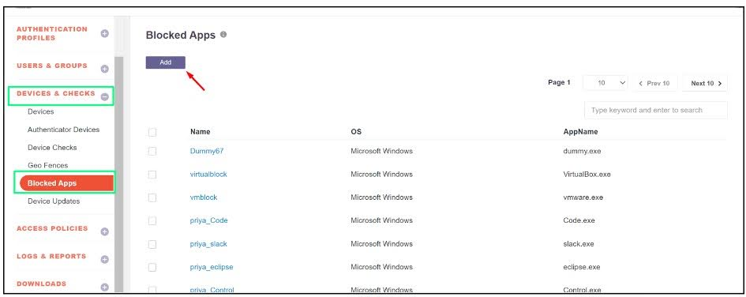

4. Enter a name for the application profile. Select Microsoft Windows for Windows-based applications. Specify the application name along with its extension (e.g., mspaint.exe).

5. Click Save and Add New to save the profile.

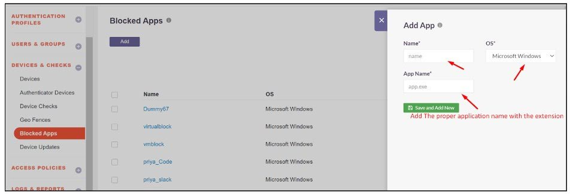

6. The newly created profile will appear in the Blocked Apps list.

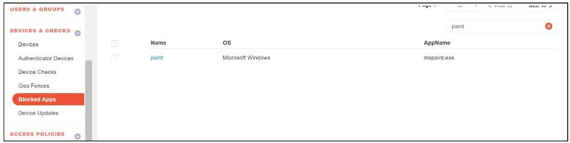

**Assigning the Blocked Application:**

The blocked application can be assigned at either the User OR Group levels.

_User Level_

1. Navigate to the User and Group module in the InstaSafe Admin Console.

2. Select the User section and search for the user to whom the app-blocking feature should be applied.

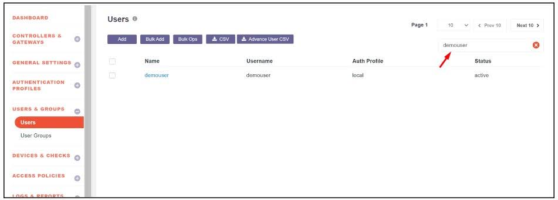

3. Click on the user to enable Edit Mode.

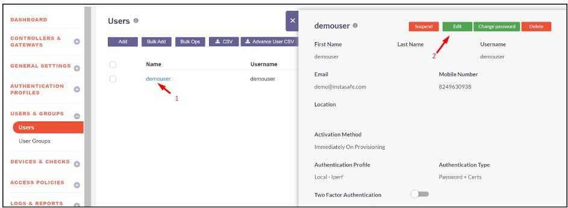

4. Enable the following toggles:

- Device DLP and select the Enable Block App Feature - Restart required.

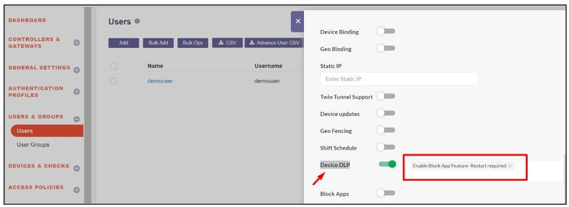

- Block Apps and select the previously created blocked application to prevent it from running on the user's system.

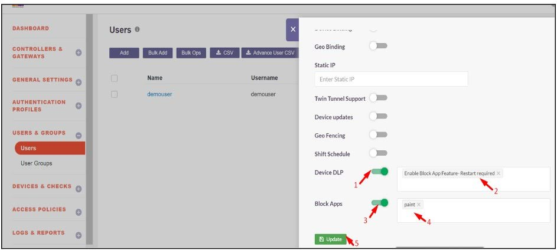

5. Click Update to apply the changes.

_Group Level_

1. Navigate to the User and Group module in the InstaSafe Admin Console.

2. Select the Group section and search for the group to which the app-blocking feature should be applied.

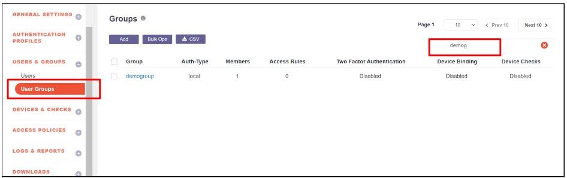

3. Click on the group to enable Edit Mode.

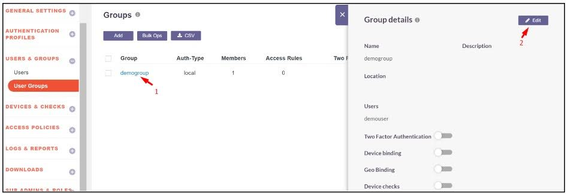

4. Enable the following toggles:

- Device DLP and select the Enable Block App Feature - Restart required.

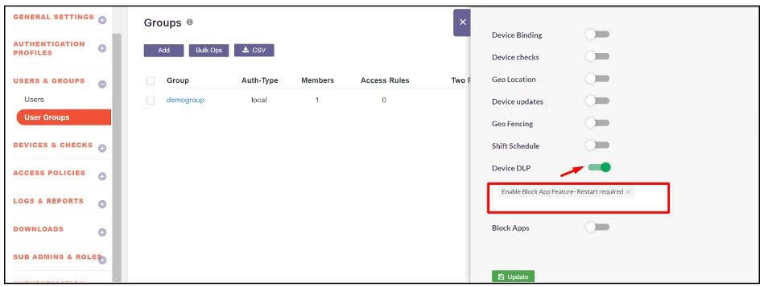

- Block Apps and select the previously created blocked application to prevent it from running on the user's system.

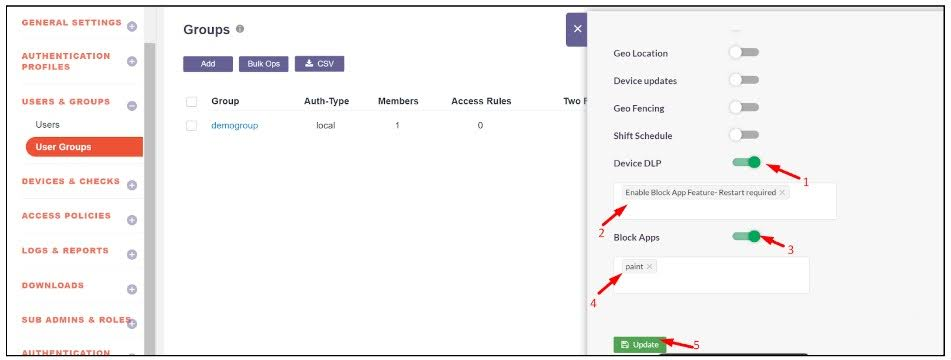

5. Click Update to apply the changes.

## **How to Disabling the App-Blocking Feature ?**

_User Level_

1. Navigate to the User section and search for the user for whom app-blocking should be disabled.

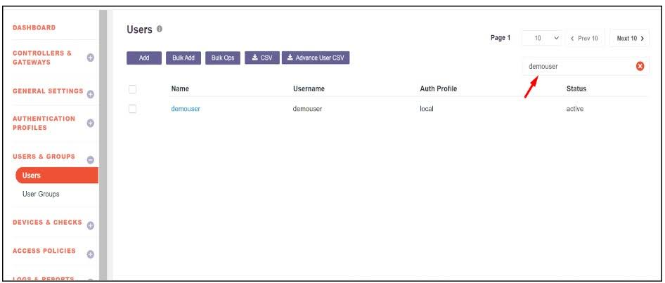

2. Click on the user and enable Edit Mode.

3. Perform the following actions:

- Remove the Enable Block App Feature - Restart required from the Device DLP.

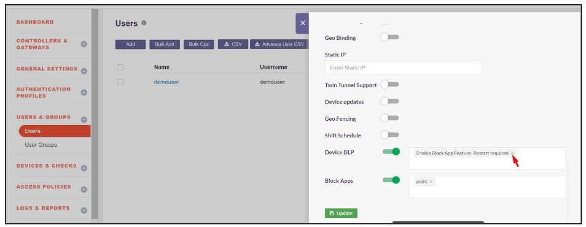

- Select Disable Block App Feature - Restart required. Also disable the Block Apps toggle

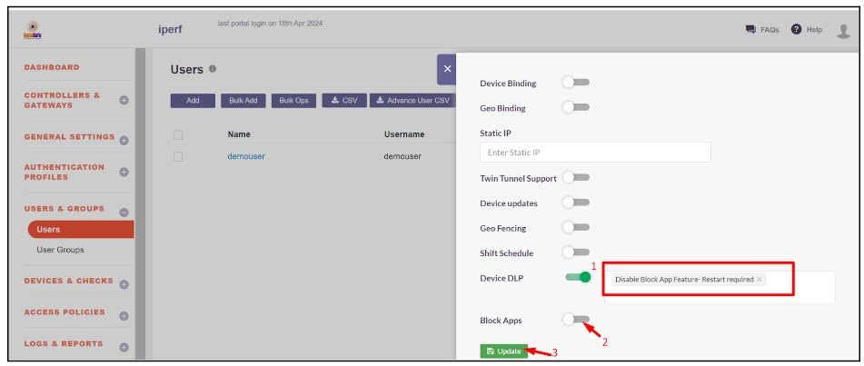

4. Click Update to save the changes.

_Group Level_

1. Navigate to the Group section and search for the group for which app-blocking should be disabled.

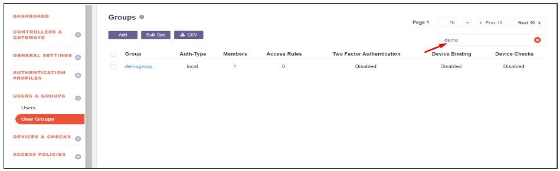

2. Click on the group and enable Edit Mode.

3 .Perform the following actions:

- Remove the Enable Block App Feature - Restart required from the Device DLP.

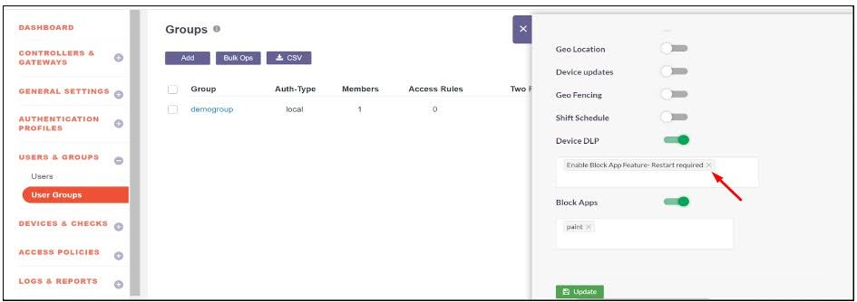

- Select Disable Block App Feature - Restart required. Also disable the Block Apps toggle

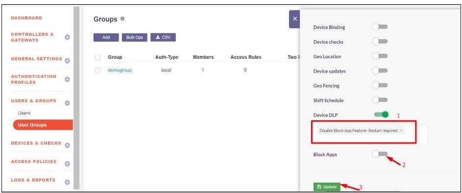

4. Click Update to save the changes.

## **Limitations**

1. It is recommended to make changes to the app-blocking configuration during non-working hours or when the user is not connected to the InstaSafe Agent.
1. The admin can enable either the "Enable App Block" feature or the "Disable App Block" feature for a particular user at a time.
1. Enabling both simultaneously for the same user may cause the app-blocking feature to malfunction.
1. Enabling or disabling the app-blocking feature for a user requires a one-time system restart for the changes to take effect.
1. If an application is blocked through the InstaSafe App-Blocking feature, the user will not be able to use the application until the InstaSafe Agent is manually disconnected. The application will remain blocked as long as the agent is active, even if changes are made.

