# What is Azure Active Directory (Azure AD)?

**Azure Active Directory (Azure AD)** is a cloud-based identity and access management service from Microsoft. Unlike the traditional **Active Directory (AD)**, which operates on-premises,** Azure AD** is designed to help manage users, groups, and devices in a cloud environment. Azure AD provides identity and access management services for applications, resources, and devices across both cloud-based and on-premises environments.

Azure AD helps businesses manage access to cloud-based resources and services, such as Microsoft 365, SaaS applications (like Salesforce or Dropbox), and custom cloud applications, as well as on-premise.

# Why Azure Active Directory is Designed in ISA (InstaSafe Secure Access)?

InstaSafe Secure Access (ISA) is a secure access solution that allows organizations to manage access to resources, applications, and services, particularly in remote or hybrid environments. By integrating **Azure AD** with ISA, businesses can leverage Azure AD’s advanced identity management features to control access to network resources securely, whether they are on-premises or cloud-based.

Here are the main reasons why **Azure AD** integration is designed in **ISA**:

1. **Centralized Authentication for Cloud and On-Premises Resources:**
   
    -  By integrating Azure AD with ISA, organizations can manage both on-premises and cloud-based resources through a single, unified identity provider. This provides consistency across user access, regardless of where the resources are hosted.

1. **Seamless SSO (Single Sign-On):**
   
    -  With Azure AD integrated with ISA, users can authenticate once and access various applications, services, or resources within the organization without needing to re-enter credentials. This improves user experience and reduces the burden of remembering multiple passwords.

1. **Enhanced Security:**
   
    -  Azure AD offers advanced security features such as **Multi-Factor Authentication (MFA)** and **Conditional Access**. By integrating Azure AD with ISA, organizations can leverage these features to enforce stricter security policies for users accessing critical resources via ISA.

1. **Scalability and Flexibility:**
   
    -  Azure AD is designed to handle a large number of users and devices, which makes it ideal for organizations that need to scale quickly. Integrating it with ISA ensures that businesses can securely manage growing remote and hybrid workforces without additional complexity.

1. **Simplified User and Group Management:**
   
    -  Azure AD allows businesses to manage users and groups efficiently, reducing administrative overhead. By syncing with ISA, user provisioning and group-based access controls are streamlined, allowing for easier role-based access management.

# Use Cases of Azure Active Directory in ISA (InstaSafe Secure Access)

1. **User Authentication and Access Control**
   
    -  Azure AD is used for authenticating users accessing applications or services via ISA, ensuring that only authorized individuals can log in.

        **Example:** Sarah, an employee working remotely, logs into ISA using her Azure AD credentials. Once authenticated, she gains access to various applications, including email, document storage, and company intranet, all without having to log into each service separately (thanks to SSO).

1. **Single Sign-On (SSO) Across Cloud and On-Premises Resources**
   
    -  Azure AD enables **Single Sign-On (SSO)**, which allows users to authenticate once to access multiple applications hosted both on-premises and in the cloud, with seamless access through ISA.

        **Example:** John, a sales manager, needs to access multiple tools: a CRM system hosted on-premises, an email service (Microsoft 365), and a sales reporting application hosted in the cloud. With Azure AD integrated into ISA, John logs in once, and his session automatically grants access to all applications without requiring separate credentials for each.

1. **Multi-Factor Authentication (MFA) for Enhanced Security**
   
    -  Azure AD’s **Multi-Factor Authentication (MFA)** can be enforced through ISA to ensure that users go through an additional layer of verification before accessing sensitive resources.

        **Example:** A finance team member, Jane, needs to access accounting software via ISA. Azure AD MFA requires Jane to verify her identity using both her password and a one-time code sent to her mobile phone, significantly improving security for accessing critical financial data.

1. **Conditional Access to Resources Based on User or Device Status**
   
    -  Azure AD’s **Conditional Access** allows ISA to restrict access to certain resources based on user or device compliance. This helps enforce security policies by granting or denying access based on defined conditions.

        **Example:** Tom is attempting to log in to the company’s internal application from his personal device. Azure AD, integrated with ISA, checks whether his device meets the company’s security policies (e.g., a secure password, and up-to-date antivirus). If the device is not compliant, Tom is denied access or prompted to take corrective action, such as installing security updates.

1. **Centralized User and Group Management for Cloud and Hybrid Environments**
   
    -   Azure AD helps organizations manage user accounts and group memberships centrally. By integrating Azure AD with ISA, businesses can enforce consistent access policies across both cloud and on-premises environments.

        **Example:** A new employee is added to the "HR" group in Azure AD. With ISA integrated, this automatically grants them access to HR applications and restricts access to systems outside of their role, like accounting or IT systems.

# Microsoft Entra ID Integration

- Log in to portal.azure.com and select Microsoft Entra ID

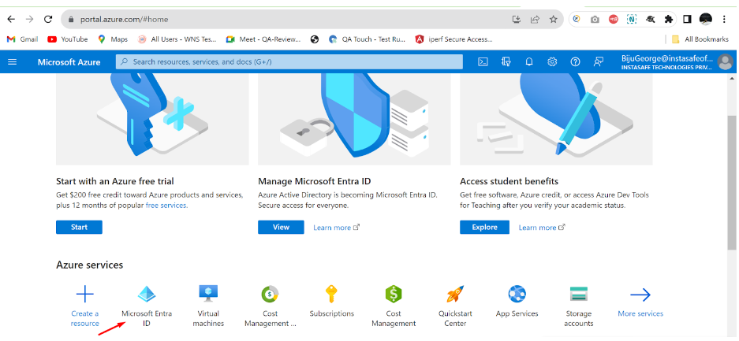

- Click on ‘App registrations’ in the dashboard panel on the left

- Then click on ‘New registration’, provide a custom name, and register the application

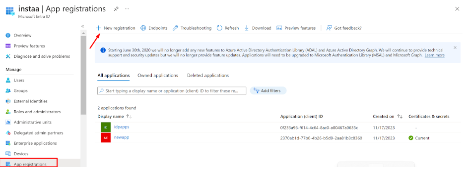

- After the new application is registered/created, select the application to expand

- Switch to the ‘API permissions’ tab

- Click on ‘Add a permission’ and grant permissions as per the screenshot below

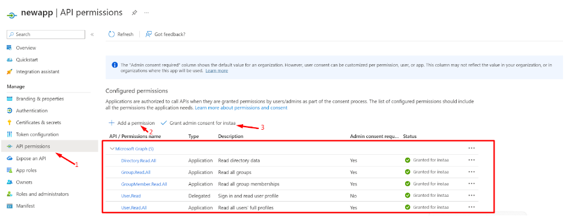

- Now, switch to the ‘Certificate and secrets’ section of the application and click on ‘Client secrets’ and then ‘+ New client secret’

- A new Client secret will be generated

- Make sure to copy the Value and save it carefully for later use (while configuring the Sync profile in the InstaSafe ISA portal)

- This Client secret value will only be displayed once at the time of generation, and won’t be visible again to Entra ID Admins (once viewed)

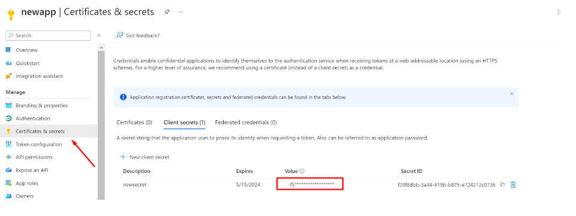

- Now, switch to the Overview section

- Copy the Application (client) ID for later use

- Copy the Directory (tenant) ID

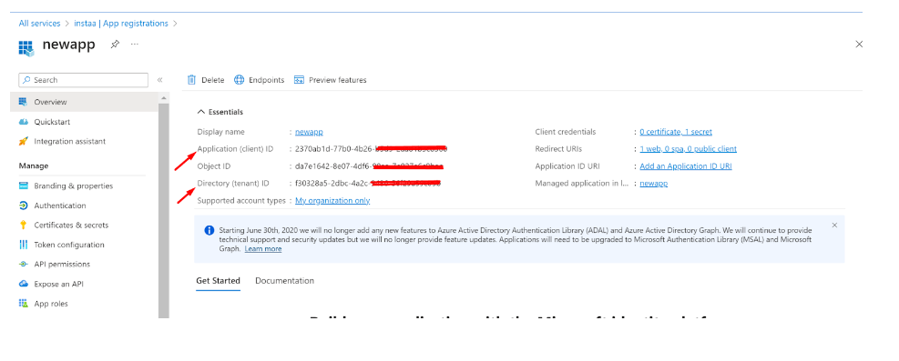

**User Sync**

- Login to the InstaSafe ISA Portal with Admin credentials

- Navigate to Authentication Profile >> Azure AD

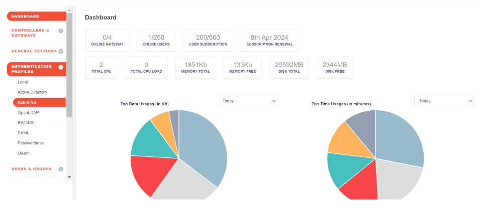

- Click on the Add button

- Fill up the details from Entra ID
    - Profile Name:
    - Domain: abc.instasafe.com (example)
    - Tenant ID:
    - Client Id:
    - AzureAD Groups: Click the ‘Save and Add new’ button

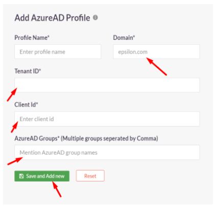

- Once the profile is created, Users and Groups from Entra ID can be synced to the InstaSafe ISA Portal by selecting the profile and clicking ‘Sync Now’

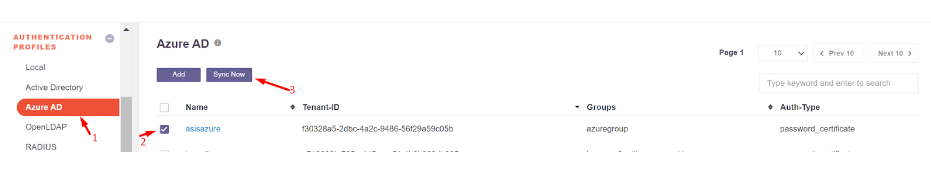

- After a successful sync, Users and Groups from Entra ID will be available in the InstaSafe ISA Portal

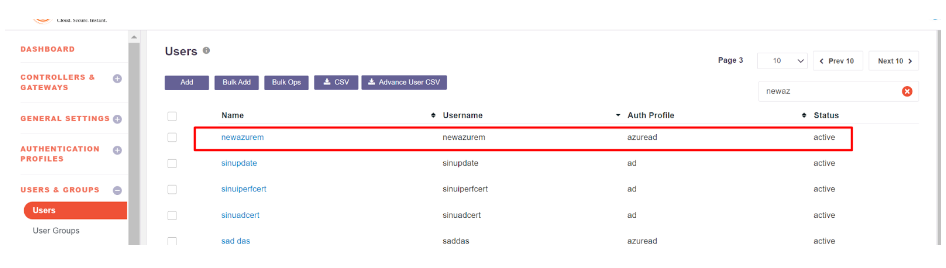

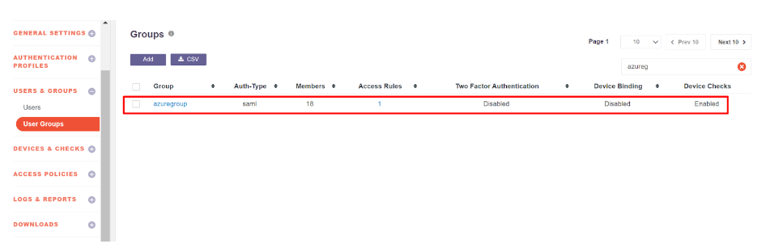

**User Authentication (SAML 2.0)**

In this step, SAML Authentication shall be configured where InstaSafe ISA shall serve as the Service Provider (SP) and Entra ID shall serve as the Identity Provider (IdP).

- Log in to portal.azure.com and select Microsoft Entra ID

- Click on ‘Enterprise applications’ in the dashboard panel on the left

- Click on ‘New application’

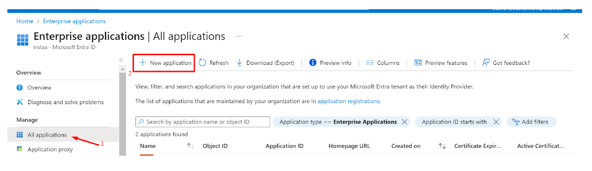

- Click on ‘Create your own application’

- Provide a custom name like instasafeisa and click ‘Create’

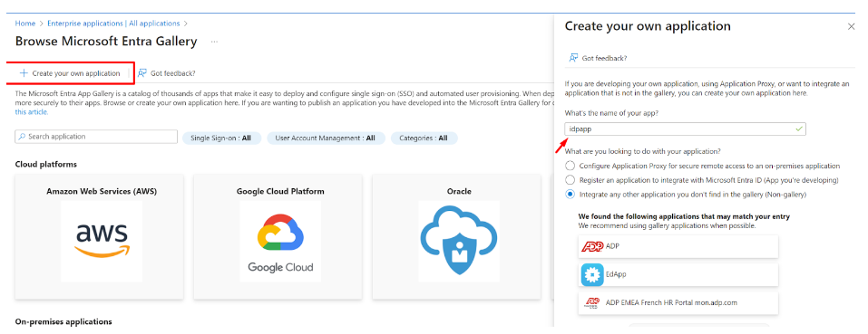

- Expand the newly created Application

- Click on ‘Single sign-on’ and then ‘Set up single sign on’

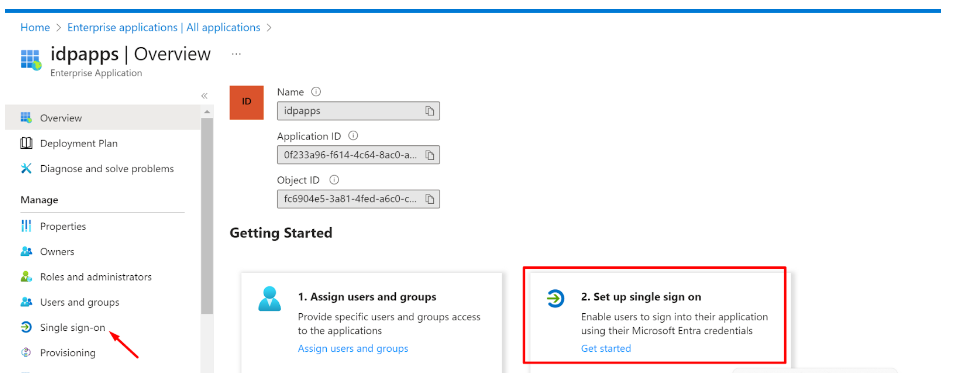

Fill up the details of your SP (InstaSafe ISA)

Identifier (Entity ID): http://abc.instasafe.com

Reply URL (ACS URL): https://abc.instasafe.com/api/saml/acs

Logout URL: https://abc.instasafe.com/api/saml/acs

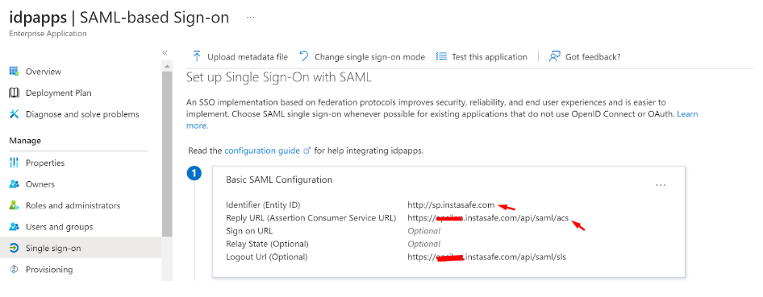

- Download the Metadata from Entra ID (or copy all required values like Certificate, Entity ID, ACS URL, etc.) to be used later

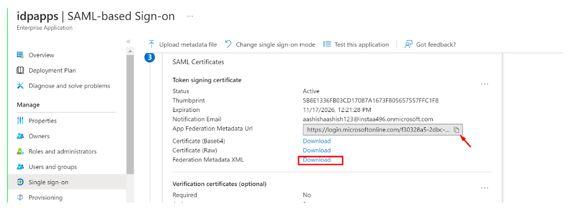

- Login to the InstaSafe ISA Portal with Admin credentials

- Navigate to Authentication Profile >> SAML

- Click on ‘Add’

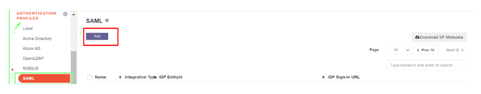

- The values from Entra ID (copied earlier) can be manually entered here, or automatically populated by uploading the IdP Metadata file (downloaded earlier)

- Click ‘Add’

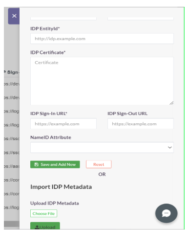

Once created, the SAML profile will be available to view

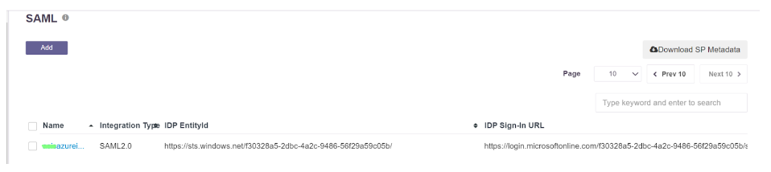

- The SAML Authentication profile can be assigned to the User Group synced from Entra ID

- Navigate to User Groups
- Locate and expand the User Group synced from Entra ID
- Click on ‘Edit’
- In the ‘Authentication Profile’ drop-down, select the SAML profile created
- Click on ‘Update’

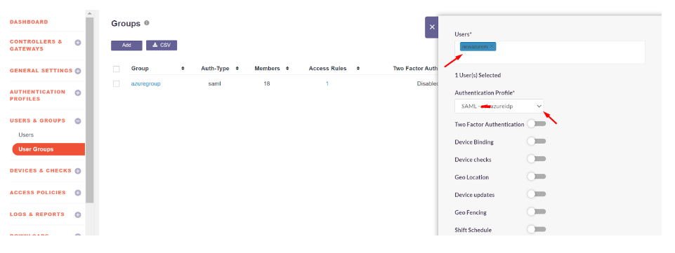

Please refer the below video on the Microsoft Entra ID configuration.

**The video need to add which is available in the docs. instasafe.com azure ad docs**

