**Device Binding** with **Automatic Device Registration (ADR)** is a powerful security feature that enables organizations to secure and control access to their systems, applications, and data by associating a user's account with a specific device. Once a device is registered and bound to a user's account, only that device is authorized to access certain resources, preventing unauthorized devices from logging into the system.

# Device bind and capture feature is Designed For:

1. **Organizations with Sensitive or Restricted Systems:**
   
    -  Organizations that handle sensitive data, such as healthcare, finance, and legal services, need a way to secure and control access to their systems and information. By binding devices to specific user accounts, organizations can restrict access to trusted devices only, thus reducing the risk of data breaches or unauthorized access.

1. **Enterprises Using Bring Your Own Device (BYOD) Policies:**
   
    -  Enterprises that allow employees to use personal devices for work purposes can use Automatic Device Registration to ensure only registered and trusted personal devices are used to access corporate applications. It gives IT administrators control over which devices can access the organization's network and data.

1. ** IT Administrators and Security Teams:**
   
    -  Security teams and IT administrators can use ADR to simplify and enforce security policies. With Device Binding, they can ensure that only devices explicitly approved for use within the enterprise are granted access. This also reduces the complexity of managing users' device access to sensitive systems.

1. **Organizations Requiring Compliance with Security Standards:
**
   
    -  Certain industries (such as financial institutions, healthcare providers, etc.) require strict compliance with security regulations. Device Binding with ADR can help meet regulatory requirements by ensuring that user access to sensitive data is limited to specific, trusted devices.

1. **Remote Work Environments:**
   
    -  With the rise of remote work, companies need secure ways of managing access to systems and applications from various devices. ADR allows remote workers to register their devices securely, ensuring that only devices they control can access internal resources.

# Use Cases of Automatic Device Registration (ADR) with Device Binding:

1. **Securing Access to Corporate Applications:**
   
    -  An organization can configure ADR to ensure that only registered, trusted devices are used to access its internal applications like CRM systems, HR tools, or financial systems.

        **Example:** An employee of a financial institution logs into their internal accounting system for the first time from their corporate laptop. After entering their username, password, and passing multi-factor authentication (MFA) using the **InstaSafe Authenticator**, the system automatically registers their device. The next time the employee logs in, the system recognizes the device and allows them access without re-registration. If the employee tries to log in from an unregistered device, they will be denied access until the device is approved by the admin.

1. **Bring Your Own Device (BYOD) Management:**
   
    -  For companies with a BYOD policy, employees can use their personal devices for work tasks. ADR ensures that only the devices that pass security checks and are registered can access corporate systems.

        **Example:** A remote employee uses their personal smartphone/pc to access a corporate document management system. When they log in for the first time, the system requests multi-factor authentication and automatically registers the device to their account. The employee can use their personal smartphone/pc to access documents in the future without needing additional approvals. If they attempt to use another device, access will be denied unless the new device is registered.

1. **Managing Device Access for External Contractors:**
   
    -  When external contractors need access to an organization's system, device binding ensures that only their registered devices can be used to access sensitive resources.

        **Example:** A third-party contractor working with a company needs to access a specific application for a limited time. After passing through the MFA and security checks, the contractor’s device is registered for the duration of the contract.The contractor can access the system only from the registered device. Once their contract ends, the device is unregistered, preventing further access.

1. **Securing Access to Cloud-Based Systems:**
   
    -  Organizations using cloud-based applications (e.g., Salesforce, Google Workspace, or Microsoft Office 365) can configure ADR to ensure that only devices that have been registered are allowed access, even when working remotely.

        **Example:** An employee needs to log in to a cloud-based system like Google Workspace from their tablet. Once they authenticate using their credentials and MFA, the system automatically registers the device.Future login attempts from the same tablet will be authorized automatically. If the employee attempts to log in from a new device, they will need to complete an additional authentication step, such as registering the new device with the admin's approval.

1. **Device-Based Access Control for Sensitive Data:**
   
    -   In environments where sensitive data (such as personal health information or financial records) is accessed, device binding helps ensure that only approved devices are allowed to view or edit this information.

        **Example:** A healthcare provider uses a patient management system that stores sensitive health data. Each healthcare worker’s device is registered when they first access the system. The device registration ensures that only authorized and secured devices can access patient records. If an employee tries to access the system from an unapproved device, they will be denied access, safeguarding patient data from unauthorized access.

Device Registration occurs when Instasafe Secure Access (ISA) automatically captures certain device identification details when an ISA User Agent connects to the ISA Controller. The information captured during Device Registration are:
1. MAC Address of the physical network adapter
1. Operating System Name
1. BIOS Serial Number
1. Universally Unique Identifier (UUID)

The above information is captured irrespective of whether the User Agent is able to successfully connect to the ISA Controller.

Using these parameters, it is possible to enforce Device Binding on users. Device Binding will ensure that the users are allowed to make connections only from those devices registered in the ISA web console. This will eliminate attacks due to stolen or shared passwords. A user can be bound to multiple devices.

In addition to configuring Device Binding using automatically captured parameters, the ISA web console allows admins to register devices manually.

This article describes the process of configuring Device Binding using automatic Device Registration.

- Log into the ISA web console using admin credentials
- Navigate to the DEVICES & CHECKS > DEVICES page.

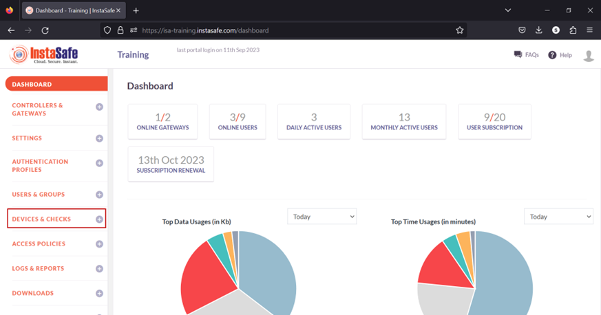

- The information of automatically captured devices will be listed here. Each device will be listed with their automatically created name. The name is the concatenation of the username of the remote user, the string “device”, and a number separated by underscores. The number represents the number of devices this user has connected with. For example, the user Ruby has connected with one device, an Ubuntu client. If the same user connects from a Windows client, a new entry will be created and listed with an identical name but the number increased to two. For the purpose of this article, we select the device profile name “_ruby_device_1_” and bind it to the user _Ruby_.

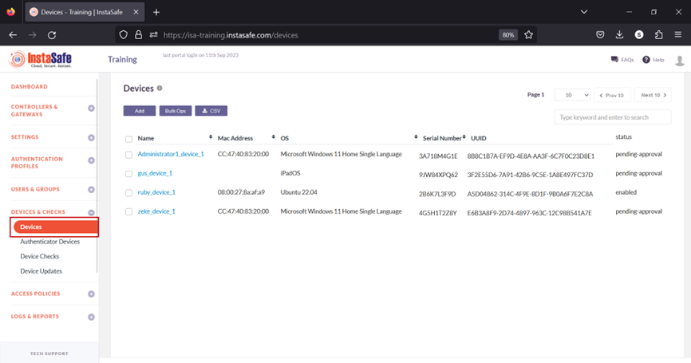

When a user's device information is captured, the default status of the device is Pending Approval. Until the device is approved or activated, if the user or the user group has Device Binding enabled, the user will not be able to connect from the device. Click the name of the device. For updating the statuses of a large number of devices at once, refer to Performing Bulk Operation on Device List.

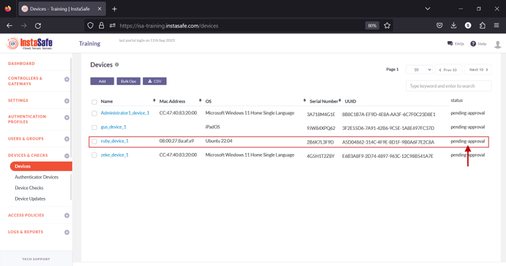

- On the Device Details window, click Activate.

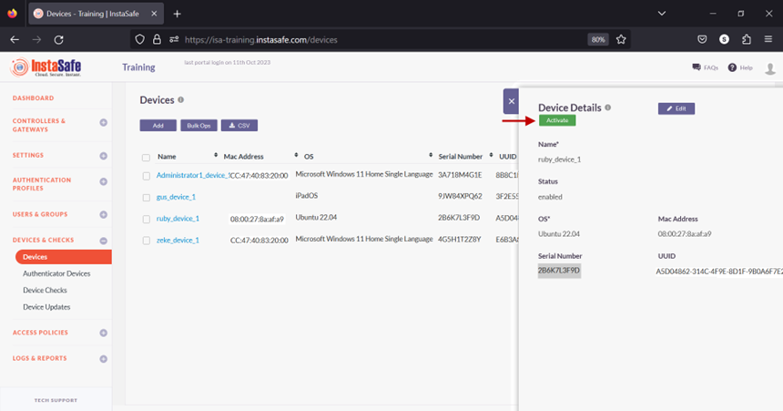

- On the pop-up window, click Yes, Activate it!.

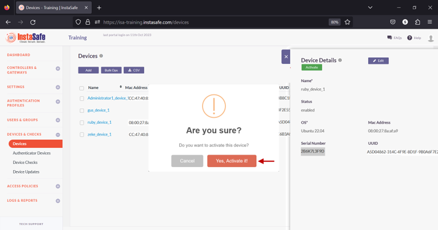

- The device has been activated.

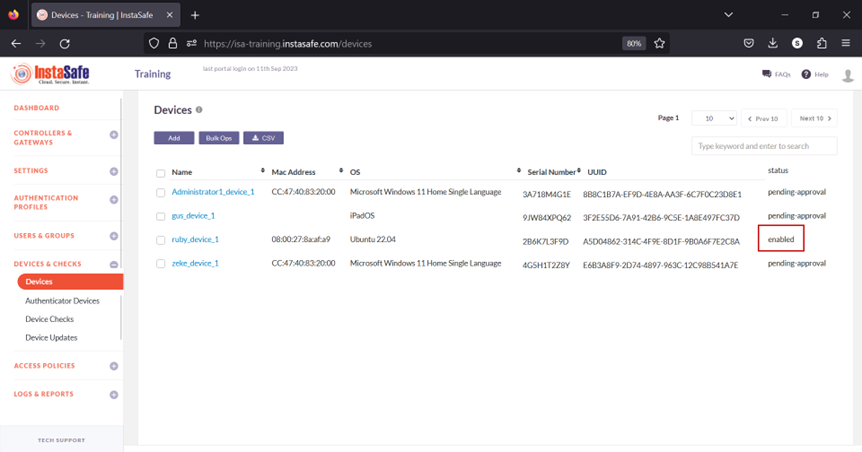

- Navigate to the USERS & GROUPS > Users page.
- On this page, click on the name Ruby Kane

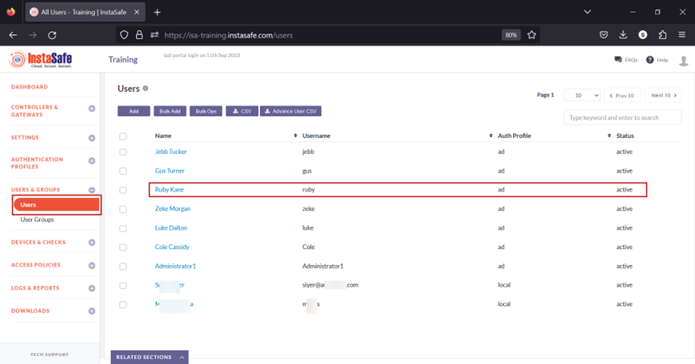

- In the edit user window, click on Edit.

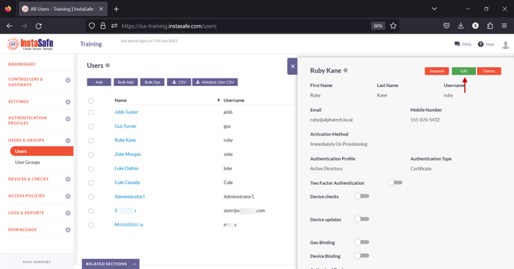

- Scroll down and toggle the Device Binding button to enable it. Then click inside the Select devices box to list the device names. Select the device name for the user. In this example, _ruby_device_1_.

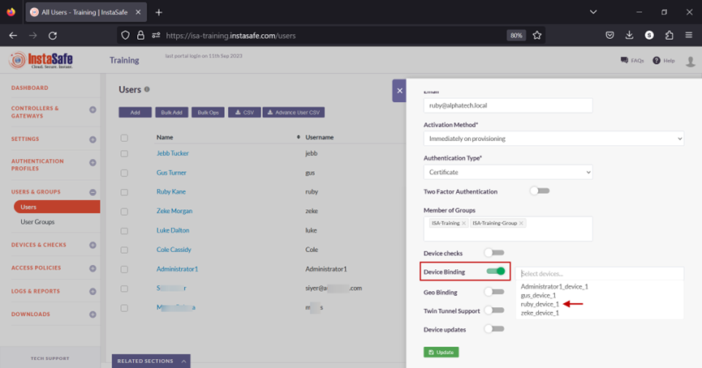

- Click on Update at the bottom to save this configuration.

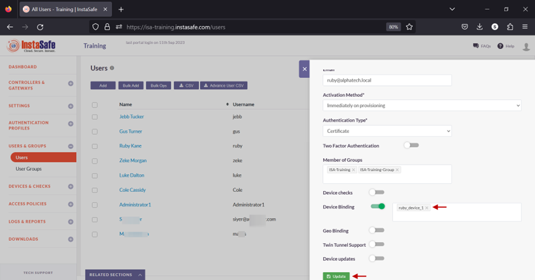

- A message at the bottom, User has been updated, indicates the configuration has been updated. Click on the “X” button to close this window.

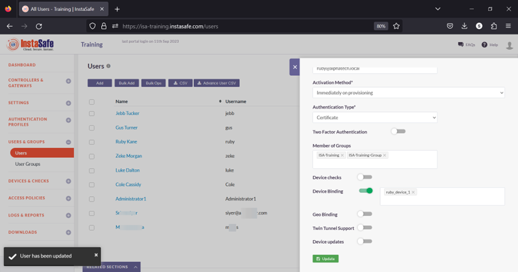

- Next, we will test Device Binding by connecting the user Ruby Kane from a different device than the device the user is bound to.

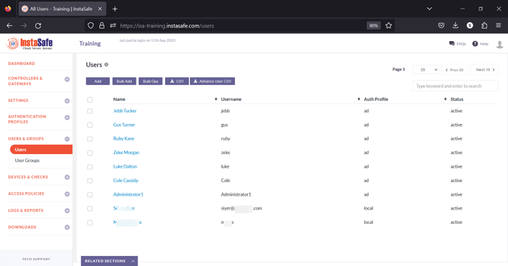

