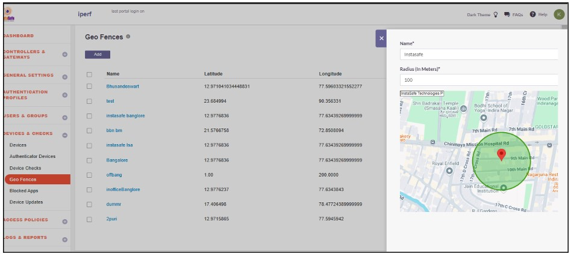
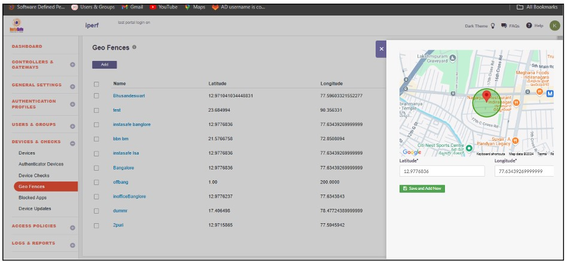
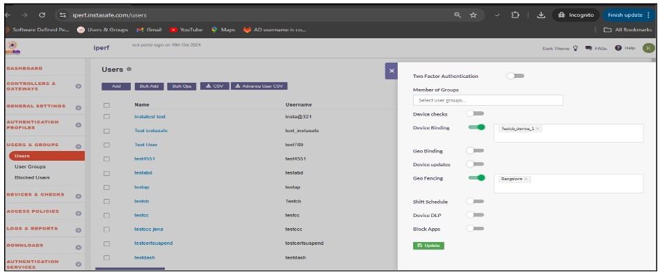
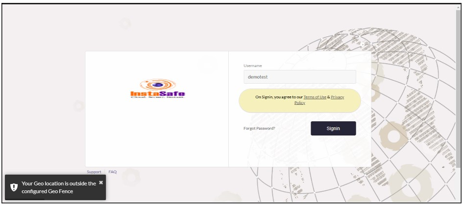
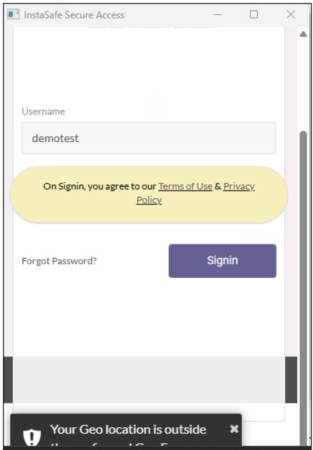
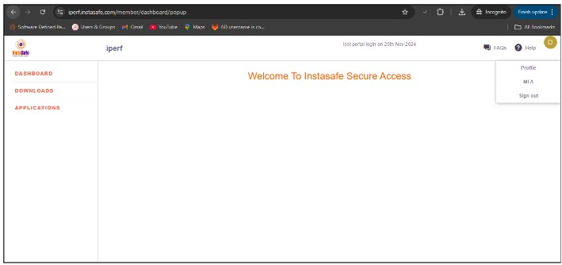

# **Geofence**

Geofence is a location-based service that allows businesses and applications to create a virtual boundary (or "fence") around a specific geographical area, such as a store, neighborhood, or city. It enables the enforcement of location-specific policies and enhances security by restricting access or triggering actions based on a user’s location.

Instasafe offers Geofence feature to limit application access for users based on predefined geographical locations. When a user attempts to access an organization's applications from a location outside the configured geofence, Instasafe prevents access, ensuring enhanced security and compliance with location-based access policies.

## **Benefits of Geofence**

- Location-Based Access Control 

Restricts or permits access to applications and systems based on a user’s geographical location, ensuring secure and context-aware access.

- Enhanced Security 

Prevents unauthorized access from unapproved locations, reducing the risk of breaches and ensuring organizational data stays secure.

- Regulatory Compliance  

Ensures that access policies align with regional data protection and compliance standards, such as GDPR or HIPAA.

- Operational Control 

Allows organizations to enforce location-specific access policies, ensuring resources are used only in approved locations.

- Dynamic Policy Enforcement 

Real-time location validation enables dynamic adjustments to access policies based on user location changes.

## **Use Cases**

- **Enterprise Application Access**

Organizations can restrict access to sensitive enterprise applications, ensuring that only users within specific locations, such as corporate offices or secure facilities, can log in.

Example: An employee accessing the company’s HR portal is restricted from logging in outside the corporate premises.

- **Location-Specific Service Delivery**

Geofence enables businesses to deliver location-based services, ensuring users access resources only within designated regions.

Example: A retail chain restricts access to store management tools for employees within the store premises only.

- **Remote Workforce Security**

For remote or hybrid employees, geo-fencing ensures access to corporate systems is granted only within pre-approved safe locations.

Example: A remote worker can access the organization’s VPN only from their registered home address.

- **Partner and Contractor Access**

Geofence ensures external partners, contractors, or vendors can access enterprise systems only within specific client-defined locations.

Example: A contractor is allowed to log in to a client’s project portal only from the client’s headquarters.

- **Compliance with Regional Regulations**

Geofence helps organizations comply with regional data protection and access control regulations by ensuring data access is restricted to permissible regions.

Example: An organization ensures that user data access from its database is only allowed within the EU, adhering to GDPR compliance.

## **Configure Geofence**

- Login to the InstaSafe ISA Portal with admin credentials

- Navigate to **Devices and Checks** -> **Geofence**

- Click on the ‘Add’ button and enter the Geofence details

- After entering the location, the latitude and longitude will update automatically. If needed, the admin can manually update the latitude and longitude.

- Assign the geofence to the user profile.

When geofencing is enabled for a user, they are allowed to log in or access the application only within the geolocation radius configured by the admin. If the end user is outside the configured geofence radius, they will not be able to log in to InstaSafe and will receive an error message stating, '**Your geolocation is outside the configured geofence**.'

When the end user returns to the configured geofence range, they should be able to log in to the agent and end-user console without any errors.

