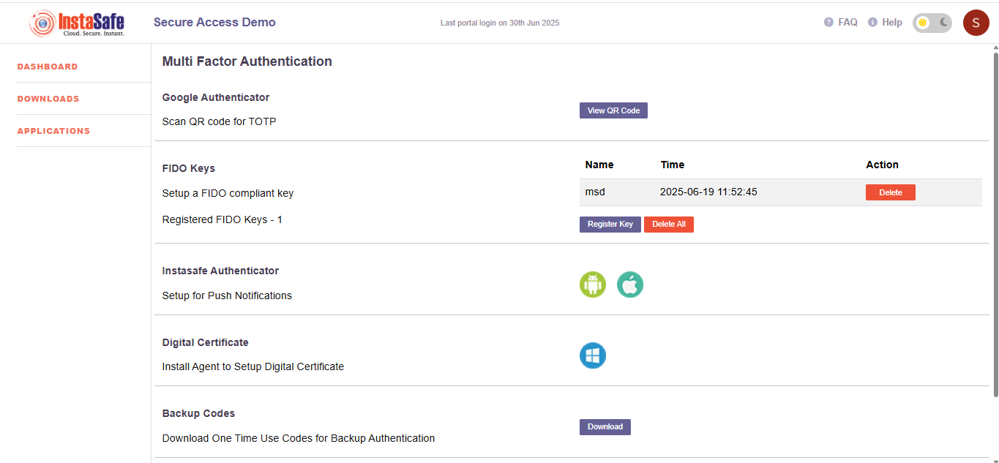

# **Multi-Factor Authentication (MFA)**

Multi-Factor Authentication (MFA) in Instasafe adds a vital layer of security by requiring users to verify their identity through more than just a password. Even if credentials are compromised, MFA prevents unauthorized access using methods like OTPs, FIDO keys, push notifications, or digital certificates. Integrated with Instasafe’s Zero Trust model, MFA ensures every login is verified, reducing risks like account breaches and unauthorized lateral movement. Users are strongly encouraged to enable at least one MFA method—ideally more—for maximum protection..

##  **Google Authenticator (TOTP)**

Google Authenticator (TOTP) adds an extra layer of security by generating time-based one-time codes on your mobile device. Even if your password is stolen, access is blocked without the TOTP code—making your Instasafe account more secure against unauthorized logins.

**How to Setup:**

1. Click the **"View QR Code"** button.
2. Open the Google Authenticator app on your mobile device.
3. Scan the displayed QR code.
4. Enter the code shown in your app when prompted to verify setup.

Click here for detailed steps [Google Authenticator (TOTP)](047-Google_Authenticator.md#google-authenticator)

> **Note:** This code refreshes every 30 seconds in the app and is required during login after username/password.

##  **FIDO Keys (Hardware Security Keys)**

FIDO (Fast Identity Online) keys are secure physical devices that enable passwordless, phishing-resistant login. With a FIDO key, users simply tap or insert the device to verify their identity—eliminating the risk of stolen or reused passwords. It's a fast, reliable, and highly secure way to access your Instasafe account.

**Registered Keys**

- **Total Registered Keys:** 1  
- **Registered Key Name:** `msd`  
- **Registration Time:** `2025-06-19 11:52:45`

**Actions**

- **Register Key:** Add a new hardware FIDO key.
- **Delete:** Remove an individual key.
- **Delete All:** Remove all registered keys.

> **Recommended:** Use a FIDO-compliant key for the highest level of security.

## **Instasafe Authenticator**

Instasafe Authenticator provides a flexible and secure MFA solution through both push notifications and TOTP (Time-based One-Time Passwords). Users can approve login requests with a single tap or enter a time-based code generated in the app. This dual capability offers convenience along with strong protection against unauthorized access, all within a single trusted mobile application.

**Push Notification Instructions**

If the user has set up **Instasafe Authenticator**, a **push notification** option will also appear (on supported platforms like **Windows**). When selected, the user will receive a login approval request via the Instasafe Authenticator mobile app.

**To authenticate:**

1. Open the **Instasafe Authenticator** app on your mobile device.
2. Approve the login request by tapping **"Allow"** or similar confirmation.
3. Access will be granted immediately after approval.

Click here for detailed steps [InstaSafe Authenticator](045-InstaSafe_Authenticator.md#installing-and-configuring-the-instasafe-authenticator-app)

> **Note:** On **macOS** and **Linux** systems, the push notification option is **not available**.  
> Instead, users will see the OTP input field directly without the method selection menu.  
> They must retrieve the OTP manually from:
> - the **Instasafe Authenticator** app (TOTP), or  
> - the selected alternative (**SMS** or **email**)  
> and enter it to complete authentication.

## **Digital Certificate**

Digital Certificate Authentication in Instasafe offers secure, passwordless login by verifying users through client certificates installed on their devices. It ensures only trusted, managed endpoints can access enterprise resources. This method is supported on Windows systems via the Instasafe agent and is ideal for strong, device-based identity verification within a Zero Trust environment.

**Setup Instructions (Windows Only):**

1. **Download** the Instasafe Agent for Windows from the official portal or as provided by your administrator.
2. **Run the installer** and complete the installation process.
3. Once installed, the agent will **automatically generate and install** the digital certificate required for authentication.
4. No further user action is needed. Authentication will occur seamlessly when accessing protected resources.

## **Backup Codes**

Backup Codes are one-time use codes that serve as a fallback MFA method when your primary authentication method—like a mobile app, FIDO key, or push notification—is unavailable (e.g., lost phone, no internet access).

Once generated, you can download and securely store them. Each code can be used only once during login.

Important: Keep your backup codes in a safe offline location. Do not share them or store them in unsecured devices or cloud services.

Recommended: Download your backup codes immediately after setup and use them only when absolutely necessary. You can regenerate them at any time if needed.

> **Note:** Treat backup codes like passwords—do not share or store them in insecure locations.

