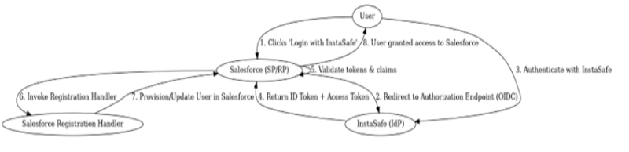
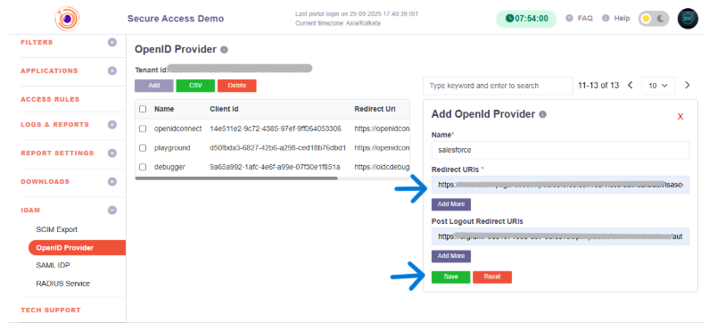
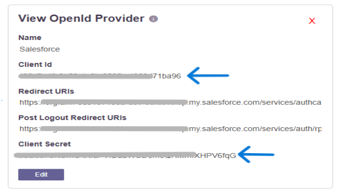
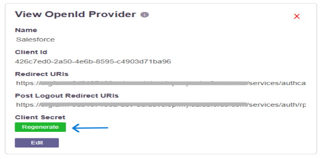
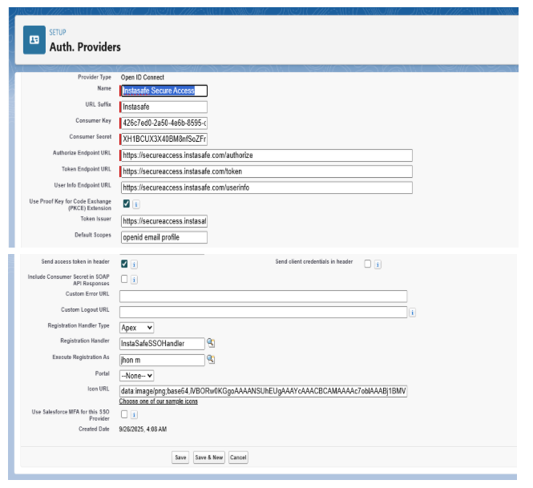
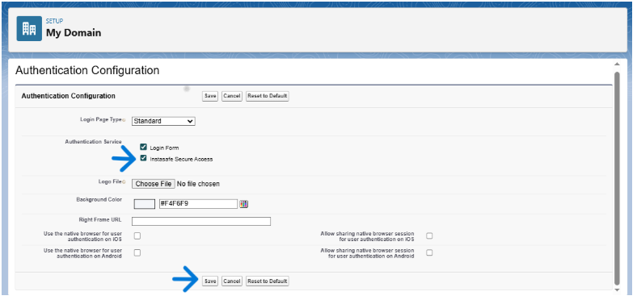
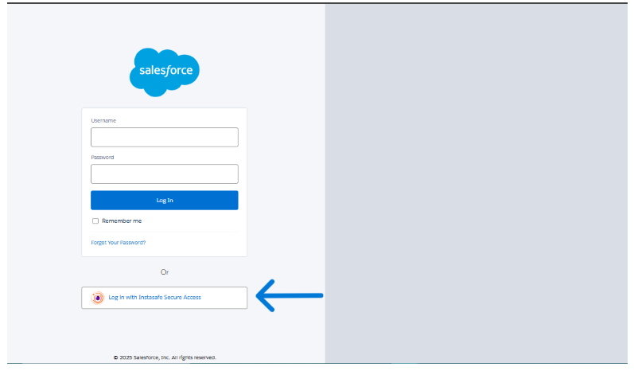

# OpenID Connect (OIDC) Overview and Use Cases

## What is OpenID Connect (OIDC)?

OpenID Connect (OIDC) is a modern user authentication protocol built on top of OAuth 2.0. It allows applications to verify a user’s identity without handling the user’s password directly.

Apps redirect users to a trusted **Identity Provider (IdP)** (e.g., Google, Microsoft, InstaSafe) to log in. The Identity Provider authenticates the user and then returns a **signed ID Token** containing identity information.

OIDC removes the responsibility of password storage and management from individual applications, letting them depend on trusted providers.

For users, OIDC enables **Single Sign-On (SSO)**: after logging in once at the IdP, they can access multiple apps without logging in again.

**Key Point:**  
OIDC is an open, standardized authentication protocol that answers **“Who is this user?”**, offloads password handling to specialized IdPs, and enables seamless SSO.

---

## How OIDC Works: Key Components and Flow

### Key Components
- **User (End-User):** The person trying to log in.
- **Relying Party (Client/App):** The application that needs authentication.
- **Identity Provider (IdP / OpenID Provider):** Authenticates the user and issues tokens.
- **ID Token:** A signed JWT containing identity claims (name, email, user ID).
- **Access Token:** Token used for authorization to access APIs.
- **User Agent:** Browser or app facilitating redirects and communication.

---

## Provisioning with OIDC (Just-In-Time Provisioning)

With OIDC, an application can automatically **create or update user accounts at login time**. This is known as **Just-In-Time (JIT) provisioning**.

In simple terms, JIT provisioning means the app uses the data in the OIDC login (the user’s **ID Token claims**) to instantly set up the user’s account. Users are created and logged in on the spot — without any manual admin work.

### How It Works
- A user logs in via an OIDC Identity Provider (IdP)
- The application receives the ID Token containing claims such as **email, name, sub**
- If the user doesn't exist, the application **creates** a new user automatically  
- If the user exists, the application **updates** the account details (like name or email)

### Example
A new employee clicks “Login with InstaSafe” for your SaaS app:

1. They authenticate using their corporate IdP through OIDC  
2. Your app checks if the user exists  
3. If not, JIT instantly creates a new account with the details in the ID Token  
4. The user is logged in immediately — no pre-creation required  
5. On future logins, updated claims (e.g., changed name or email) are synced automatically

### Without JIT
- First login **fails** unless an admin pre-created the account  
- User onboarding is slow and manual  

### With JIT
- User accounts are **created or updated automatically** during login  
- Users can access the app **immediately**  
- Admin overhead is eliminated  

### Analogy
Think of JIT provisioning like a club that automatically issues you a membership card the first time you visit and show your ID.  
Your corporate IdP is the “ID,” and the application's user account is the “membership card.”

### Key Point
**JIT provisioning = automatic user creation/update during OIDC login**, ensuring instant onboarding and up-to-date user records.

---

## Benefits of OIDC

OpenID Connect provides strong advantages in security, user experience, and operational simplicity.

### 1. Enhanced Security
- Applications **don’t handle raw passwords**
- ID Tokens are **cryptographically signed** by the IdP  
- Authentication is performed by trusted identity providers
- Strong login policies (MFA, risk-based auth, passwordless) can be enforced by the IdP
- OIDC protects against common web attacks using:
    - nonces
    - secure token exchange
    - standardized flows (Authorization Code + PKCE)

Centralizing authentication with expert IdPs “increases the security of the whole Internet.”

### 2. Better User Experience
- Enables **true Single Sign-On (SSO)**  
- Users remember **one set of credentials**
- Reduces:
    - Password fatigue  
    - Login friction  
    - Password reset tickets  
- Faster login through familiar IdPs (Google, Microsoft, etc.)
- Works consistently across web, mobile, and desktop apps

Fewer login failures → better engagement and smoother UX.

---

## Summary

OIDC strengthens overall identity management by offering:

- **Higher security**  
  (no password storage, stronger authentication, signed tokens)

- **Better user satisfaction**  
  (single sign-on, quick logins, consistent multi-device experience)

- **Simplified operations**  
  (standardized protocols, built-in user provisioning)

It is a key technology for modern enterprise and consumer identity systems.

### Key Takeaway
Using OIDC:

  - Apps rely on trusted identity providers for authentication  
  - Users get seamless one-click SSO  
  - IT teams spend less time managing credentials and accounts  

The result is **safer logins, better UX, and more efficient IT management**.


# Single Sign-On (SSO) Integration Guide  
### InstaSafe Secure Access (IdP) ↔ Salesforce (SP/RP) via OpenID Connect (OIDC) with Provisioning

---

## 1. Overview

This document describes how to configure Single Sign-On (SSO) between **InstaSafe Secure Access** as the **Identity Provider (IdP)** and **Salesforce** as the **Service Provider / Relying Party (SP/RP)** using **OpenID Connect (OIDC)**.

With this integration:

- Users authenticate once with InstaSafe using OIDC.  
- Authenticated sessions are federated to Salesforce.  
- User accounts in Salesforce are **provisioned or updated automatically** using a Salesforce **Registration Handler**.

**Note:**  
OIDC is an identity layer built on OAuth 2.0. It provides secure authentication while delivering verified user identity claims (email, name, sub, etc.) to Salesforce.

---

## 2. Prerequisites

- Access to **InstaSafe Secure Access Admin Portal**
- Access to **Salesforce Admin Portal**
- **Active Salesforce My Domain** configuration
- Admin privileges on both systems

---

## 3. High-Level Flow (OIDC)

The OIDC SSO flow works as follows:

1. User clicks **“Login with InstaSafe”** on Salesforce’s login page.  
2. Salesforce redirects the user to the **InstaSafe Authorization Endpoint**.  
3. The user authenticates using InstaSafe.  
4. InstaSafe returns an **Authorization Code**, which Salesforce exchanges for an **ID Token** and **Access Token**.  
5. Salesforce validates the tokens, maps the user, and grants access.

**Notes:**

  - OIDC ensures the ID Token contains verified claims such as **sub**, **email**, **name**, etc.  
  - These claims are used by Salesforce for user matching & provisioning.  
  - **Use Authorization Code Flow with PKCE** for maximum security (recommended for web/mobile apps).

    

---

## 4. Configuration Steps

---

### **Step 1: Configure Application in InstaSafe (IdP)**

1. Log in to the **InstaSafe Secure Access Admin Console**.  
2. Navigate to **IDAM → OpenID Provider → Add**.  
3. Configure basic application details:

    - **Application Name:** Salesforce  
    - **Redirect URI / Callback URL:**  
     ```
     https://<your-salesforce-domain>/services/authcallback/<url-suffix>
     ```
     (This exact URL comes from the Salesforce Auth Provider created in Step 3.)

    
    

4. After saving, open the created OpenID profile and copy:

   - **Client ID (App ID)**
   - **Client Secret (App Secret)**  
   - OIDC Metadata URL:  
     ```
     https://<tenantName>.instasafe.com/.well-known/openid-configuration
     ```

    

**Important:** Keep Client Secret secure.


**Note**

  - The Callback URL must match exactly between Salesforce and InstaSafe.  

  - To regenerate the secret key, click Regenerate. The old secret will no longer work

    

---

### **Step 2: Create Registration Handler in Salesforce**

1. Go to **Setup → Apex Classes → New**.  
2. Paste the following code:

```apex
global class InstaSafeSSOHandler implements Auth.RegistrationHandler {

    global boolean canCreateUser(Auth.UserData data) {
        return true;
    }

    global User createUser(Id portalId, Auth.UserData data) {
        Profile p = [SELECT Id FROM Profile WHERE Name = 'Standard User' LIMIT 1];
        User u = new User(
            Username = data.email,
            Email = data.email,
            FirstName = (data.firstName != null && data.firstName != '') ? data.firstName : 'InstaSafe',
            LastName = (data.lastName != null && data.lastName != '') ? data.lastName : 'User',
            Alias = data.username != null ? data.username.left(8) : 'instasf',
            TimeZoneSidKey = 'Asia/Kolkata',
            LocaleSidKey = 'en_IN',
            EmailEncodingKey = 'UTF-8',
            LanguageLocaleKey = 'en_US',
            ProfileId = p.Id,
            FederationIdentifier = data.identifier
        );
        insert u;
        return u;
    }

    global void updateUser(Id userId, Id portalId, Auth.UserData data) {
        User u = [SELECT Id, Email, FirstName, LastName FROM User WHERE Id = :userId];
        u.Email = data.email;
        u.FirstName = (data.firstName != null && data.firstName != '') ? data.firstName : u.FirstName;
        u.LastName = (data.lastName != null && data.lastName != '') ? data.lastName : u.LastName;
        update u;
    }
}
```


## Important
Ensure OIDC claims (`sub`, `email`, `name`) map correctly to Salesforce fields such as:

- **Username**
- **Email**
- **FederationIdentifier**
- **FirstName / LastName**

---

## Step 3: Configure Auth Provider in Salesforce

1. Go to **Setup → Auth. Providers → New**
2. Choose **OpenID Connect** as the provider type.
3. Fill in the following fields:

| Field | Value |
|-------|--------|
| **Name** | InstaSafe |
| **URL Suffix** | instasafe |
| **Client ID** | From InstaSafe |
| **Client Secret** | From InstaSafe |
| **Authorize Endpoint URL** | from InstaSafe metadata |
| **Token Endpoint URL** | from InstaSafe metadata |
| **Scope** | `openid email profile` |
| **Registration Handler** | `InstaSafeSSOHandler` |
| **Execute Registration As** | A dedicated admin user |

  

4. Save the Auth Provider.
5. Copy the **Callback URL** generated by Salesforce and paste it back into **InstaSafe (Step 1).**

---

## Important
- The **`openid` scope is mandatory**.  
  Without it, Salesforce will **not receive an ID Token**.

---

## Step 4: Add InstaSafe to Salesforce Login Page

1. Go to **Setup → My Domain → Authentication Configuration**.
2. Enable the checkbox for **InstaSafe Secure Access**.

    

3. Save.

Users will now see a **“Login with InstaSafe”** button on the Salesforce login page.

### When clicked:
- User is redirected to InstaSafe  
- User authenticates  
- Salesforce provisions or updates the user  
- User is logged in seamlessly  

---

## Important
Always **test with a non-admin user** to validate user mapping and provisioning.




