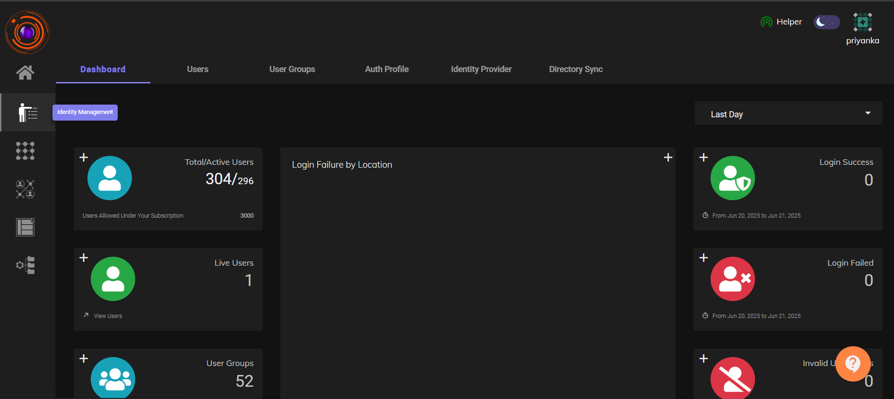
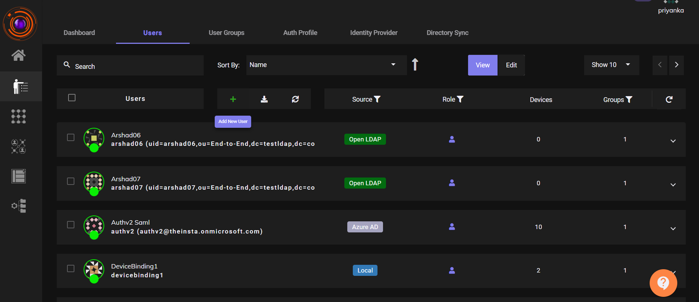
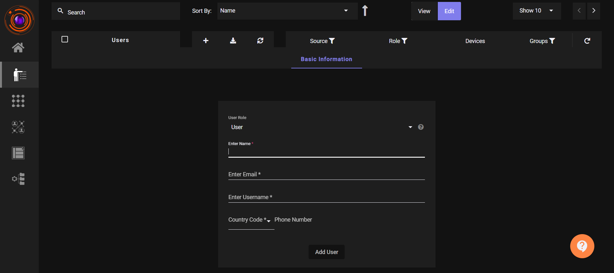
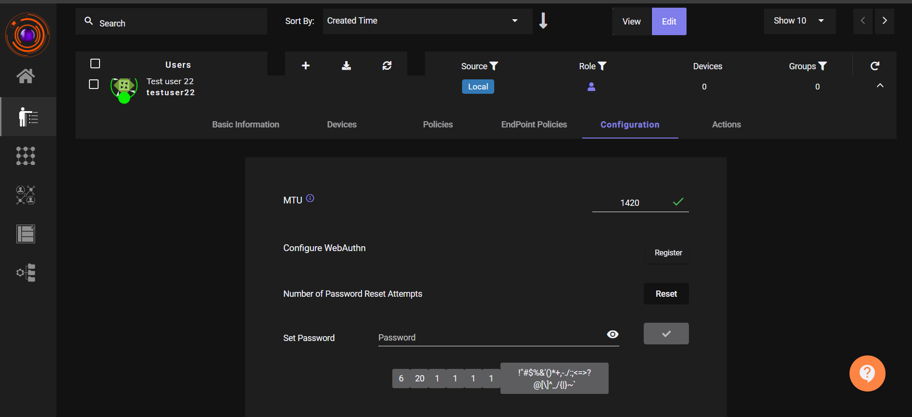

_Last Updated: 11th July, 2025_

ZTAA supports user creation through two methods:

- **Locally**, directly from the console

- **Imported** from directory services such as **Active Directory (AD)** or **Azure AD**


The following article highlights how a single user can be added directly.User addition via importing from directory services has been dealt with in later articles.Users can be created from the User Tab under Identity Management Section or directly from  Create User option in the  Quick setup section of the homescreen.


## Adding an User

The article describes the steps, how an individual can be added to the ZTAA platform.
Only users with Admin or Owner privileges can create users.


| Role | |
| ------ | ----- |
| Owner| The principal admin account associated with a company,it is generally  the first account created for a company.  Ownership can be transferred to  another Admin, user within the company,but Owner accounts cannot be deleted.|
|  Admin|Responsible for managing activities on the ZTAA platform. Can add, edit, or delete configurations.|
| Read Only Admin| Can view but cannot modify any configuration. Acts as a sub-admin with limited access.|
| Regular User| Has no configuration like view or modify privileges. Can only access enterprise applications assigned to them.|
|Service Account|| It is used during Gateway Configurations|


### Steps to Add a User

- Go to **Identity Management > Users**

  

- Click on **(+) Add New User**

  

- Fill in the following basic details:

  - **Role**: Select from Owner / Admin / Read-Only Admin / Regular User

  - **Full Name**

  - **Email Address**

  - **Username**

  - **Country Code and Phone Number**


  

- Click **Add User**

  A confirmation message will appear: "User created successfully".
  
  The user will receive an email notification

  


**To manually set a password:**

- Click on the created user
- Go to the **Configurations** section under **Password**
- Set a manual password if needed

  

```
An admin can add multiple team members until the total license subscribed is met.
```


