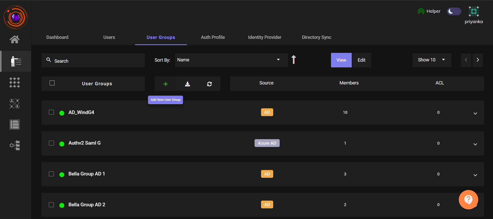
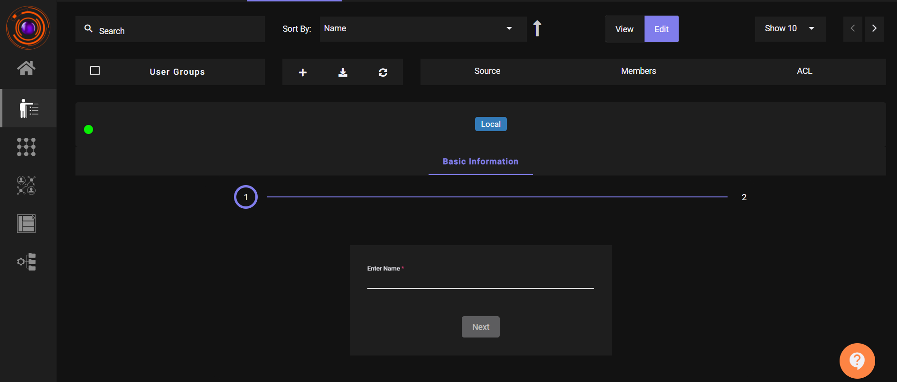
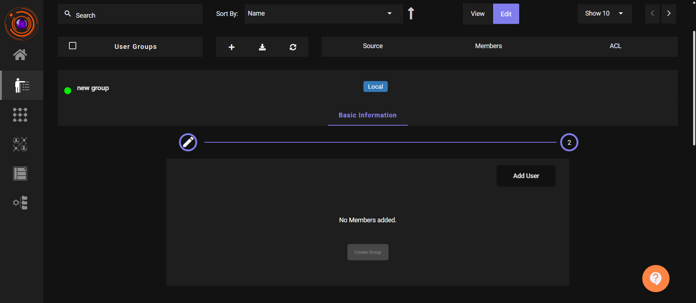
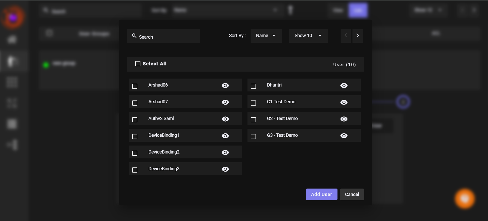
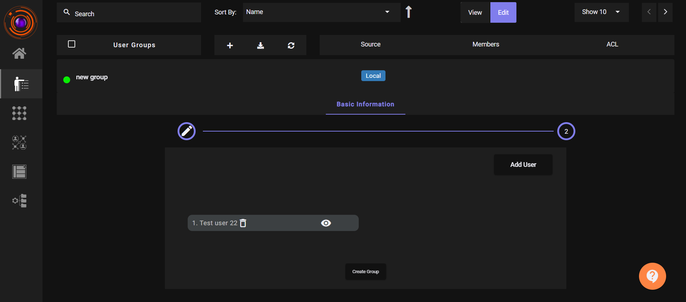

To support the needs of a growing organization and enable efficient administration, ZTAA allows administrators to group users based on roles, responsibilities, and locations.

User Groups are a way to manage users collectively rather than individually. This improves scalability, simplifies bulk operations, and reduces administrative overhead.

### Why Use User Groups?

- Organize users by department, location, or access needs.

- Apply access controls or configurations to many users at once.

- Reduce repetitive administrative tasks.

### Steps to Create a User Group

User groups can be created from the User Groups tab under the Identity Management section.

### Step-by-Step Guide:

1. Navigate to Identity Management > User Groups

2. Click on (+) Add New User Group

	

3. Fill in the Group Name

	- Provide a valid and meaningful name for easy identification

	- Click Next

	

4. Add members to the group:

	- Click Add User

	- Select one or more users from the list

	- Click Add User again to confirm the selection

	

	

5. Once users are added, click Create Group

	

6. A success message will appear: "User group created successfully."

### Example Use Cases

- Create a group for the HR Team, Developers, or Regional Offices.

- Assign common policies or access levels to all members in a group.

>##### Note: Groups can be edited later to add or remove users as organizational needs evolve.

