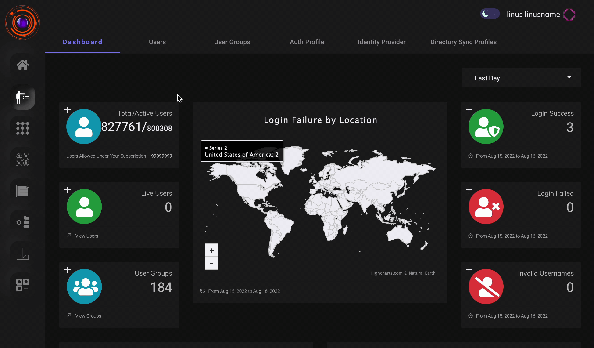

The admin can view details of all registered devices under the *Devices* tab of *Perimeter Management* section. The admin can also block or unblock access from a device.

The admin can also view devices associated with a particular user, in the devices section of the user.

Detailed steps on how to view device details can be veiwed in the video below.

