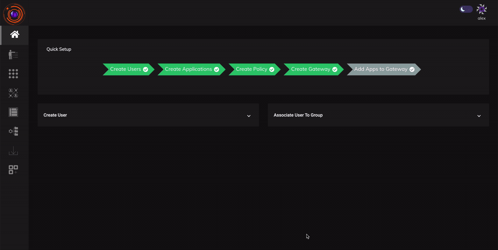

Applications need to be added to gateways before they can be accessed. Applications can be added by editing gateways and adding them.

## To add an Application to a gateway

1. Go to **Gateways** section in **Perimeter Management** and enable edit.

2. Click on the Gateway you want to add the application to.

3. Go to Applications Tab. Click on Add Application Button.

4. Select the applications and Click add application button.

Application will be successfully added.

The above steps and the process of adding an application to a Gateway can be seen in the video below.

