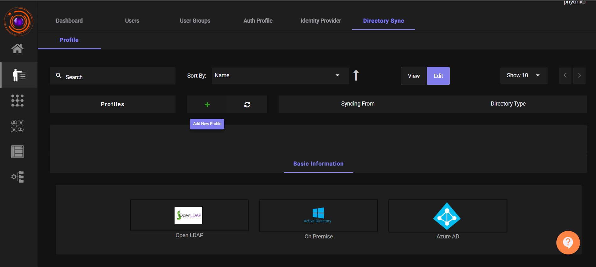
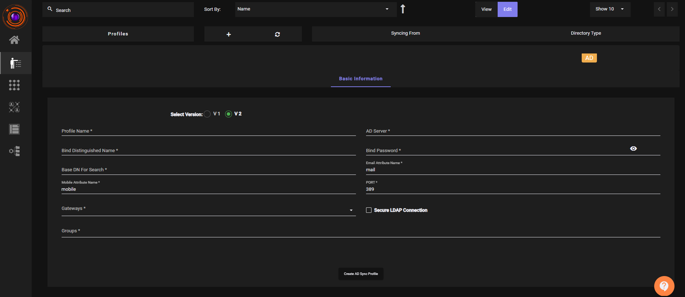
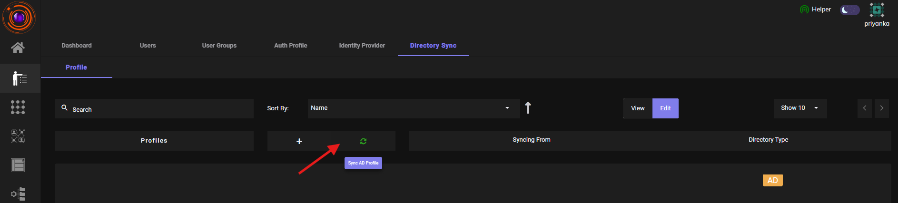
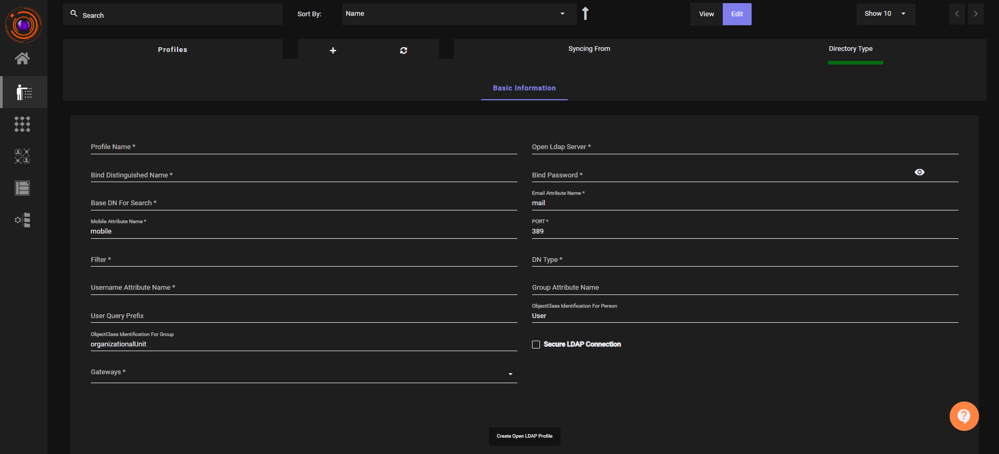

# Import Users from AD/LDAP

ZTAA supports integration with various Identity and Access Management (IAM) services, such as **Active Directory (AD)**, **LDAP**, and **Azure Active Directory**. Through the **Directory Sync** feature, organizations can onboard multiple users efficiently by syncing from their existing identity management systems.

ZTAA can also be configured to use Active Directory as the **Primary mode for authentication**.

> **Note:** Before syncing users from AD, ensure that the **AD server is reachable via the configured Gateway**.

## Prerequisites

- A **ZTAA Gateway** must be installed in the **same subnet** as the AD/LDAP server.
- Required AD/LDAP credentials and network details must be available.

##  Steps to Import Users via AD Authentication Profile Sync

1. Navigate to the **Directory Sync Profile** tab under the **Identity Management** section.
2. Click the **"Add New"** button.
3. Click **Active Directory (On Premise)**

    

4. Fill in the required details in the form.

    

5. Click on **"Create AD Sync Profile"** to save the configuration.
6. Now, Click on **Sync**.

    

7. User's are now successfully imported via **Active Directory (AD)**.

##  Terminologies & Configuration Parameters

| Field | Description |
|-------|-------------|
| **Bind Distinguished Name** | The Bind DN is the credential used to authenticate against the LDAP directory, comes with a password associated with it. While specifying it you are using that object security access to go through the LDAP tree.   Example: `CN=Administrator,CN=Users,DC=instalocal,DC=in` |
| **Bind Password** | Password for the above Bind DN user. The login/password of an LDAP user that can access base DN. |
| **Base DN for Search** | The point from where a server will search for users.   Example: `DC=instalocal,DC=in` |
| **Email Attribute Name** | Attribute used to fetch user email. Common value: `mail` |
| **Mobile Attribute Name** | Attribute used to fetch user mobile number or telephoneNumber. Common values: `mobile`, `telephoneNumber` |
| **LDAP Groups** | Groups are used to collect user accounts, computer accounts, and other groups into manageable units.   Example: `CN=Demogroup,OU=Techteam,DC=instalocal,DC=in` |
| **LDAP URL** | String used to encapsulate the address and port of a directory server, the DN of an entry within that server, or the criteria for performing a search within that server.   Example: `ldap://10.2.0.5` |

> **Important:** All LDAP entries such as **Bind DN**, **Group Name**, etc., must be referred by their **Distinguished Name (DN)** format.

##  Steps to Import Users via Open LDAP

1. Navigate to the **Directory Sync Profile** tab under the **Identity Management** section.
2. Click the **"Add New"** button.
3. Click **Open LDAP**

    

4. Fill in the required details in the form.

    

5. Click on **"Create Open LDAP Profile"** to save the configuration.
6. Now, Click on **Sync**.

    

7. User's are now successfully imported via **Open LDAP**.

By leveraging ZTAA's AD/LDAP sync capability, IT teams can onboard and manage users efficiently with centralized control. This reduces manual effort and ensures consistency in access management across the organization.

