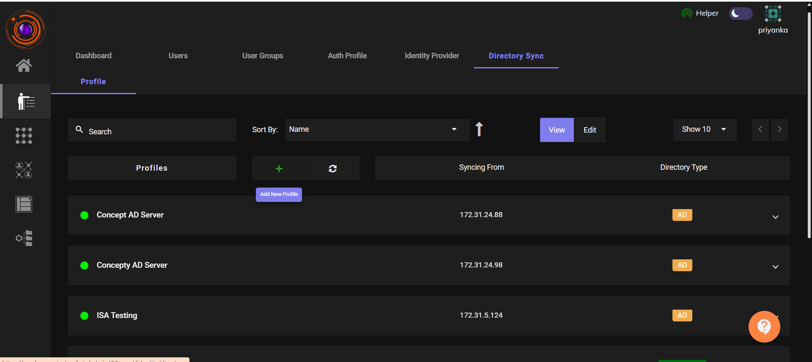
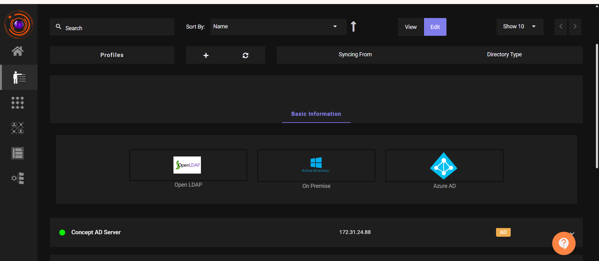
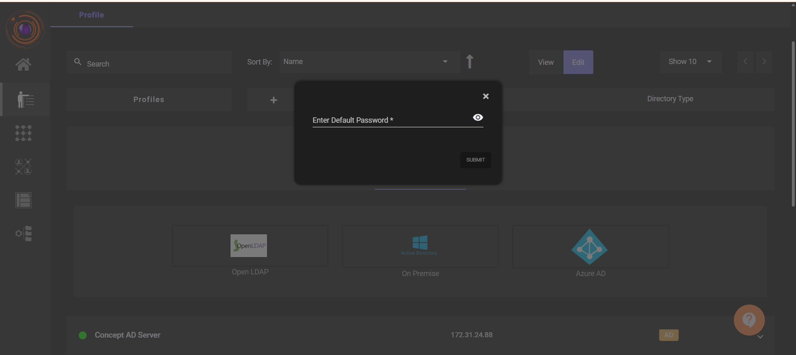
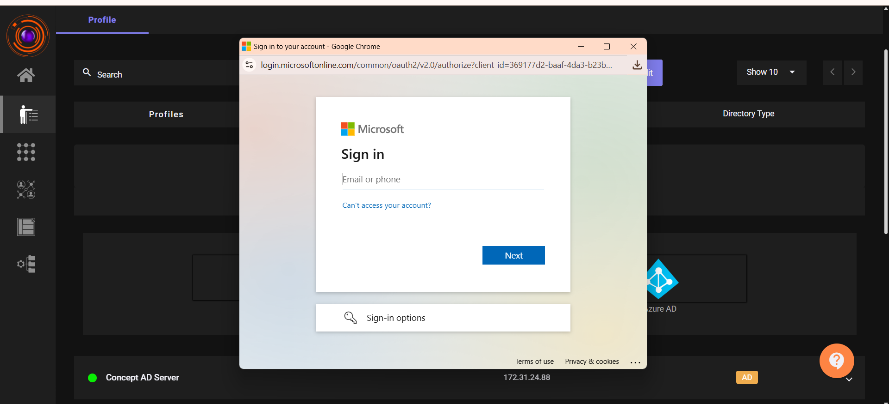
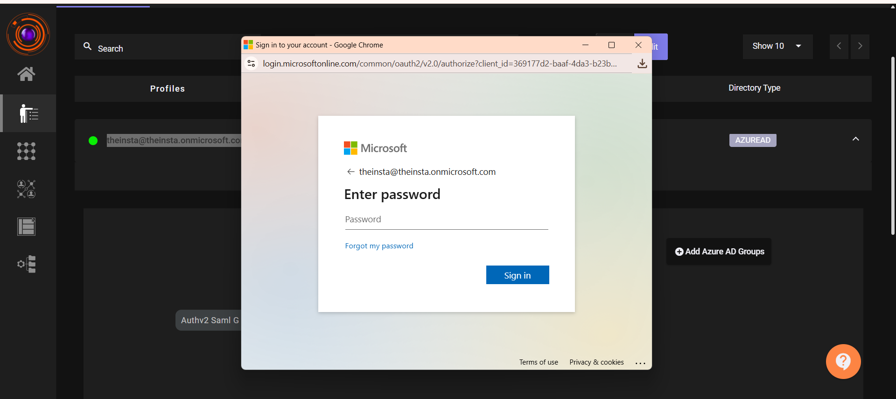
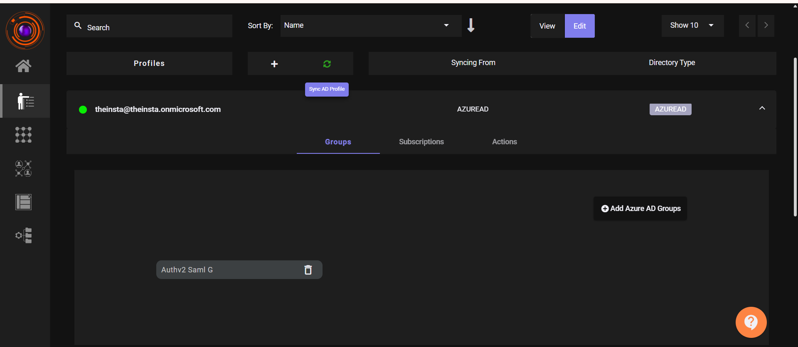
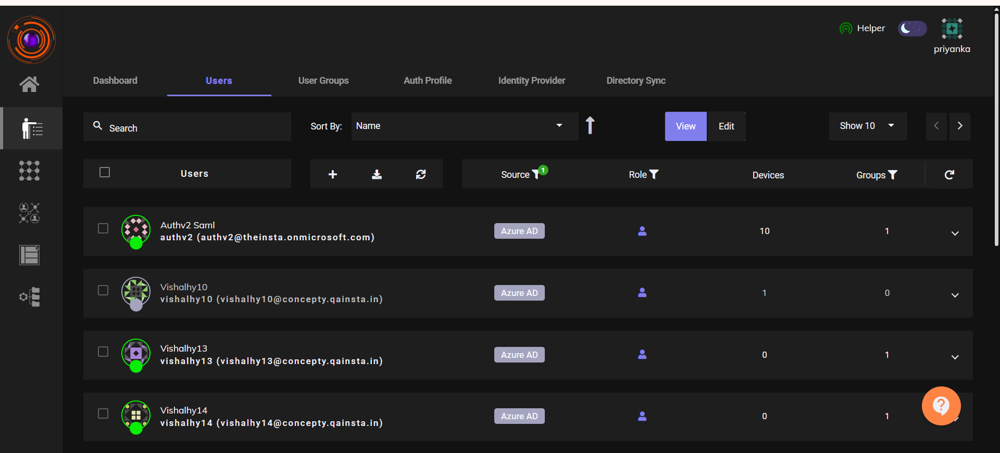
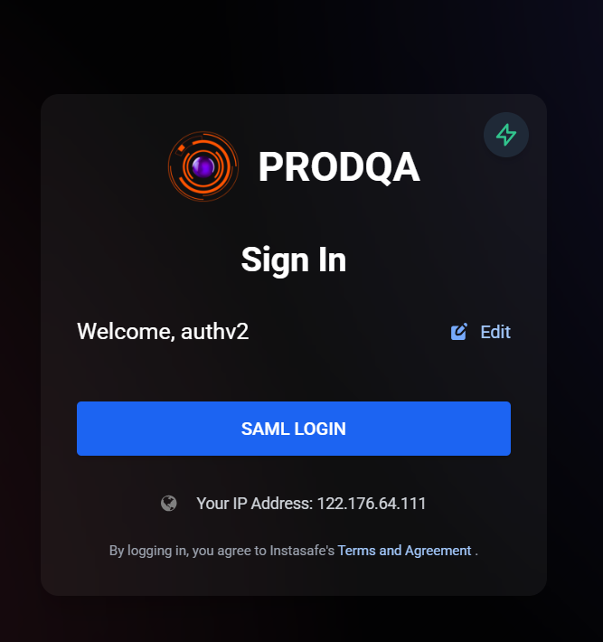
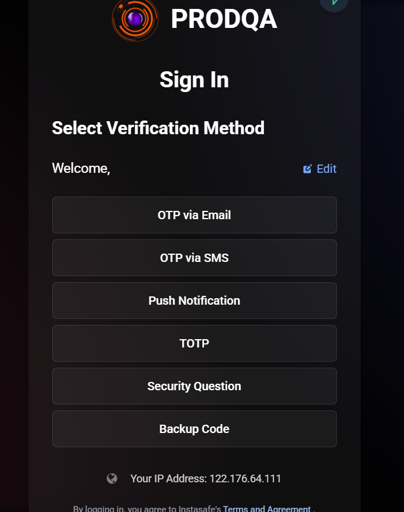
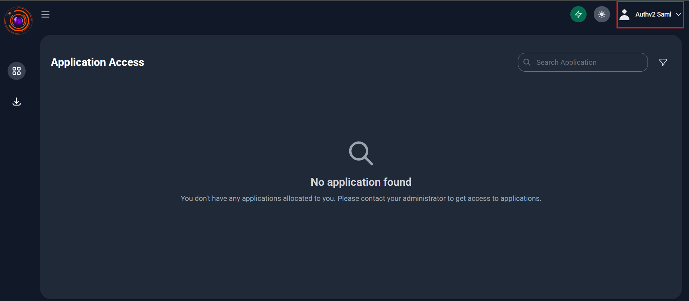

# Import Users from Azure AD

ZTAA supports user synchronization directly from **Azure Active Directory (Azure AD)**, enabling seamless onboarding and identity management. Azure AD acts as the **Identity Provider (IdP)**, while ZTAA functions as the **Service Provider (SP)**.

##  Steps to Import Users from Azure AD

### 1. Azure AD Preparation

- Log in to your [Azure Portal](https://portal.azure.com).
- Create a **Pure Azure user** (without a federated domain, only with a subdomain).
- Create a **Group** in Azure AD and add the users you want to sync.

### 2. Configure Azure AD Sync in ZTAA

- Log in to the **ZTAA Console** as an admin.
- Navigate to:  
  `Identity Management > Directory Sync Profile`

  

- Click **Add New Profile (+)** and select **Azure AD**.
- Set a **Default Password** for imported users.

  

  

- You’ll be redirected to the Microsoft login page.
- Log in using your Azure AD admin credentials (e.g., `user@devinsta.onmicrosoft.com`).
- After successful authentication, the Azure AD profile will be created in ZTAA.

  

  

### 3. Sync Azure Group with ZTAA

- Open the created **Azure AD Profile** in ZTAA.
- Add the Azure Group (created earlier) to this profile.
- Click **Sync** to import users.
- Once synced, verify that **users and groups** are listed in ZTAA.

  

  

### 4. Testing Azure User Login

- Go to the **ZTAA login page**.
- Log in using the synced Azure AD user's credentials.
- Upon successful authentication, the user will be redirected to the **ZTAA Console**.

  

  

  

##  Summary

| Component       | Role                  |
|----------------|-----------------------|
| **ZTAA**        | Service Provider (SP) |
| **Azure AD**    | Identity Provider (IdP) |
| **Users/Groups**| Synced via Directory Profile |

 

