# ZTAA as an Identity Provider (IdP) for SSO

**Security Assertion Markup Language (SAML)** is an XML-based open standard for exchanging authentication and authorization data between two parties: a **Service Provider (SP)** and an **Identity Provider (IdP)**.

InstaSafe ZTAA can function as a **Single Sign-On (SSO)** solution for applications that support SAML-based authentication.

## Supported SAML Configurations in ZTAA

### 1. Frontend SAML → Backend Local

- ZTAA directly acts as the **IdP**.
- Flow:   `Application (SP) → ZTAA (IdP)`

### 2. Frontend SAML → Backend SAML

- ZTAA acts as both **IdP** for the application and **SP** for the organization’s primary IdP.
- Flow:  
  `Application (SP) → ZTAA (IdP)`  
  `ZTAA (SP) → Organization IdP`

ZTAA forwards the request to the organization’s primary IdP and relays the response to the SP after transforming it.

## SAML Terminologies

- **Identity Provider (IdP):** Authenticates the user and passes the identity to the SP.
- **Service Provider (SP):** The application requesting authentication via IdP.

### Basic SAML Configuration Settings

| **Field**                              | **SP-Initiated**       | **IdP-Initiated**      | **Description**                                                                                                                                                                                                                                                                      |
| -------------------------------------- | ---------------------- | ---------------------- | ------------------------------------------------------------------------------------------------------------------------------------------------------------------------------------------------------------------------------------------------------------------------------------ |
| **Identifier (Entity ID)**             | Required for some apps | Required for some apps | A globally unique identifier for the SAML entity (either the Identity Provider or the Service Provider). It serves as the **audience** parameter in the SAML assertion. This must match on both ends to establish trust. In ZTAA, this is also referred to as the **IDP Entity ID**. |
| **ACS URL** (Reply/Redirection URL) | Required               | Required               | The **Assertion Consumer Service (ACS)** URL is the endpoint where SAML assertions (SSO tokens) are sent. This is used in both SP-initiated and IdP-initiated flows.                                                                                                                 |
| **Sign-on URL**                        | Required               | Not required           | The URL the user accesses to start the login process (mainly for SP-initiated flows). In platforms like Azure AD, this is used to launch apps from Microsoft 365 or Azure AD My Apps. When left blank, an IdP-initiated login is assumed.                                            |
| **IdP URL / SSO URL**                  | Auto-generated by ZTAA | Required               | The SSO URL (IdP URL) is the endpoint that accepts authentication requests and issues SAML tokens. This URL is generated by ZTAA and must be entered in the SP’s SAML configuration. |                                                                                                

##  Setting Up ZTAA as an Identity Provider

### In ZTAA Console:

1. Login as **Admin**.
2. Navigate to:  
   `Identity Management → Identity Provider`
3. Click **Add New Provider**.

   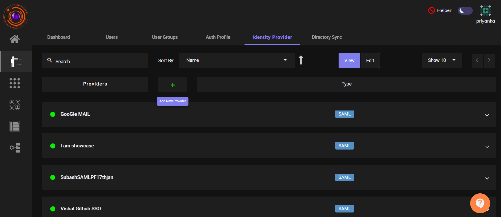

4. Click **SAML**.Enter IDP  name for the application you want to create like Freshwork, Zendesk, Zoho etc.  Then, Select **Generic SAML SP**.
5. Click **Next**.

   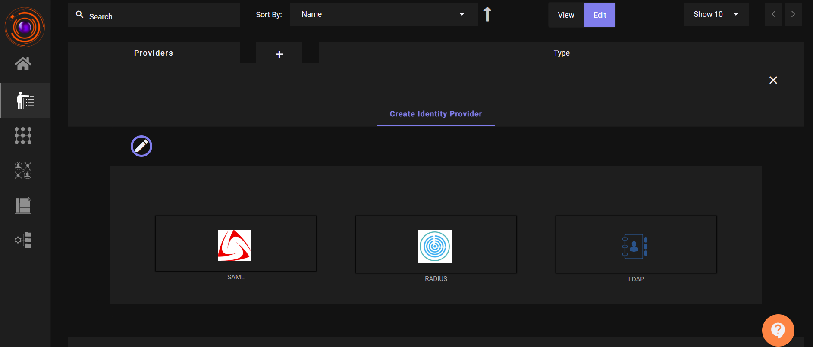

   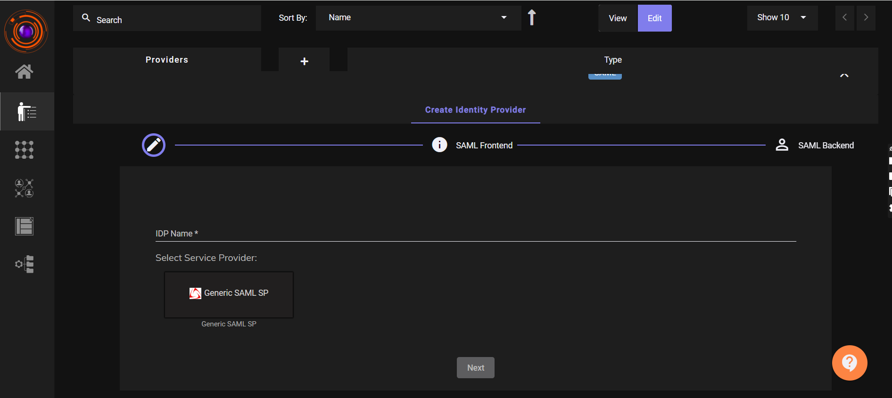

6. Enter the required fields for **Create Identity Provider**:
      - **ACS URL** and **SP Entity ID** (from the Service Provider).
      - **IDP Entity ID** (recommended: your tenant domain).
7. Enable toggles for:
      - **Allow access from browser**
      - **Allow access from desktop**
      - **Allow access from mobile**

   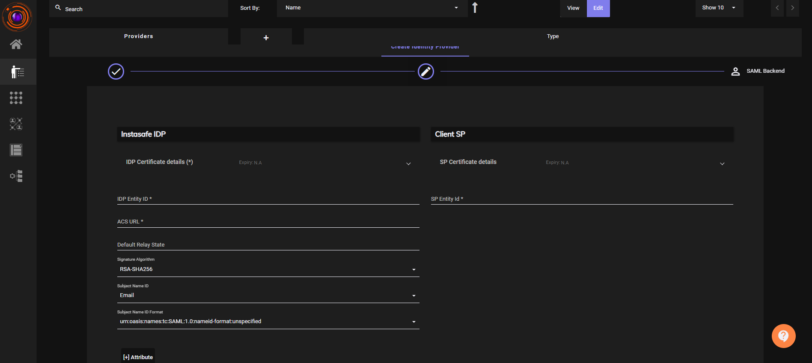

   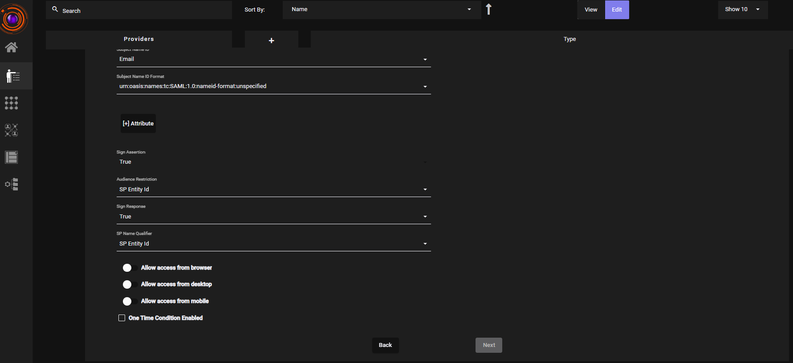

8. Set Backend Type - **Local**

   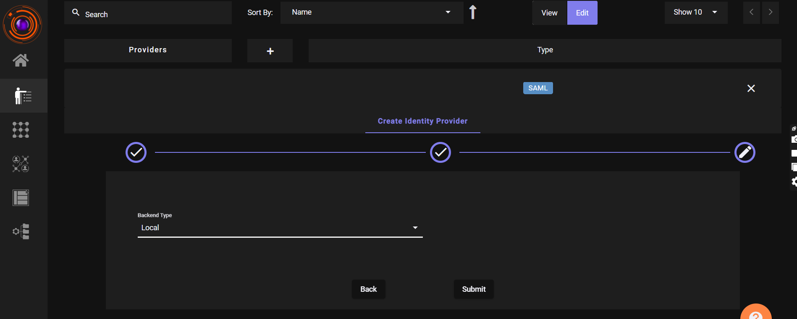

9. Click **Submit**.

> Note: Field names and UI may vary across different applications.

## Configured SSO for Freshdesk

### In ZTAA:

- Set `Signed Assertion` to `true`.
- Use domain as `IDP Entity ID`.
- Paste Freshdesk's **ACS URL** and **SP Entity ID**.
- Save the configuration to generate **IDP URL** and **Logout URL**.

### In Freshdesk:

1. Login as **Admin**.
2. Go to: `Admin -> Security `.

   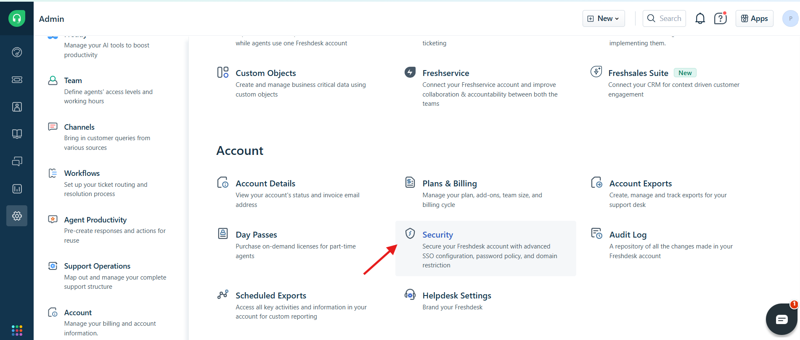

3. Click `Configure Freshworks SSO`

   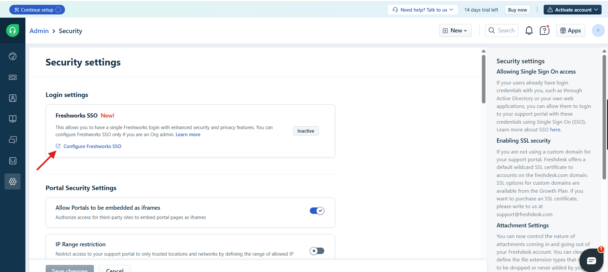

4. Click on SSO Login.

   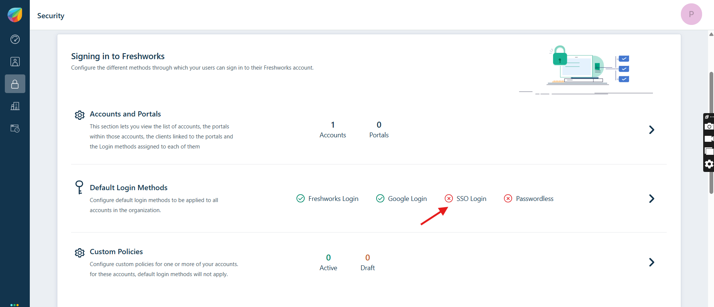

5. Enable the SSO Login.

   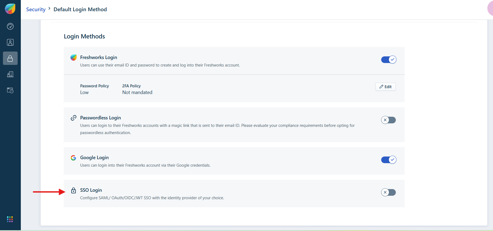

6. Copy and paste:
   - ACS URL & Entity ID paste it  into ZTAA.
   - IDP Certificate (from ZTAA) → into Freshdesk.

   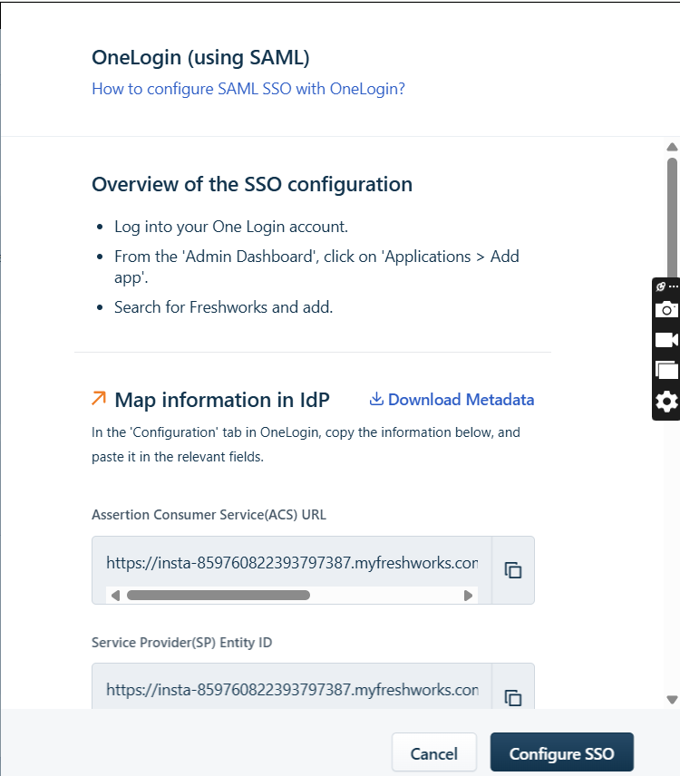

7. Set `Signing Option` to **"Signed Assertion only"**.
8. Paste the ZTAA-generated IDP URL into **SSO URL**.

9. Click **Configure SSO** to finish.

   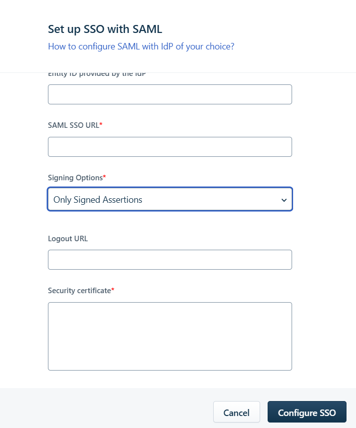 

10. Navigate to the ZTAA Console. `Go to Perimeter Management > Applications.`
11. Click on Create New Application. Select Web Application as the type.

   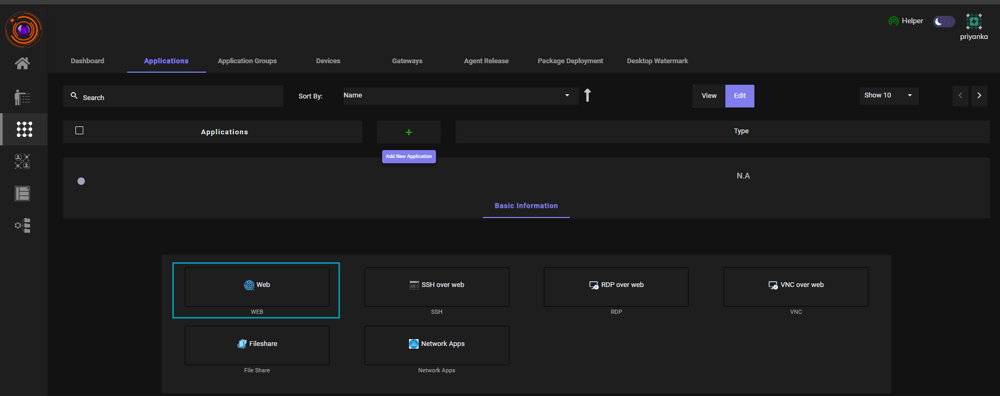 

12. Fill in the required details (e.g., application name,url, protocol, etc.).

   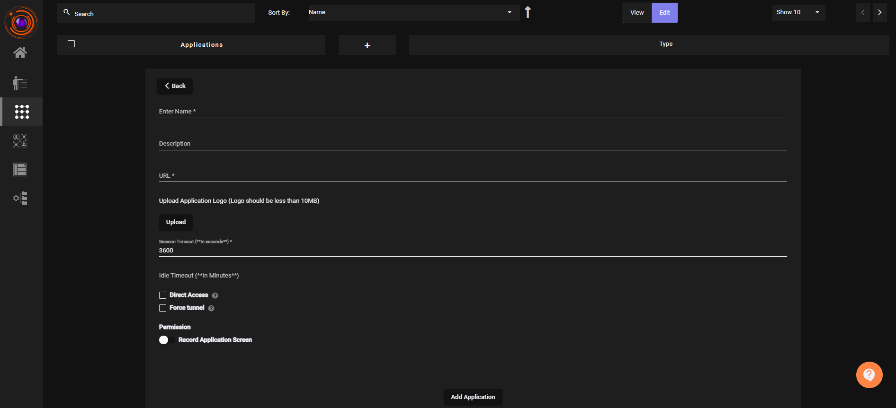 

13. After creation, go to Gateways and add this newly created web application to the appropriate gateway.

   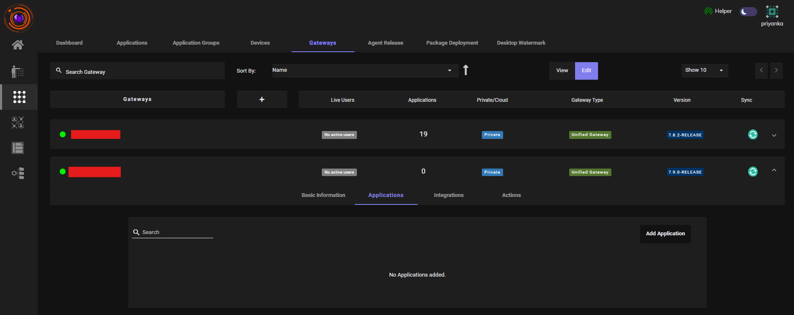 

14. Go to dashboard, Click on the configured web application to initiate login,you will be seamlessly logged in to the application without entering a password, as it uses SAML-based SSO.

   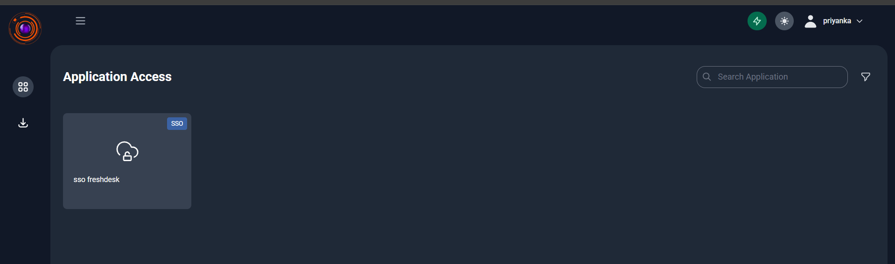 

##  Example: Configure SSO for Zendesk

### Similarly for Zendesk

1. Login to **Zendesk** as Admin.
2. Go to: `Account`->`Security`.Click on `Create SSO Configuration` -> `SAML`

   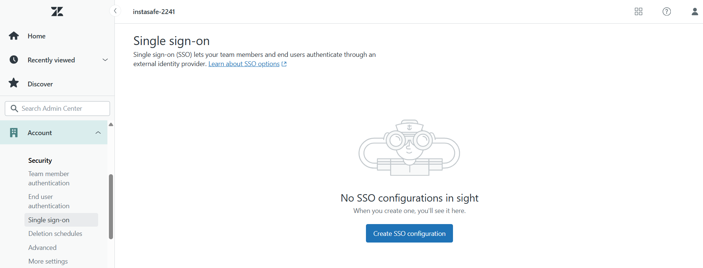 

3. Copy Zendesk's **ACS URL** → paste into ZTAA.
4. Copy ZTAA's **IDP Certificate**, use a tool to calculate ** Certificate Fingerprint**, and paste it into Zendesk.
5. Paste the **SAML SSO URL** (from ZTAA) into Zendesk.

   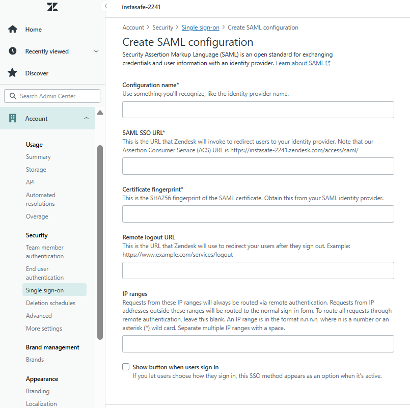 

6. Click on Save.
7. Enable all access toggles in ZTAA i.e in the Identity Provider that you created.
8. Choose **Backend Type: Local**, then **Submit**.
  Similarly as above,
9. Go to `Perimeter Management → Applications.`
10. Create a new Web Application with required details.
11. Add the application to the correct Gateway.
12. Associate the web app with the created Identity Provider.
13. From the ZTAA Dashboard, Click the Web App that you created now. You will be automatically redirected and logged in via SSO, without entering credentials.

