# Log into ZTAA via SSO

### ZTAA as SP and Azure AD as IDP – SAML Configuration

Instasafe ZTAA can function as both an **Identity Provider (IDP)** and a **Service Provider (SP)**. This article demonstrates how to configure **ZTAA as a Service Provider** and integrate it with **Azure AD as an Identity Provider** using **SAML-based SSO**.

##  What is SAML SSO?

SAML (Security Assertion Markup Language) is an XML-based standard for exchanging authentication data between an **Identity Provider (IDP)** and a **Service Provider (SP)**. It allows for **Single Sign-On (SSO)**, enabling users to access multiple applications with a single login.

- **SSO** simplifies access management by reducing the number of login prompts.
- **ZTAA SSO** supports integration with **multi-factor authentication (MFA)** for enhanced security.

##  Key Concepts

| Term                     | Definition                                                                                       |
|--------------------------|--------------------------------------------------------------------------------------------------|
| **Identity Provider (IDP)** | Authenticates users and provides assertions to the service provider. Azure AD is the IDP here.   |
| **Service Provider (SP)** | Consumes SAML assertions to authenticate users. ZTAA acts as the SP in this configuration.       |
| **Assertion Consumer Service (ACS)** | Receives and validates SAML assertions sent by the IDP.                                           |
| **Entity ID**            | Unique identifier for a SAML application.                                                        |

## Logging into ZTAA via Azure SSO

| Setting         | SP-Initiated | IDP-Initiated | Description |
|----------------|--------------|---------------|-------------|
| **Entity ID**  | Required  for some apps    | Required  for some apps     | It uniquely identifies the ZTAA application. Azure AD sends it as the Audience in the SAML token, and ZTAA validates it. It also serves as the Entity ID.|
| **ACS URL**    | Required     | Required      | Redirect URL where ZTAA receives SAML token from Azure. |
| **Sign-on URL**| Required     | Optional      | This URL is used by Azure AD to initiate sign-in when launching the app from Microsoft 365 or My Apps. If left blank, Azure AD performs an IdP-initiated sign-on from those sources.|

##  ZTAA as SP and Azure AD as IDP: Flow Summary

1. **User Access Request** → User attempts to access ZTAA-protected resource.
2. **ZTAA Redirects** → Redirects user to Azure AD login.
3. **User Authentication** → User logs in via Azure AD.
4. **SAML Assertion Generation** → Azure AD sends user identity details in SAML token.
5. **Assertion Validation** → ZTAA validates the SAML token.
6. **Authorization** → ZTAA grants access if user is authorized.
7. **Access Granted** → User gains access to the application.

## Steps to Configure

###  Azure AD Configuration

1. **Login to Azure Portal** → [https://portal.azure.com](https://portal.azure.com)
2. Go to **Azure Active Directory > Enterprise Applications**
3. Click **+ New Application** → Select **Create your own application**
4. Name the app (e.g., `Instasafe ZTAA`) and click **Create**

	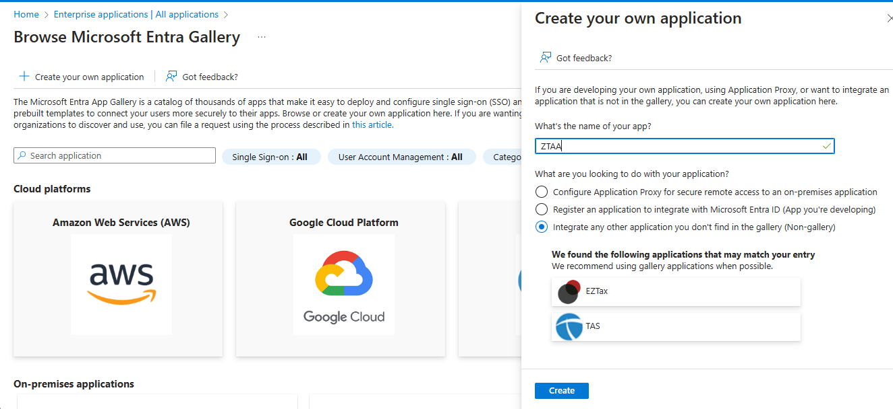

5. Under **Manage > Properties**, save the **Access URL**
6. Go to **Users and Groups** and assign users or groups

	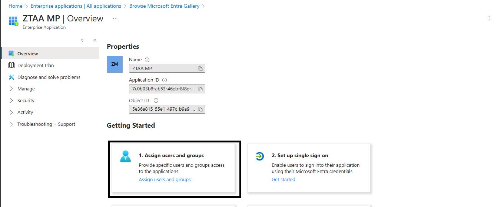

	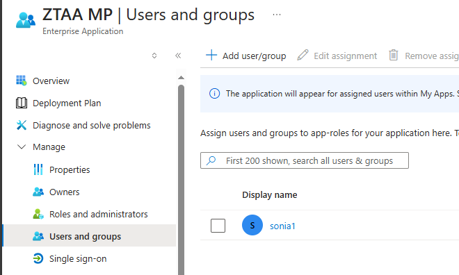

7. Go to **Single sign-on > SAML**

	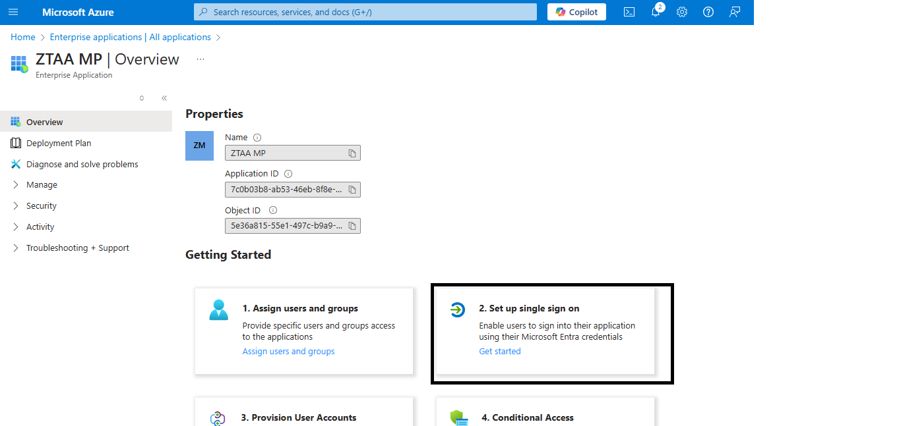

	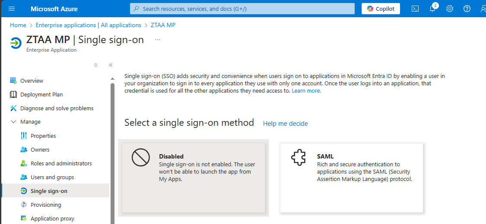

####  Basic SAML Configuration

| Field             | Value / Source |
|------------------|----------------|
| **Entity ID**     | Enter a unique string (e.g., `https://ztaainstasafe/entity`) |
| **ACS (Reply) URL** | Copy this from ZTAA console |
| **Sign-on URL**   | ZTAA login page URL (optional for IDP-initiated login) |

	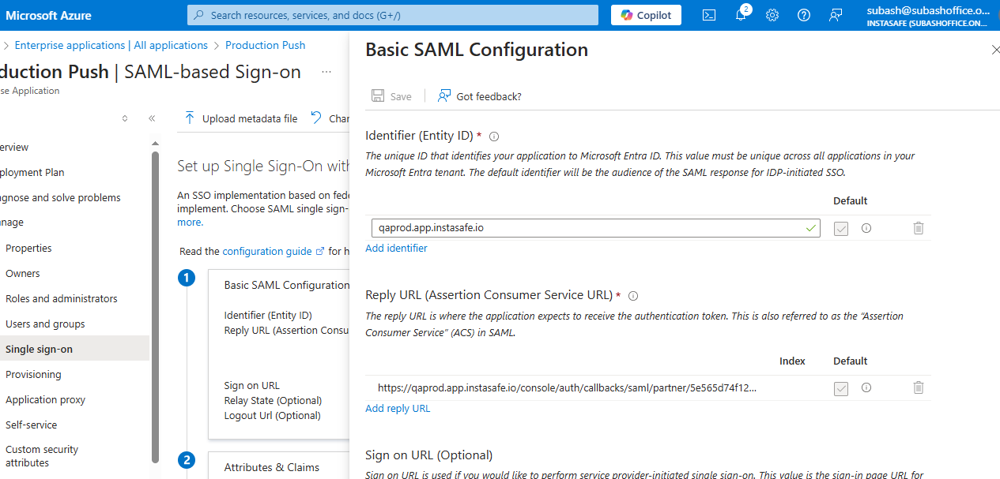

8. User Attributes & Claims

	- Ensure the value for **NameID** or **email claim** is set to: `user.mail`

9. SAML Signing Certificate

	- Download the **Base64 certificate**
	- Copy the **App Federation Metadata URL**
	- Open the URL in browser and extract:
  		- **IDP Entity ID**
  		- **SSO Login URL**
  		- **Certificate (X.509)**

	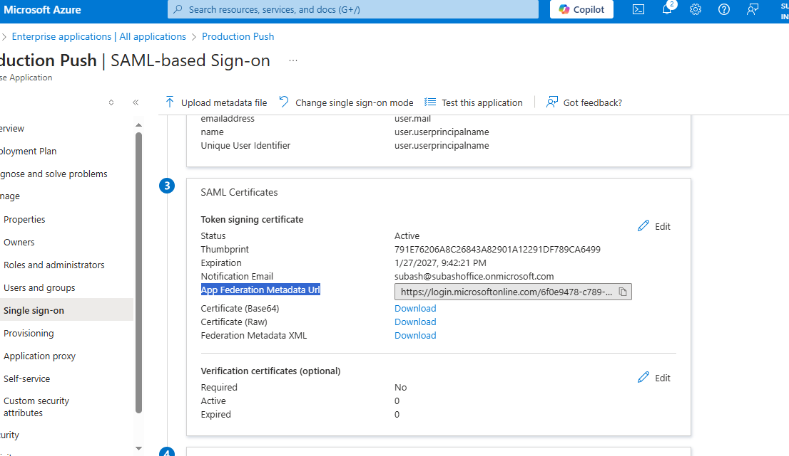

	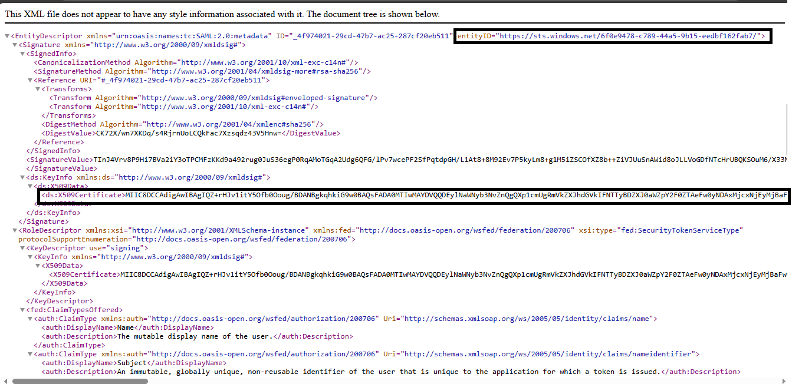

	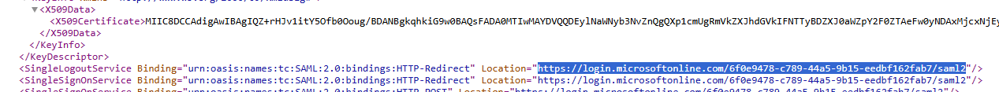

###  ZTAA Configuration

1. **Login to ZTAA Console** as administrator
2. Navigate to **Identity Management > Directory Sync Profile > Azure Profile**

	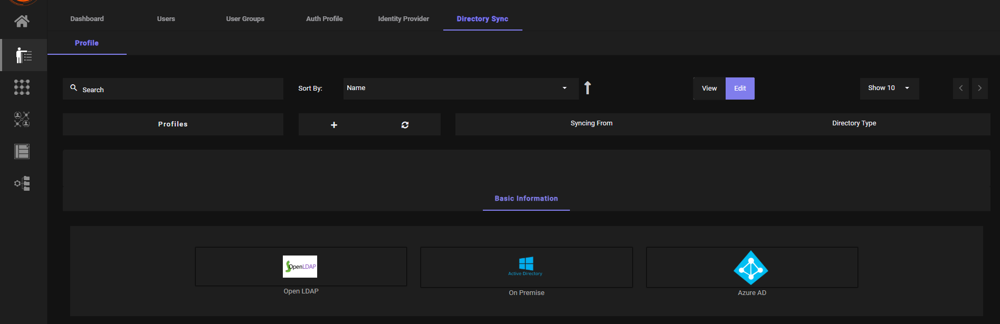

3. Add **Azure Group to Profile** and click **Sync**
4. Navigate to **Auth Profile**
5. Click **Add New Profile**

	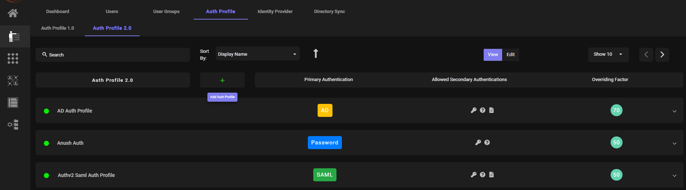

6. Select **SAML** as primary authentication. Fill the details.
	- Paste the following details from Azure:
     	- **IDP Entity ID**
     	- **SSO Login URL**
     	- **Certificate** (downloaded earlier)
		- Set **Requested Authentication Context Comparison** to `Exact`
		- Match **Entity ID** 

	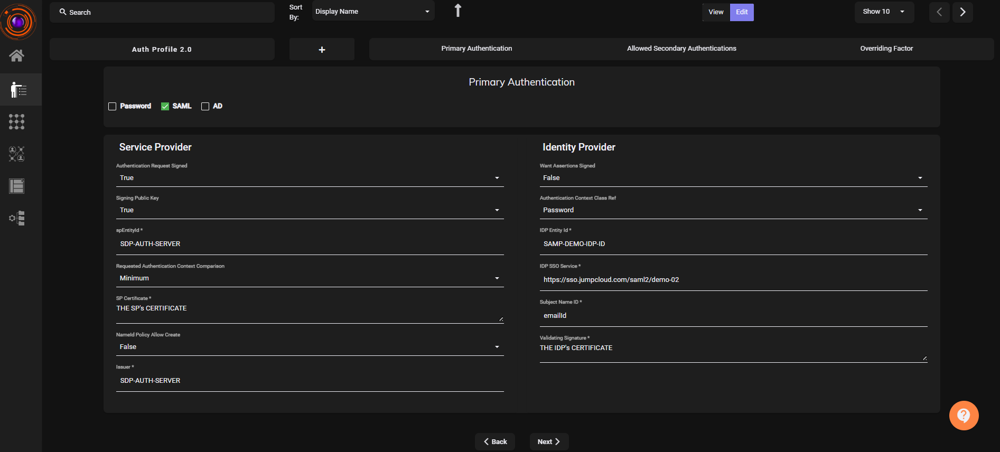

7. Click Next. Save and complete the setup.
8. Go to **User** or **User Group** that were imported from Azure AD and add this Auth Profile to them.

	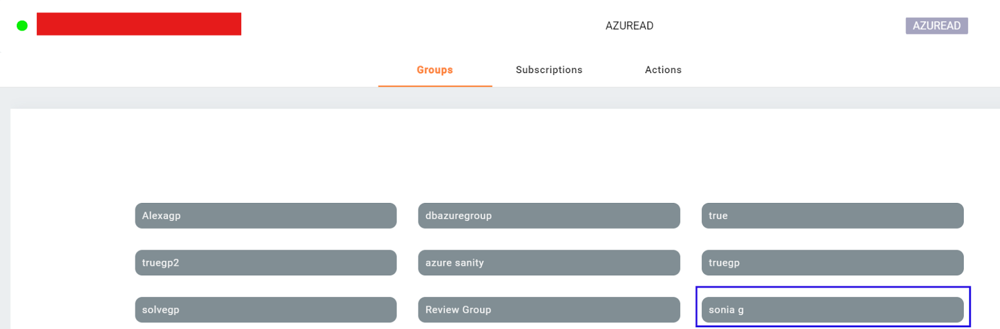

##  Verification

1. Visit the ZTAA Login Page
2. Enter the configured **username (usually email)**
3. Click on **SAML Login**

	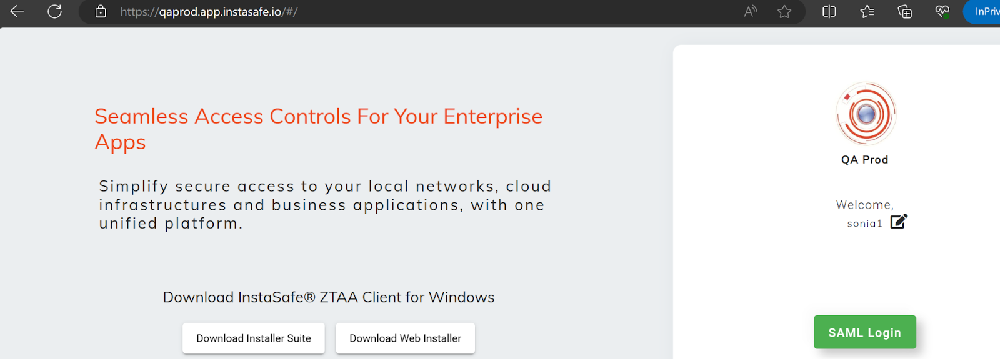

4. Redirects to **Microsoft Login Page**

	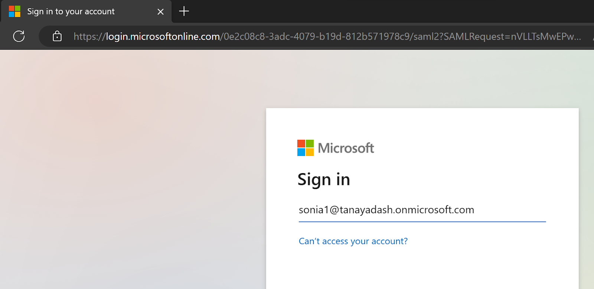

5. Enter **Azure credentials**

6. Upon successful login, redirected back to ZTAA and granted access

	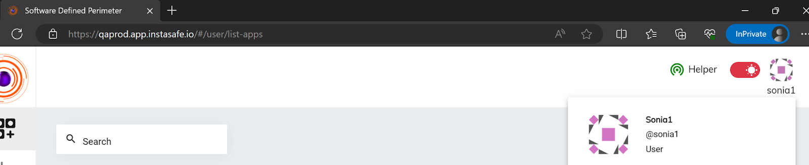

> **Note:** It is recommended to keep the **ZTAA username same as the email** to avoid configuration issues.

