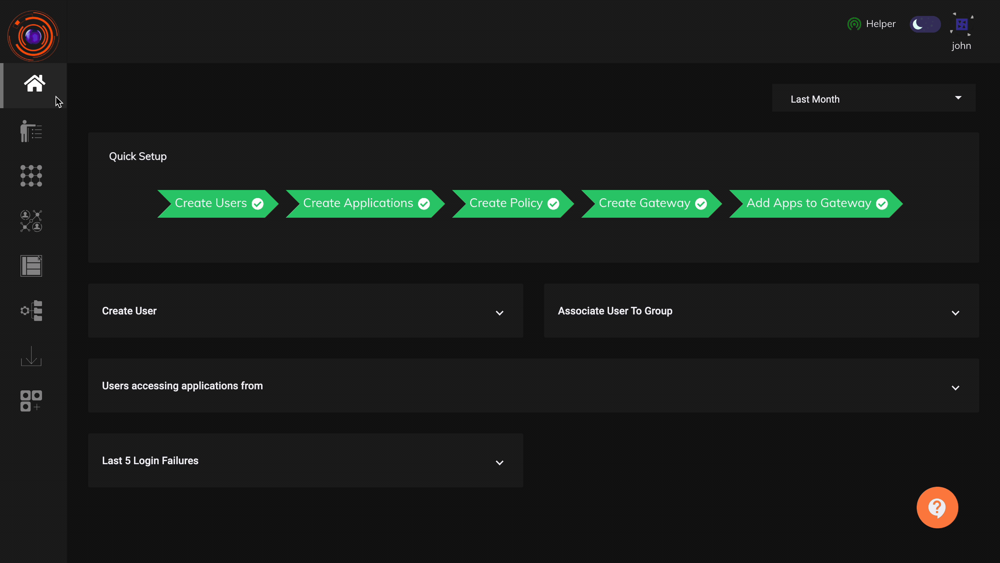
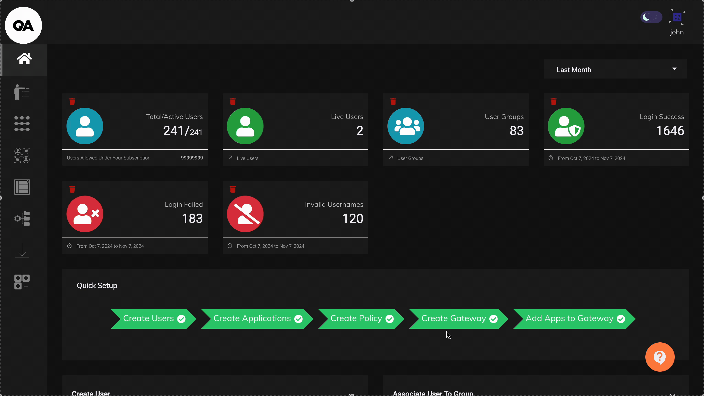

## Audit Logs

For efficient monitoring and compliance ZTAA  collects and maintains a large range of logs and reports. The different logs and reports available under Audit Section of the Dash board are:-

- Recent Active Users

- Max Concurrency Graph

- Gateway Status

- User Logins

- Authentication Logs

- Application Access Request

- Application Recordings

- Session Logs

- Network Gateway Logs

- Network Packet Logs

- Events

- T-OTP Status

- Exports

The below video illustrates the various reports available in the InstaSafe Zero Trust platform for audit and monitoring.

- as illustrated in the video, in the "**Recent Active Users**", all the users connected from the ZTNA & ZTAA agent are displayed. Admins will have the control to logout a user from the agent remotely from the Admin console incase of any suspicious activity.

To download a report, Click on the download button.

The below video illustrates how the various available Audit reports can be downloaded from the "Exports" section. Reports can also be scheduled to be delivered to the Admins by email at a configured frequency and time.

