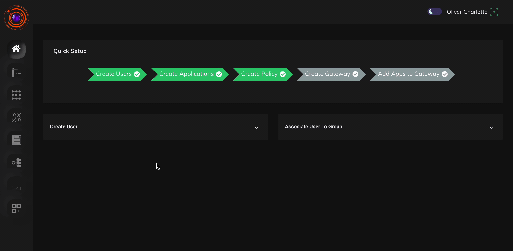

ZTAA supports creation of advanced security rules which can control access based on device security posture. Advanced security checks such as Application Access Time, Operating System, Antivirus,location details etc. can be configured using data management features. Dataset created here will be used in Access Policies to configure rules.

### Creating a Dataset

1. To create dataset, go to configuration section of the console and click on Data Management.

2. Click on create a new Dataset. Fill the details and select parameter for which you want to create data set for.

3. Click on "Create Dataset" button.

ZTAA currently supports the following parameters for which dataset can be created. 

* Application
* Application Access Time
* AntiVirus Enabled Name
* AntiVirus Installed Name
* AntiVirus Updated Name
* Certificate Thumbprints
* Country Code
* Disk Serial Number
* Geolocatoin
* IP Address
* Mac Address
* Motherboard ID
* OS Build Version
* OS Family
* OS Major Version
* OS Minor Version
* System Domain Name
* System MacAddress
* System Serial number
* Windows Hotfixes
* UA Suffix

The below video illustrates on how to create a Dataset for the 'Country Code', 'Application Access Time', 'OS Family' & 'System Serial number'  device posture check. 

The below video illustrates on how to create a Dataset for the 'AntiVirus Enabled Name' device posture check. 

