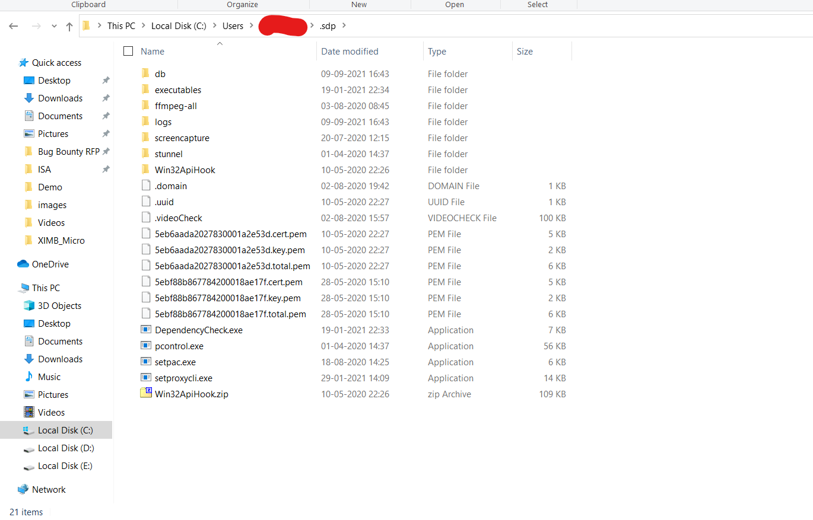
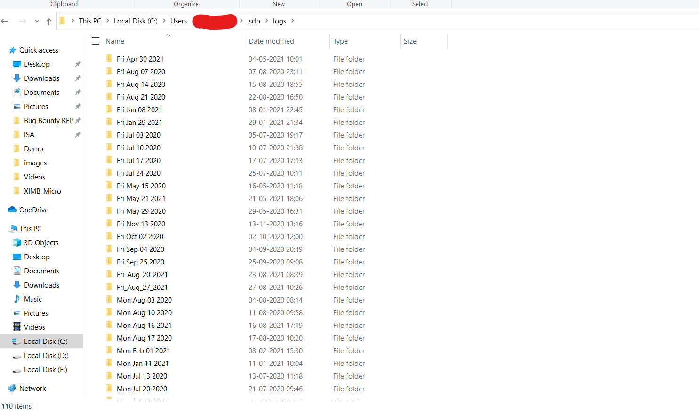

## Raising a Support ticket

In case you not able to resolve the issue with the help of Troubleshooting articles or Online Documentation,

Please raise a ticket with below specific information so as to resolve the ticket faster.

- A summary of the issue with Workflow
- Impact due to the issue
- Error Screenshots & Error Messages
- Details of Agent & OS version
- Log files – please mentioned the procedure for all WIN, MacOS and Linux.
- To raise a support ticket please drop a mail to support@instasafe.com with a screenshot of the error and ZTAA log file.
- Contact information on how to reach you.

* For obtaining the logs go to users and select the user for whom you want to collect the logs for and add \.sdp to the path name

**Location of the Log files:-**  C:\Users\[usernamehere]\.sdp

* In the log folder the log files will be arranged according to date. Select the recent log and share it as attachment.

* Once a new case is submitted, our Support Team will share articles that might resolve the issue. In case the issue is not resolved, our Support Engineer will either contact you by phone or email.
Your email replies will automatically be appended to the case.

**Please Note** 

Support Includes

- Initial Triaging and Troubleshooting of the problem
- Bugs and Break Fixes
- ZTAA Console Configurational Questions
- Product & Best Practices Questions
- Product Releases Information

Support Does not  Covers

- Request for Console Administrations

- Configuration Changes

- Product Feature Requests or Changes

- Customizations of Products

- Audit, Control and other Usage Reports

