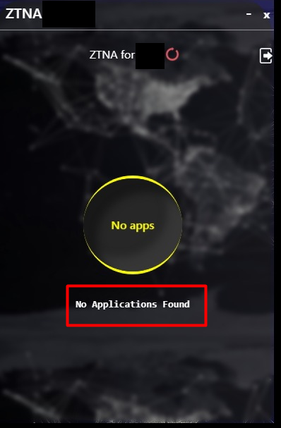
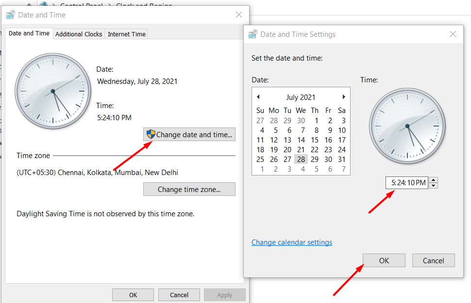
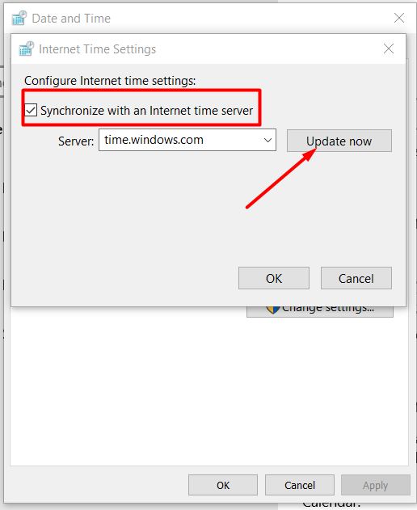

The article contains information on some of the most frequently occurring errors in ZTAA. Below mentioned are the basic troubleshooting steps that the user or admin can undertake before reaching out to support.

Please follow the steps in the exact mentioned order in case you face any of the issues

### Unable to Install or Open the ZTAA application

Installation might fail or application might not start after installation if 

| Root Cause | Resolution |
| ------ | ------ |
| The agent is installed on an OS not supported by ZTAA. | Before installation please check if the Operating system on which the agent is being installed is supported by ZTAA. |
| Any component is blocked by anti virus or firewall. | Please ensure all required permission are allowed for ZTAA. |
| Installation error might occur in case all component are not downloaded or in case any dependencies are missing duing installation. | Download the agent once again from the  console and install it once again.  |


#### Failed to register device,error:self signed certificate in certificate chain

**Root Cause**
A self-signed certificate is a digital certificate which are basically free, not signed by any publicly trusted certificate authority (ca). Self-signed certificates include SSL/TLS certificates, code signing certificates etc. self-signed certificates are created, issued, and signed by the organization responsible for the website or the signed software. Self-signed certificates are  not trusted by our browser because simply a certificate itself doesn't enders any trust,  as the trust generates if it is signed by a certificate authority(ca).

By default the SSL certificate configured on our server would be a self-signed one, actively  meaning that it has not been issued by a certificate-authority(ca), but instead our own server  has self- signed the certificate as being authentic.


**Resolution**
1.	Press Windows+R button, it will open the below tab, and type “cmd”.
2.	Run this command in cmd.

` “setx node_tls_reject_unauthorized "0" `

3.	refresh/restart the zta client.


### Unable to connect

Follow the Steps below incase the agent is installed but connection fails.

1- Connection might fail in case of slow internet or low bandwidth availability.  Please check if proper internet connection is available by opening another webpage.

 #### Connection Refused 

 1- Connection reused error might occur in case Stunnel has not been started or not downloaded completely.

 2- To verify check the size of stunnel file in  sdp/stunnel/bin.Stunnel-osx-5.21 should be 160kb.

 3- If files indeed partially downloaded then delete .sdp folder and restart the agent.


### User is unable to access an application 

Follow the Steps below incase the user gets connected to ZTAA successfully, but faces any of the issues mentioned below. 

1-  Check from the ZTAA admin portal if access control policy has been configured for the user i.e.The user will be able to access the application only if,the  user has been given explict permission to access the application.

```
P.S Before beginning trouble shooting please confirm if the issue is being faced 
by multiple users across your organisation. In case multiple users are facing the 
same error, this might be an issue relating to the gateway.

```

### No Applications Found or Waiting for Application Details

 




The error mentioned error may occur in case there is a mismatch in system time i.e. date and time on user device and ZTAA server.


These issues can be resolved by resetting the sytem time and enabling automatic syncronisation with the Internet time.

1- To Reset the System time Open clock application and go to Internet Time settings and enable syncronisation with Internet Time. 





### Device Registration Failure - Windows

As InstaSafe ZTAA follows device authentication model along with user authentication, device details are captured white registering the device. 

If an end user using Windows family PC is facing Device Registration Failure, it could possibly be one the following reaons for it.

1- Device is not approved by administrator (incase of device binding is enabled)

     - Solution: You can contact your organization IT administrator to approve your device, post that on retry you will be allowed to access applications

2- Device doesnt have / HDD is not detected. 

    - In case HDD is not detected, we fallback to using system serial number. No user intervention is needed.

3- WMIC not found.

    - This command is by our client to get disk serial number.
    - If this is not found, then our client automatically will look for Get-WMIObject from powershell 5+ 

4- Get-WMIObject  object not found in powershell.

    - This command is used by client incase wmic system util is not found.
    - If this command / powershell doesnt exist in the machine, end user will receive an error message "Failed to Register Device - Error: Command Failed"
    - Solution: As a fallback mechanism we can also use CIM capability to fetch device details. 
     To use CIM, user has to be go command prompt and execute `setx CIM_INSTANCE "true"`


### Troubleshooting agent installation on MAC

Current version of ZTAA client requires Homebrew for installation on a mac OS machine.
To confirm if Homebrew is installed on the mac machine, execute the below command from the terminal.

```
brew -v
```
If the above command does not fetch any results then HomeBrew has not been installed successfully.
If Homebrew is available and if the agent is stuck with a message "Please restart the agent after installing the missing dependencies" for long then quit the agent and try running the following command in the terminal.

```
>  brew install wireguard-tools
```

If agent keeps requesting for a restart then we might have to reinstall the service for which following commands can be used.

```
>  cd ~/.sdp/executables
===========================================================================
>  uname -a
===========================================================================
**(if the above command’s response ends with `x86_64`) then run**

>  cp Instasafe.ZTNA.Helper_darwin_amd64.app Instasafe.ZTNA.Helper.app

**(else)**

>  cp Instasafe.ZTNA.Helper_darwin_arm64.app Instasafe.ZTNA.Helper.app
===========================================================================
>  sudo ./Instasafe.ZTNA.Helper.app -uninstall

===========================================================================
>  sudo ./Instasafe.ZTNA.Helper.app -install

```

Incase you are unable to find a resolution for your problem or the issue still persists after follow these steps Please [raise a ticket](025-supportticket.md) with Instasafe support and we will help you resolve the issue at the earliest.


