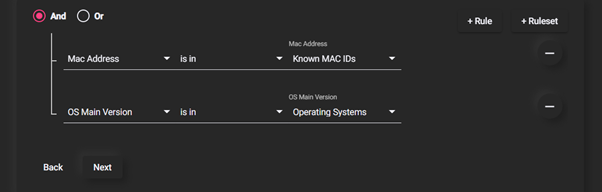

Getting Started - Admin UI
--------------------------

The admin ui is the place where every administrative task available to the admin can be performed on the Zero Trust Platform. The admin ui is common for both ZTAA and ZTNA platforms. Admins can manage any number of these platforms with the help of the features provided by this UI.
The admin UI is driven by a View/Edit toggle to prevent accidental deletions. Modifications to existing entities can only be made in the edit mode.

### Identity Management

This part of the console is to manage users, user groups, their authentication profiles and the level of their access on the platform. The solution helps to manage the access policies against the users and the groups.
The Dashboard shows an overview of the users and some useful information at a glance.
#### Users

A user in the Zero Trust platform allows any member of the organization to log onto the zero trust platform and access the resources that they are allowed access to by the company policies. The extent of access of a user on the Zero Trust platform is determined by the Role that has been  assigned.

There are two Roles that can be assigned to any user in the organization.
- User
- Admin

A user has read only privileges on the Zero Trust Network implying that they can only access the resources and cannot modify them in any way

Admin or Administrators have full control over the Zero Trust Platform and have all the privileges to create, modify or delete resources,users and infrastructure.

 
#### User Groups

Users are easily manageable when the size of the organization is small or medium but as the size of the organization keeps increasing, it poses an administrative challenge to the people maintaining the users on the platform. User Groups are a construct by which administrators can keep track of users as groups instead of individual users. This allows the administrators to perform actions on groups of users which saves them a lot of time and organizational effort. Additionally, Administrators can still grant users privileges apart from their group privileges.
The method helps to share the common access to a group specifically such as
access for HR operations to HR department(group) alone.

#### Auth Profile

Users can be authenticated into the Zero Trust platform in the following ways,

1. Primary authentication  
2. Secondary authentication
	
The primary authentication mode can be any of the following
##### Password

A username password can be used to authenticate a user into the platform. The admin need to add the user at the IDP of the ZTA platform at the admin UI. The password confirmation can be done from the side of the end user againt the information present at the ZT Controller.

##### Security Assertion Markup Language (SAML)

Instasafe Zero Trust can act as a [SAML](https://docs.instasafe.io/Zero%20Trust%20Application%20Access/013-ConfiguringZTAAasSSOwithSAML/) Service Provider to utilize any third party IDPs to log users into the system. Both IDP Initiated and SP Initiated modes of SAML Authentication are supported by the ZTAA platform

##### Active Directory ([AD](https://docs.instasafe.io/Zero%20Trust%20Application%20Access/008-importADusers/))

Companies with existing Active Directories can add their servers to the platform and ZTAA will contact the AD server to authenticate the user’s credentials without the need to register the users individually into the platform. Further details about syncing the AD profiles can be found under the Directory Sync Profiles.
In addition to the the primary authentication schemes, Instasafe offers several MultiFactor authentication schemes like,  
OTPs (Mobile Apps, Email and SMS)  
Captcha  
Security Questions

The User session timeout i.e  the event occuring when a user does not perform any action on the platform during an interval and is subsequently logged out due to inactivity can be configured according to the company policy.

### Identity Provider
For third party applications, Instasafe can act as an SAML Identity Provider and provide authenticated identities to a SAML SP to enable Single Sign On  with Instasafe’s user validation and device posture checks. This allows users to login into third party applications by a simple one click interface on the ZTAA Agent and Web Browser.
Directory Sync Profiles
The user database can be synced with the existing active directory of the company to assign privileges and resource access to various users/user groups. The user groups existing in the active directory can be imported into the  platform to provision resources without the need to create user groups on the platform separately.

### Perimeter Management

#### Applications

Administrators have control over the applications and their interaction with the end users. Administrators can restrict access to certain browser features like downloads, clipboard access, can record the screen for auditing purposes and set aliases for the applications.
The application groups supported by ZTAA are as follows  
1. Web Applications  
2. SSH  
3. RDP  
4. File Share  
5. Windows Application  
6. Android  
7. IOS  
8. Network Apps  
9. Thick client applications

#### Devices

Whenever a user connects to the Zero Trust Platform, the platform collects vital information about the user’s device to ensure the security posture of the device. The information collected can be reviewed and reused by the admin to make more exclusive rules to tighten the security of the network. The admin can also use this data to detect any rogue devices and actively block them right through the panel. Once blocked, the device cannot be used to access the platform when accessed from any interface on the computer. The collected data can be exported into a CSV for later review or piped into the data management system under configuration for further processing.

#### Gateways

As detailed in the architecture, The gateway is the policy enforcement point of the entire system. The gateway acts as the interface between the Internet and the protected network. Applications in the protected network can only be accessed through the gateway. Applications can be added and removed from the gateway dynamically.

#### Access Policies

Access policies are one of the most important security configurations in the ZTAA platform. It is through these policies that the ideas of micro segmentation and granular access control, both cornerstones of a Zero Trust network are achieved on the platform.
A basic access policy consists of a user and application in which case the user is allowed access to the application. By default, No user has access to an application when it is added to the gateway. An access rule including the user and the application has to be manually added to allow the user access to that application.

Instasafe’s Zero trust platform allows a lot more configuration with respect to the access policies. In addition to the basic rule allowing a user access to an application, Users groups can be added directly to the policy to access applications. Multiple users can be given access to multiple applications just by the means of a single access rule.

In addition to users and user groups, Each user can be validated against a set of preset boolean rules to allow access to an application. If the rule results in true, the user is allowed access to the application. Such rules can be configured on parameters such as

AntiVirus Updated Name,serial number,location,DateTime,OS Family,OS Main Version,OS Minor Version,OS Build Version,System Domain Name,Mac Address,AntiVirus Installed,AntiVirus Enabled,AntiVirus Updated,AntiVirus Installed Name,AntiVirus Enabled Name,AntiVirus Updated Name.

The platform can store reference values as datasets under data management to be used as a reference to compare the retrieved parameters with.
	
A complex check might look like the following image 
	

	
Here, every device’s MAC address is verified with a database of known MAC Addresses and OS Version is verified to be a known operating system. Such complex checks are important when dealing with highly critical applications which might warrant that extra layer of protection.

### Audit

Audit provides an interface to monitor the entire Zero Trust Platform. All critical information about the users and their usage on the platform is logged and can be accessed from here.The information about user's application access timelines and log/logout helps in the company audit and route causing the incidents. A myriad of data points can be exported from the platform Recent Active Users,Gateway Status,Username Lookups,User Logins,Authentication Logs,User Last Login,Never Loggedin,Application Access Request,Application Recordings,Session Logs,Events,T-OTP Status,Exports The data can be displayed on the portal with options to sort and search or can be exported to a CSV for ingestion into other data analysis platforms.

### Configuration

Data Management Datasets can be added into the platform to be used as reference value or values to compare existing device parameters against.

#### Event Stream Profiles

The platform runs an event streaming server to capture events on the machines inside the protected network. The server is capable of capturing linux syslogs, FTP event logs, SFTP event logs etc. An event streaming client has to be installed on the end machine to push logs to the server. The portal then pulls these events from the event server and publishes them to the user.

#### VPN Profiles

ZTNA can be configured to allow access to a particular virtual address space when connected into the gateway. By default, a rule is added during the ZTNA setup but can be later configured as per the requirements of the users.

#### Application Access

The session captures how an end user interacts with a ZTAA agent and accesses the application. The entire process is automated so that the end user has a simple one click interface to access the application.
