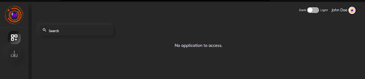

Getting Started - End User
--------------------------

This section will be helpful for the users who are using the Instasafe Zero
Trust platform for the first time to access an application, and want to learn
their way around the platform. 

### Downloading the InstaSafe Agent
	
Head to the <companyname>.app.instasafe.io and login with the username and password. Your username and password will be provided by your IT administrator.
Once logged in with the credentials, You will be presented with the following screen

Navigate to the download icon (second icon) on the menu to the left. Download the agent for your operating system. Install the agent and login. 
All the applications that you have access to will be shown on the screen

	
Clicking on any application will launch it within the agent.

Third party applications can be accessed through the web portal by logging to the portal as well. The would become a agentless mode of access and it should be configutred at the admin UI.
