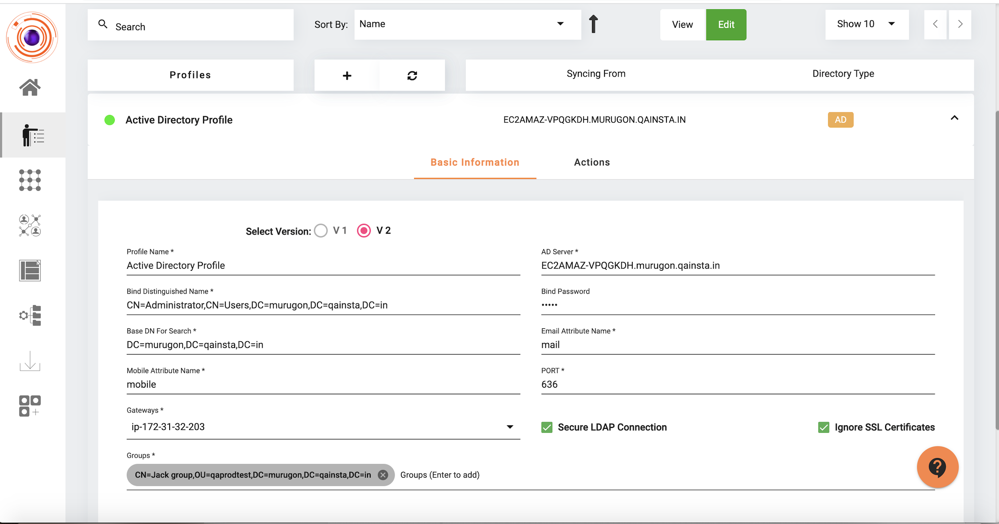
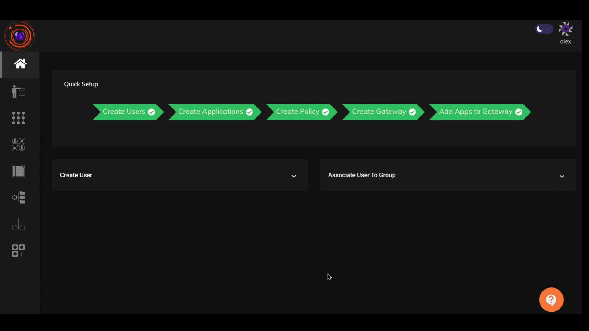
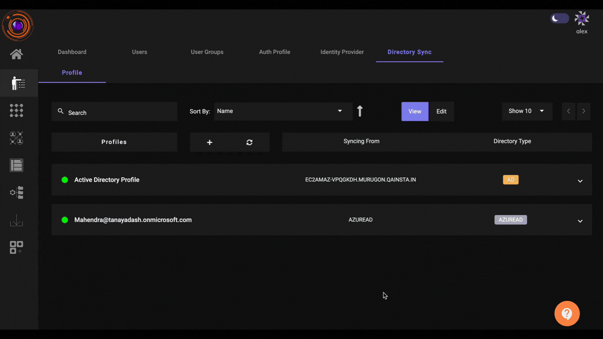
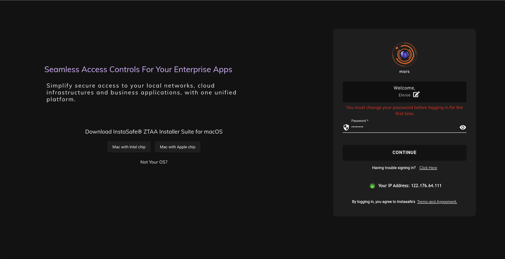

Many organization's do not have any tool that would facilitate users to reset their Active Directory (AD) password by themselves. In such cases, users reach out to their organization's IT Team for assistance. This overhead is addressed by providing the AD users a Self-Service Password Reset feature in ZTAA itself.

In case the user has forgotten their password or their password has expired, they can use this feature to submit a new password. The new password will be updated in the AD server itself, and it can be used for ZTAA logins as well.

Admins can also enforce new users to reset their Active Directory password from the ZTAA platform by selecting the 'User must change password at next login' option in the Active Directory.

### Security

Since password reset functionality needs to be provided before login (as user has forgotten password and cannot login) it will be available over an unauthenticated session. To prevent malicious entities from using this feature to modify a user’s password, the user must authenticate himself through MFA before being able to use this feature. 
Administrators can select any or all of the below options through which they would like to have the password reset functionality enabled.

-	Send Reset Password link through Email

-	Send Reset Password link through SMS

-	Verify Through TOTP

### Prerequisites to enable the feature in ZTAA

1.	Password modification operations are permitted only over LDAPS connections, so a Secure LDAP Connection is required to the Active Directory.
2.	TCP gateway version 4.4.18 or higher.
3.	The ‘Reset password option is Enabled’ toggle needs to be enabled by the Administrator in the ZTAA Admin console under My Profile -> Organisation

### Modifications in the Active Directory Sync profile to support password reset

The tenant admin needs to update the directory sync profile created for importing AD users to support the password reset feature as shown in the above screen. There are a few fields which will affect the working of the password reset feature which is shared as follows:

AD Server: This is the host URL for the AD server. It can be either the Fully Qualified Domain Name (FQDN) format, or in IP address format. If user wants to use IP address, the tenant admin must make sure that the IP address is added to the SSL certificate as a Subject Alternative Name (SAN) otherwise the connection will fail for password reset due to a certificate error (see Ignore SSL Certificates for more).

Port: This is the port where LDAP for AD is configured. By default 389 is used for LDAP and 636 for LDAPS.

Secure LDAP Connection: The password update operations are permitted only over LDAPS connections, so Secure LDAP Connection is required to be selected for the password reset feature.

Bind DN & Bind PW: Password modify operations can be done only after a successful bind request in the connection. We use the admin credentials provided in Bind DN & Bind PW to make this bind while connecting to the server, so the information provided should be accurate.

Base DN For Search: This is required for obtaining the distinguished name of the user from username.

Mobile & Email Attribute Names: These fields are required to be present in the AD server for users to be synced to ZTAA. The values in these are used for MFA for password reset.

Gateways: TCP gateways are required for communication with the AD server. For the password reset feature, TCP gateway 4.4.18 and above is needed.

Ignore SSL Certificates: If this is selected, the feature can work despite certificate errors (eg.- certificate expired, certificate invalid, IP not registered as SAN).

The below video shows the flow of the Self Service AD Password reset with the reset link sent over Email.

The below video shows the flow of the Self Service AD Password reset with TOTP.

The below image shows the prompt received by users in the ZTAA platform, if Admin has selected the 'User must change password at next login' option in the Active Directory. Users will have to proceed to reset their Active Directory password before they can login to the ZTAA platform.

