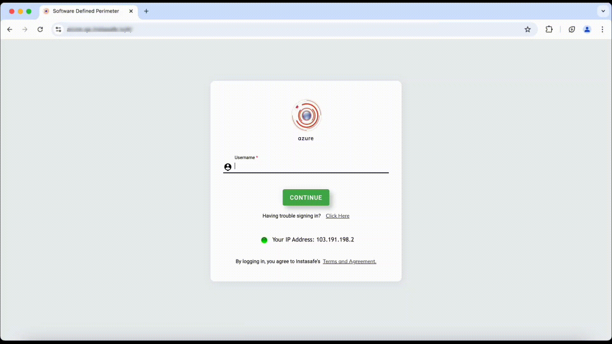
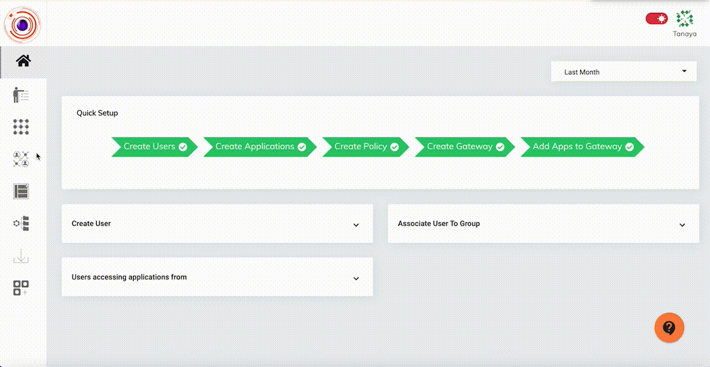

In today’s increasingly interconnected world, secure and efficient remote access to applications is crucial for maintaining productivity and operational efficiency. The InstaSafe Zero Trust platform provides agentless access to Web, RDP and SSH applications through a secure gateway. The solution offers a powerful combination of ease of use and secure method for managing and accessing your IT infrastructure without the need for complex installations or configurations.

### Key Features

**Agentless Connectivity:** No software installation is required in end user machine. Access your systems directly via RDP and SSH without needing to install any agents on remote machines.

**Secure Gateway:** All connections are routed through a secure gateway that enforces stringent authentication and authorization policies.

**Multi-Factor Authentication (MFA):** Ensure that only authorized users gain access with multi-factor authentication, adding an extra level of protection to sensitive systems.

**Granular Access Controls:** Define access policies to configure which users should have access to which RDP & SSH resources.

The below video illustrates the agentless access of RDP and SSH applications over the InstaSafe Zero Trust platform with Multi-Factor Authentication (MFA).

**Comprehensive Audit Trails:** The InstaSafe Zero Trust solution has the capability to record the RDP & SSH application access sessions of each user for audit and monitoring purposes.

The below video illustrates the RDP & SSH application access sessions of the users which are available in Audits.

