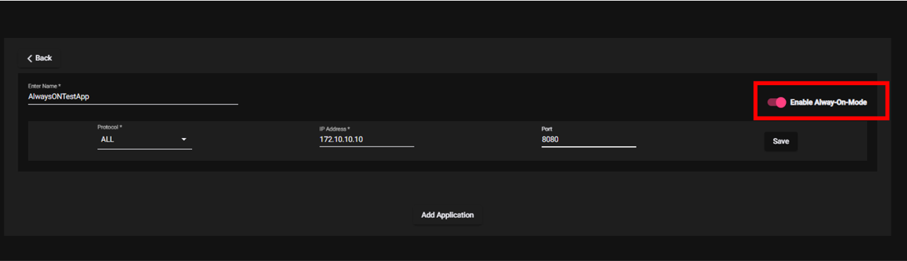
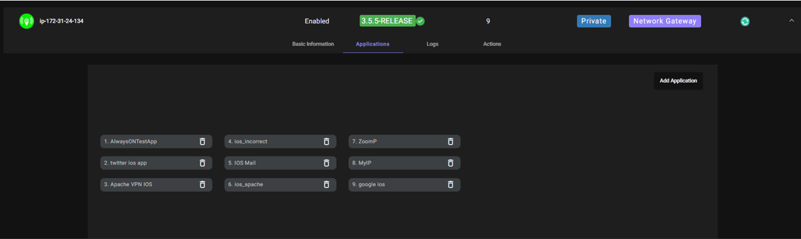
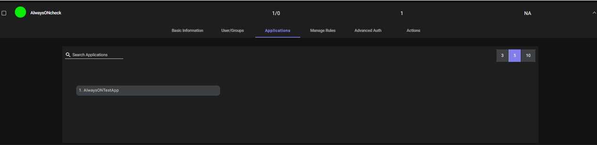

With Always ON enabled the VPN tunnel is established with the configured network applications as soon as the user switches on his/her's PC. There is no need to log in to the ZTAA client to have the VPN tunnel established. By enabling ZTAA's Always ON functionality, organizations can keep all digital assets fully protected and provide secure access for remote workers across all  devices. 

`Please note: Always ON feature is applicable only for network applications`

Below are the steps for enabling Always ON feature for an application:

1. [Create an Network application](https://docs.instasafe.io/Zero%20Trust%20Application%20Access/005-creatingapplication/#for-network-application).
2. Enable the "Always ON" toggle button.

3. [Add the application to relevant gateway](https://docs.instasafe.io/Zero%20Trust%20Application%20Access/006b-addapptogateway/).

4. [Create an Access Policy](https://docs.instasafe.io/Zero%20Trust%20Application%20Access/007-accesscontrol/) allowing user access to the application.

