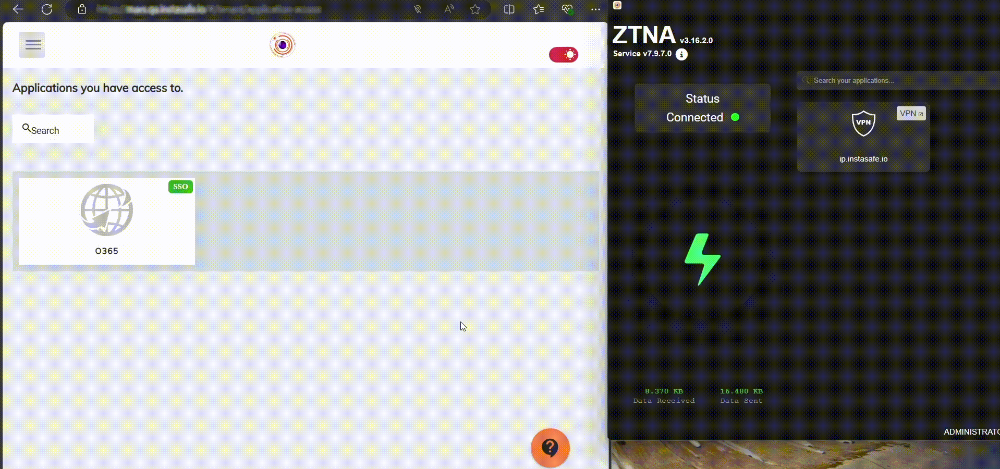
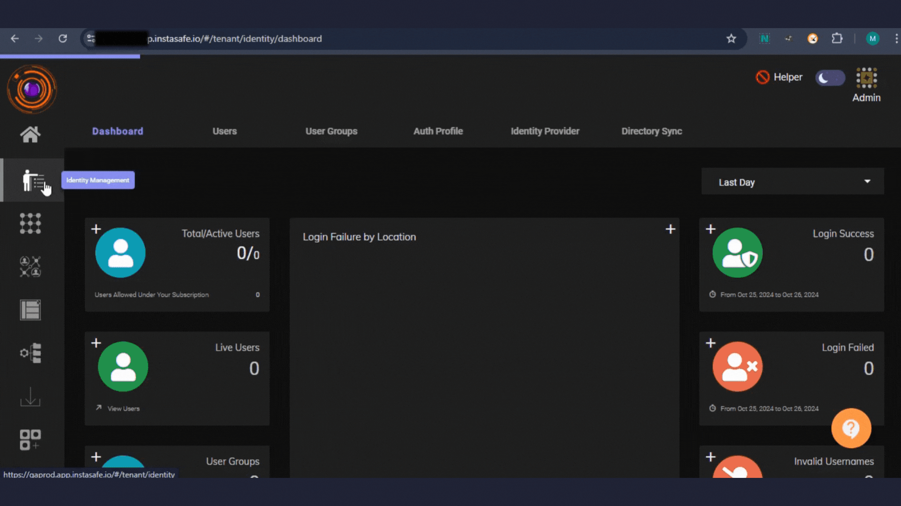

The problem statement from a financial institution was that they wanted to restrict the access of Microsoft Office 365 suite of applications only from approved devices which are compliant with organizational policies and from specific geographic locations to reduce the risk of unauthorized access and data breaches.

###Agent based contextual access

The InstaSafe Zero Trust platform offers the capability to integrate with [Microsoft O365 and any web application which supports SAML and acts as an Identity Provider](https://docs.instasafe.com/Zero%20Trust%20Application%20Access/saml-single-sign-on/). The access to the Microsoft Office 365 suite of applications is granted only after the user connects to the InstaSafe agent. 

The InstaSafe agent performs the following contextual access checks:

[Device Binding check](https://docs.instasafe.io/Zero%20Trust%20Application%20Access/devicebinding/): validates that the application access request is from a known device which is approved.

[Device Compliance check](https://docs.instasafe.com/Zero%20Trust%20Application%20Access/deviceposture/): validates that the device posture is compliant with organizational policies.

[Gelocation check](https://docs.instasafe.com/Zero%20Trust%20Application%20Access/geolocationbasedaccess/): validates that the user request is from a known geographical location.

If the above contextual access checks are successful then the InstaSafe agent gets connected and the user can access Microsoft Office 365 suite of applications.

Please refer to the below video for an illustration on contextual access to Microsoft Office 365 suite of applications only after the user is successfully connected to the InstaSafe agent.

- as illustrated in the video, if the user disconnects from the InstaSafe agent then he/she loses access to the Office 365 applications from the web portal.

- if the user is not connected to the InstaSafe agent and tries to access the Office 365 applications by directly trying the url then access is forbidden.

- only after the user connects to the InstaSafe agent, he/she will be able to access the Office 365 applications.

###Agentless contextual access

The InstaSafe Zero Trust platform acting as an Identity Provider for Microsoft Office 365 suite of applications and any SAML supported applications can also provide conditional access based on the below parameters without requiring an agent to be installed in the end user device.

**System Serial Number:** Access to Microsoft Office 365 suite of applications and any SAML supported applications can be restricted from devices with known System Serial Numbers.

**IP Address:** Organizations can create trusted IP address ranges and access can be granted to requests originating from those IP addresses.

**Geolocation:** Organizations can define specific countries or city from which access needs to be provided.

As illustrated in the below video, user is able to access Microsoft Office 365 suite of applications only from a device with a known System Serial Number. If the user tries to access from a device whose System Serial Number is not recorded in the InstaSafe platform then access is not granted.

**Note:** The number of device posture checks available on a agent based access is more compared to an agentless access.

