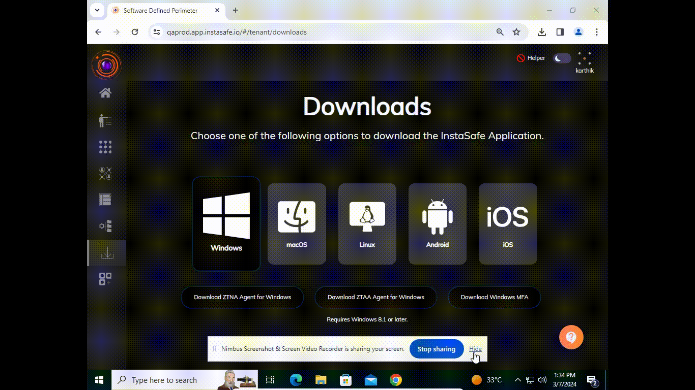
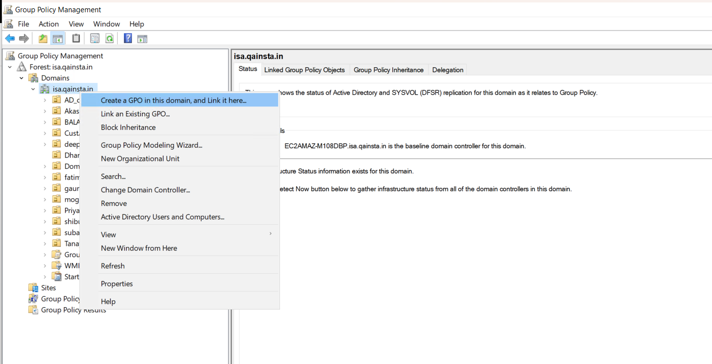
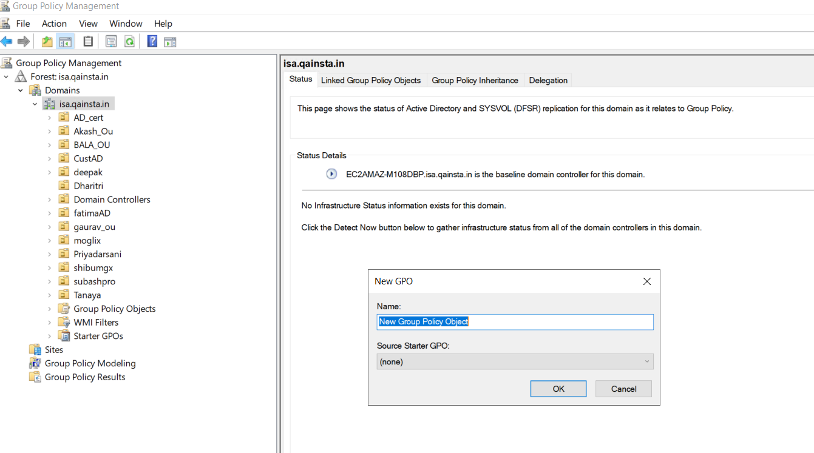
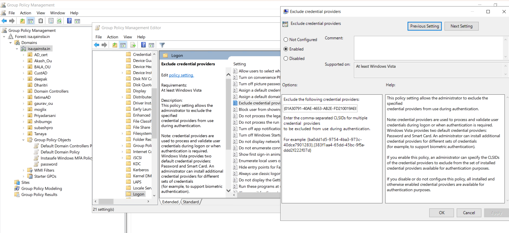
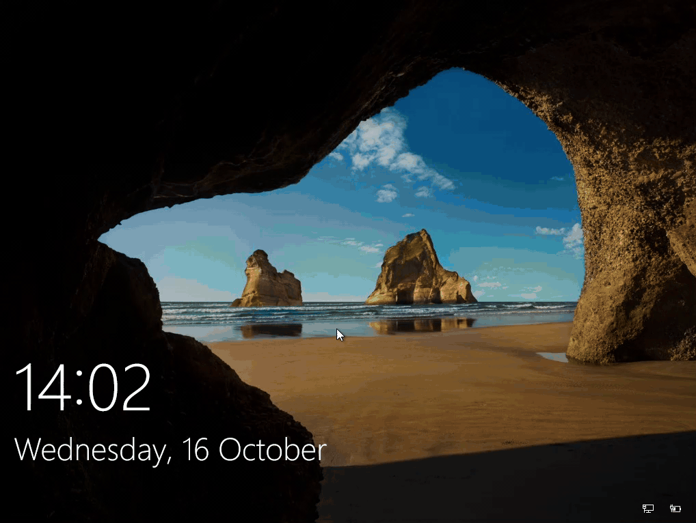
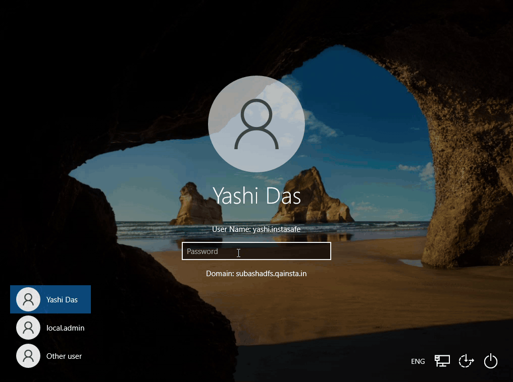

The InstaSafe Windows MFA feature is essentially a plugin that implements multi-factor authentication (MFA) as part of the Windows login, thereby providing an improved security posture. With the InstaSafe Windows MFA installed, users will be prompted to provide a secondary factor of authentication along with the password while doing a login to their Windows system. This approach adds an additional layer of security beyond just a username and password, making it significantly harder for unauthorized users to gain access.

Users will be provided with the InstaSafe logo in the Windows login screen. When a user selects the login method via Instasafe then the authentication request (for UserName and Password) is sent to the ZTAA authentication server for verification. Domain joined users, provisioned in ZTAA via Active Directory/LDAP would then be authenticated by the corporate IAM configured for the tenant, while local users provisioned in ZTAA would be authenticated by the ZTAA authentication server itself.

The InstaSafe Windows MFA utility will prompt the user to perform the secondary authentication with the below two options:
- authenticate with OTP sent over Email and SMS.
- authenticate with the 6 digit TOTP from the configured Authenticator app.

**Note:** It is highly recommended that users configure their ZTAA profile with a third party authenticator app or with the InstaSafe Authenticator app to perform the secondary authentication while login to their Windows system. In case there is a delay in receiving the OTP from the SMS provider or if user do not have an internet connection then they can use the TOTP from the authenticator app to login to their windows machine.

Similar MFA plugin is also available for **Ubuntu** and **Red Hat Enterprise Linux** to perform secondary authentication during the login process.
The MFA plugin for macOS is in Beta Release.

##Support for Windows MFA without internet connection

Users can login to their Windows system through the InstaSafe MFA utlitiy even when they do not have an active internet connection. For the MFA, users should have had their InstaSafe profile configured with an Authenticator app.

Prerequisites for Windows MFA without internet connection:

1. Authenticator App set up: Users must set up an authenticator app with their Instasafe profile. Users can use Instasafe Authenticator, Google Authenticator, Microsoft Authenticator, etc.

2. One Time Login to ZTNA agent: Users should log in once to the ZTNA Agent and click the Connect button.

3. MFA Installation: InstaSafe Windows MFA agent must be installed on the user's system.

Please refer to the below video on how the InstaSafe Windows MFA feature can be installed and configured.

**By default, the InstaSafe Windows MFA is optional while doing a login to the Windows system.** 

Admins can exclude other credential providers from the Windows login screen so that InstaSafe Windows MFA is the only available sign-in method for users.

**To exclude other Windows credential providers, the following steps needs to be performed:**

1. In Windows Explorer, open the **Local Group Policy Edito**r.

2. Navigate to **Computer Configuration > Administrative Templates > System > Logon**.

3. Right-click the **Exclude credential providers** setting and select **Edit**.

4. Select **Enabled**.

5. In the **Exclude the following credential providers** field, enter the comma-separated Class IDs (CLSIDs) for excluding multiple credential providers during authentication. Do not include the Class ID (CLSID) of InstaSafe Windows MFA (InstaSafeCredentialProvider).

6. Select **OK** to save changes.

7. Execute **gpupdate** to enforce the policy change immediately.

###**Default credential providers in Windows**

Listed below are the default credential providers available in Windows and their associated class IDs (CLSIDs).

**Note**: The InstaSafe Windows MFA (InstaSafeCredentialProvider) has a Class ID (CLSID): {FCEFDFAB-B0A1-4C4D-8B2B-4FF4E0A3D978}

| Credential Provider | Class ID (CLSID) |
|---------------------|------------------|
| Automatic Redeployment Credential Provider | {01A30791-40AE-4653-AB2E-FD210019AE88} |
| Smartcard Reader Selection Provider |{1b283861-754f-4022-ad47-a5eaaa618894} |
| Smartcard WinRT Provider | {1ee7337f-85ac-45e2-a23c-37c753209769} |
| PicturePasswordLogonProvider | {2135f72a-90b5-4ed3-a7f1-8bb705ac276a} |
| GenericProvider | {01A30791-40AE-4653-AB2E-FD210019AE88} |
| TrustedSignal Credential Provider | {27FBDB57-B613-4AF2-9D7E-4FA7A66C21AD} |
| NPProvider | {3dd6bec0-8193-4ffe-ae25-e08e39ea4063} |
| Secondary Authentication Factor Credential Provider | {48B4E58D-2791-456C-9091-D524C6C706F2} |
| CngCredUICredentialProvider | {600e7adb-da3e-41a4-9225-3c0399e88c0c} |
| PasswordProvider | {60b78e88-ead8-445c-9cfd-0b87f74ea6cd} |
| FaceCredentialProvider | {8AF662BF-65A0-4D0A-A540-A338A999D36F} |
| Smartcard Credential Provider | {8FD7E19C-3BF7-489B-A72C-846AB3678C96} |
| Smartcard Pin Provider | {94596c7e-3744-41ce-893e-bbf09122f76a} |
| WinBio Credential Provider | {BEC09223-B018-416D-A0AC-523971B639F5} |
| Cloud Experience Credential Provider | {C5D7540A-CD51-453B-B22B-05305BA03F07} |
| PINLogonProvider | {cb82ea12-9f71-446d-89e1-8d0924e1256e} |
| NGC Credential Provider | {D6886603-9D2F-4EB2-B667-1971041FA96B} |
| CertCredProvider | {e74e57b0-6c6d-44d5-9cda-fb2df5ed7435} |
| WLIDCredentialProvider | {F8A0B131-5F68-486c-8040-7E8FC3C85BB6} |
| FIDO Credential Provider | {F8A1793B-7873-4046-B2A7-1F318747F427} |
| Automatic Redeployment Credential Provider | {01A30791-40AE-4653-AB2E-FD210019AE88} |
| IrisCredentialProvider | {C885AA15-1764-4293-B82A-0586ADD46B35} |

###**Block Windows Default Credential Providers via Active Directory Group Policy**

Active Directory Group Policy can be used to block Windows default credential providers to ensure that only InstaSafe Windows MFA for Windows logon is available for authentication.

Inspect the subkeys of the following registry key to verify the available credential providers:

[HKLM\SOFTWARE\Microsoft\Windows\CurrentVersion\Authentication\Credential Providers]

**Follow the below steps to block credential providers with Group Policy:**

1. On the domain controller, start **Group Policy Management** by entering gpmc.msc in a command prompt.

2. To create a new Group Policy Object:
   - Select the domain or organizational unit for which you want to set a Group Policy in the Group Policy management tree.

   - Select **Create a GPO in this domain, and Link it here...** from the context menu.

   - Enter a name for the new Group Policy Object.

3. Select the relevant Group Policy Object in the tree.
 
   - Ensure the Group Policy Object is associated with the domain, site or organizational unit whose users will be affected by the policy.

4. Select **Edit...** from the context menu.

5. Navigate to **Computer Configuration > Policies > Administrative Templates > System > Logon** in the Group Policy Object tree and select **Exclude credential providers:** to edit the settings:

   - Select **Enabled** to enable the policy setting.

   - Enter the CLSIDs for any additional credential provider you want to exclude in the **Exclude the following credential providers** 
     field. To specify more than one credential provider, use a comma-separated list.

   - Click **OK**.

   - Close Group Policy Object Editor when you have finished configuring the Group Policy Object.

**Important considerations:**

1. If there are any issues in login to Windows with the InstaSafe Windows MFA, the above created Group Policy can be disabled to make InstaSafe Windows MFA optional and restore the other default Windows Credential Providers.

2. The InstaSafe Windows MFA should not be uninstalled from the workstations while the above created Group Policy is enabled. Otherwise, the specified credential providers remain excluded, which might leave users unable to authenticate and log on to their workstations.

The below video illustrates the login to Windows with the InstaSafe Windows MFA made mandatory. The MFA mode chosen is OTP.

The below video illustrates the login to Windows with the InstaSafe Windows MFA made mandatory. The MFA mode chosen is TOTP.

