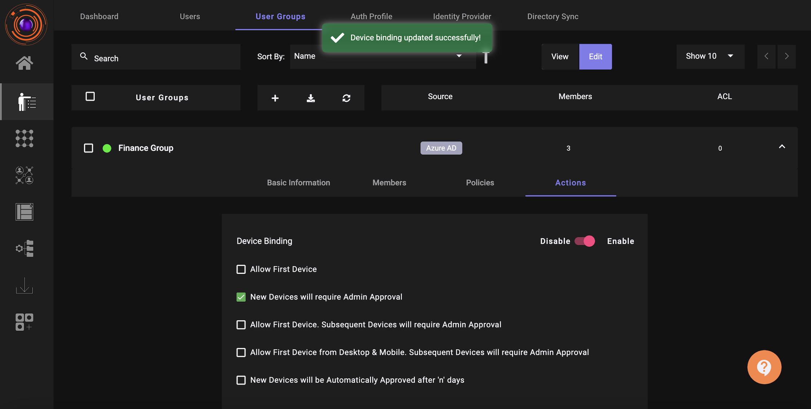
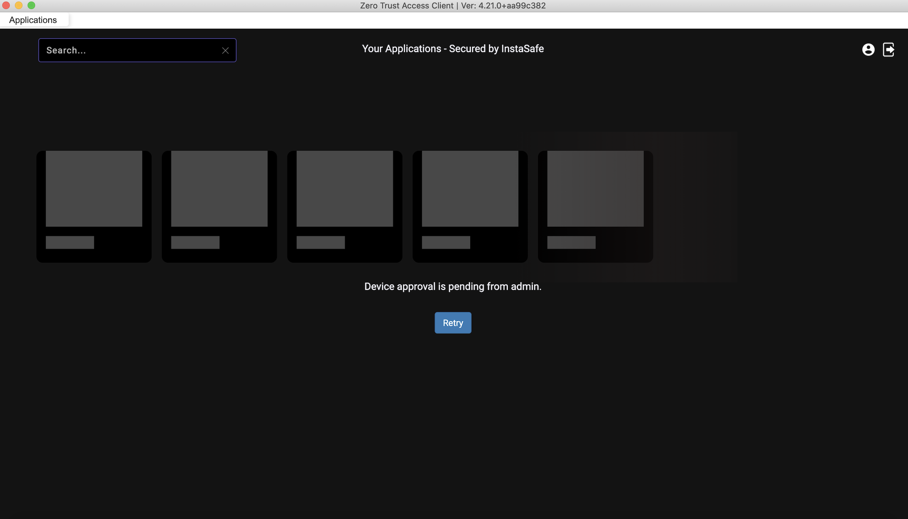
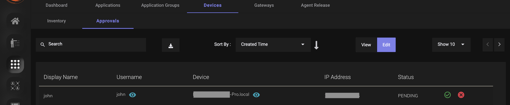
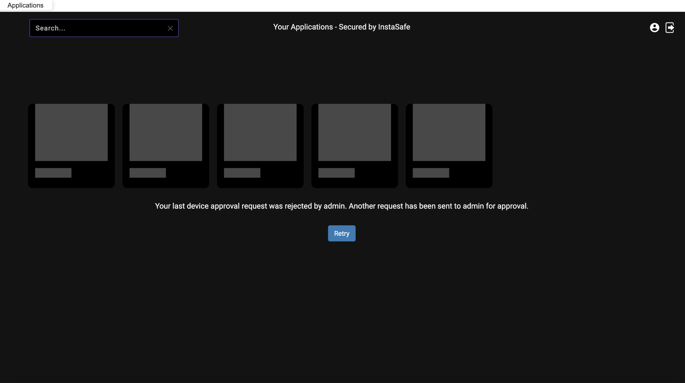
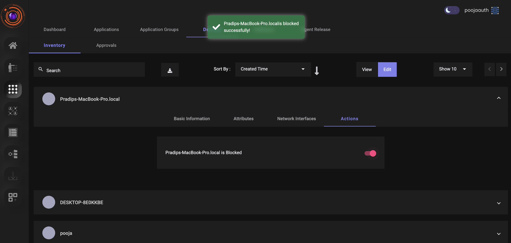
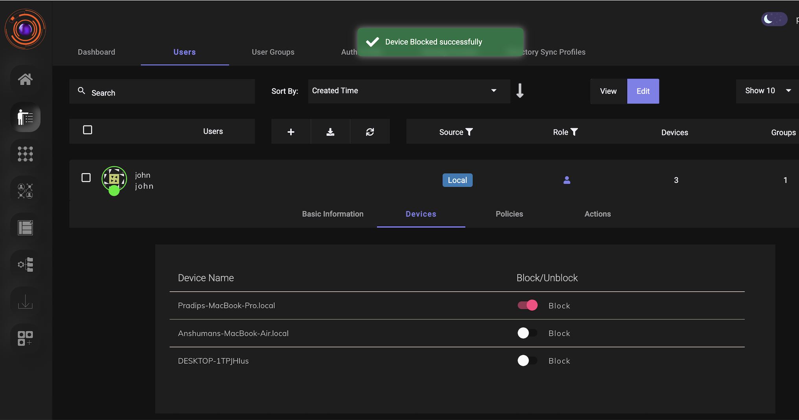
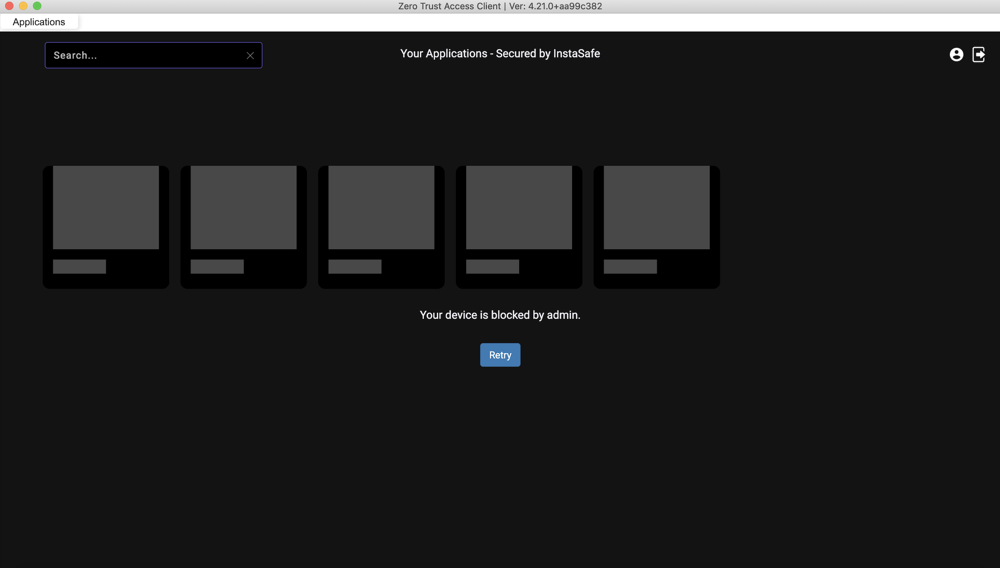

Device authorization is a feature that allows administrators to review and approve or reject new devices before they can access enterprise applications from the ZTAA agent. This will ensure that only trusted devices upon approval by the administrator, can access enterprise applications from the ZTAA agent.

**Enable device authorization for your organization** 

The device authorization feature can be enabled from the ZTAA console by an Admin. ZTAA provides multiple options to the Admins for the device authorization rule implementation.

Rules available in ZTAA for device authorization implementations:

- Allow First Device

- New Devices will require Admin Approval

- Allow First Device. Subsequent Devices will require Admin Approval

- New Devices will be Automatically Approved after 'n' days

To enable device authorization, ZTAA administrator will have to perform the below steps.

1. Navigate to Identity Management.
2. Click on User Groups.
3. Select a “User Group” for which you want to enable device authorization.
4. Click on “Edit”.
5. Navigate to the “Actions” tab and drag the toggle to “Enable” for Device Binding.
6. Click on the checkbox for the Device Authorization rule which you would like to be enforced.

**Authorize devices from the ZTAA console** 

Once Device Binding is enabled for a User Group, depending on the device authorization rule set, users when they try to access the ZTAA agent from their device will see a notification that their device is awaiting approval from Admin. Devices awaiting approval cannot access enterprise applications until they are authorized by the Admin.

Devices awaiting approval by the Admin can be viewed in the ZTAA console.

1. Navigate to Perimeter Management.
2. Click on “Devices” in the horizontal menu bar.
3. Click on the “Approvals” tab.
4. Click on Edit.
5. Select “Approve” or “Reject” for the devices awaiting approval.

If the device is approved by the admin then users can access the applications from the ZTAA agent. If the device is rejected by the Admin then users will get a message that their request was rejected by the Admin when they login to the ZTAA agent.

The details of all the devices which try to login to the ZTAA agent are captured and are available to the Admin for review in the console. Admin have the option to block any device.

Admins can also view the details of all the devices which are used by each user to login to the ZTAA agent. Admin can block or unblock any device for any particular user.

Once the device is blocked, users will get a notification that their device is blocked by admin when they try to login to the agent.

