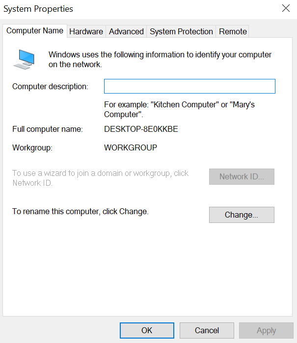
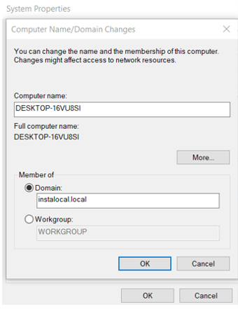
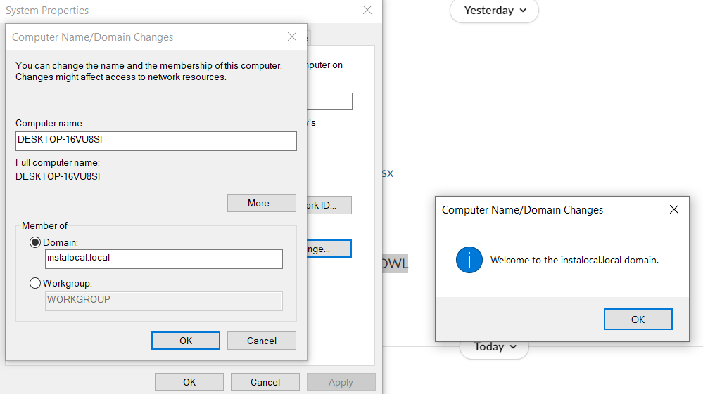
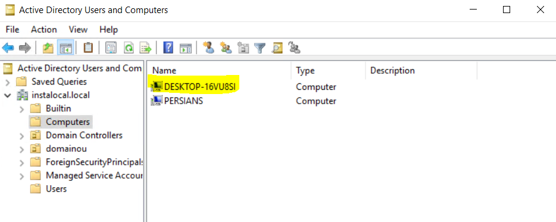
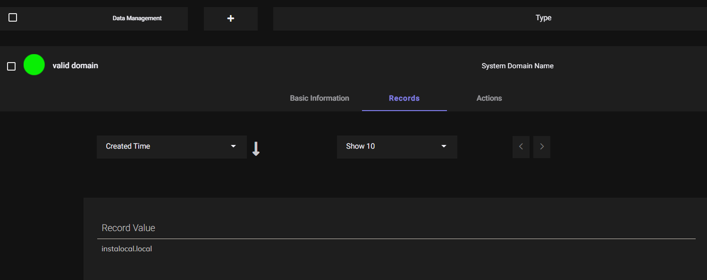
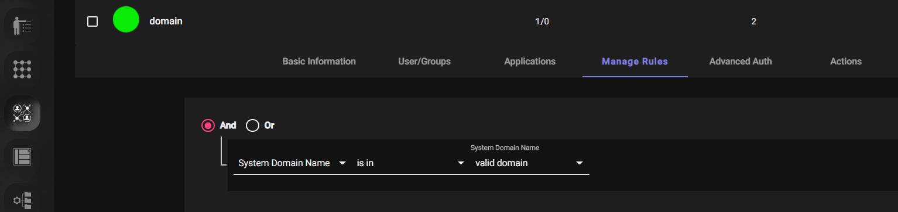
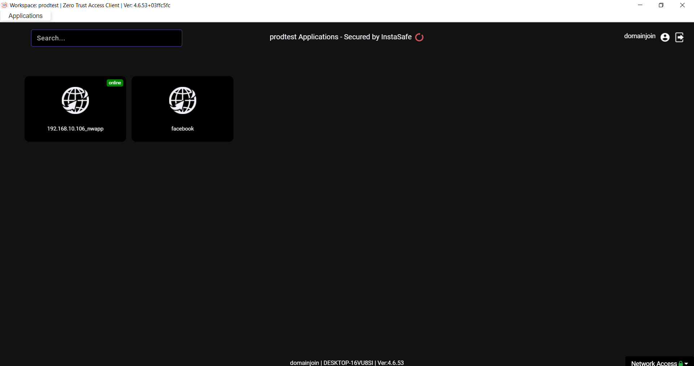
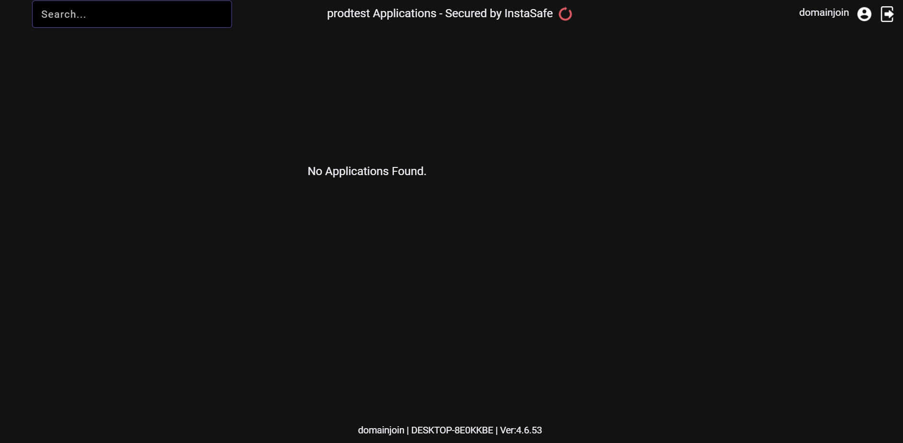

#### DOMAIN JOINING 

Workforce today, is becoming increasingly mobile and dynamic. They expect that the individuals should not be confined to an office and should have the freedom and ability to work remotely.Over the years, IT Admins have relied on directory services like AD (Active Directory) to make
the workforce compliant to the company policies. However, in today’s scenario, it becomes very difficult to make the remote workers comply with the policy, as the directory services can only be implemented on On-Premise users. InstaSafe ZTAA empowers the IT teams to make the remote devices join the corporate domain, so they can then easily push policies using AD(Active Directory). 

**Prerequisites-**

1. [TCP Gateway should be added](006-creatinggateways.md) and [Directory Sync Profile](008-importADusers.md) should be added and then synced.

2. [Network Gateway](006-creatinggateways.md) (Version 3.6.2+ ) should be added in console.

3. Domain joining is not available for devices with Windows HOME Edition installed.

**Steps to Configure**

1. Login to ZTAA console as an admin

2. Create a  [Network application](https://docs.instasafe.io/Zero%20Trust%20Application%20Access/005-creatingapplication/#for-network-application) with the domain of AD-Server(eg. instalocal.local).

3. Select protocol as ALL.Give IP adress field as AD-Server Private IP .Allow Port over which you want the connection to be establised. If unsure you can choose to allow all ports (1-65535 as open.)

4. After creation of the application Add it into the network gateway and change the DNS server value of gateway to  ADServer private IP.If the DNS server value is not set as that of the AD server IP then after the VPN tunnel is established, the DNS resolution would be incorrect.

5. Add the Network application into an ACL which is associated with your user. 

**Connect User to Domain**

1. Go to control panel >> system security >> system

2. Click on Advance Setting >> click computer name

3. Click on change button of rename computer

4. Click on the member of select domain instead of the workgroup and give domain name as Your ADServer domain name(instalocal.local) >> click on ok

5. Provide the domain administrator credentials in the following format: domain\ad_username ( instalocal\administrator) and password. 

On Successful Configuration a Welcome Popup message will be displayed.

**Verify Successful Connection**

1. Login into the AD Server. 
2. In case of successful domain joining the user device will be visible in the ADServer.

#### Creating ACL rules based on system Domain 

1. [Create a Dataset](https://docs.instasafe.io/Zero%20Trust%20Application%20Access/019-datamanagement/) with System Domain Name as Datatype and value as domain name to which the system is to be joined.

2. [Create an ACL](https://docs.instasafe.io/Zero%20Trust%20Application%20Access/007-accesscontrol/) with rule **System Domain Name  isin   valid domain**.

3. Now only the configured application will be visible to the user if his/her system is joined to the required domain.

 DOMAIN JOINED SYSTEM

SYSTEM WHICH ARE NOT JOINED WITH DOMAIN

