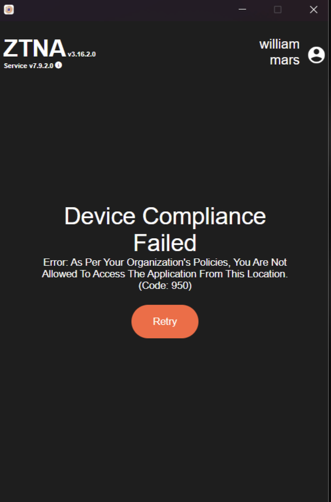

Geolocation-based access in Zero Trust Architecture (ZTA) refers to a security approach where access to resources is determined not just by a user’s identity or device status, but also by their geographic location. This adds an additional layer of security by considering the physical location of the user or device attempting to access resources.

**Benefits**

*Enhanced Security*: Limits access based on physical location, reducing the risk of unauthorized access from unfamiliar locations.

*Contextual Access Control*: Combines geographic context with other factors (such as user identity and device posture check) to make more informed access decisions.

When end users try to connect to the ZTNA agent outside of the defined locations then they will be presented with the below message.

