One of our customers requested the ability to skip password-based (primary) authentication on BYOD devices to reduce the risk of keylogging attacks introduced by potential malware infections on unmanaged endpoints.

To address this, InstaSafe integrated with XDR platform used by the customer (CrowdStrike Falcon) to retrieve system serial numbers. This allowed us to accurately differentiate between Enterprise-Managed Assets and BYOD devices.
By leveraging this telemetry received from the XDR, ZTAA was able to:

1. Identify and differentiate BYOD devices from Enterprise-Managed Assets.

2. Restrict access and enforce passwordless login flows.

3. Prevent password entry on potentially compromised personal devices.

This solution significantly enhanced the customer’s security posture by reducing the risk of credential theft, while aligning with Zero Trust principles and maintaining a seamless user experience.

### What is CrowdStrike

CrowdStrike is a cybersecurity company known for its cloud-native endpoint protection platform called CrowdStrike Falcon. It’s widely used by organizations to detect, prevent, and respond to cyber threats in real time.

### What is XDR (Extended Detection And Response)

XDR (Extended Detection and Response) is an advanced security solution that collects and correlates data across multiple security layers—including endpoints, networks, servers, emails, and cloud workloads—to detect, investigate, and respond to threats more effectively.

### Integration with ZTNA

The integration between CrowdStrike Falcon and InstaSafe was designed to:

- Differentiate between enterprise-owned and BYOD (Bring Your Own Device) endpoints by using system-level identifiers such as serial numbers.

- Eliminate the need for password entry on BYOD devices, which are more susceptible to keylogging attacks and other malware-based credential theft.

- Strengthen Zero Trust enforcement by verifying not only users but also their devices before allowing access to protected applications or data.

This enables organizations to adopt a device-aware access model that reduces the risk associated with unmanaged, personal, or compromised endpoints accessing corporate resources.

### Configuration Steps for CrowdStrike XDR Integration with Instasafe

1. Login and navigate to Integrations

   - Log in as Admin to the ZTAA Console.
 
 
    - Go to Configuration.

 
    - Under Configuration, click on Integrations.
 
 
    - Click on Add New Integration Profile.

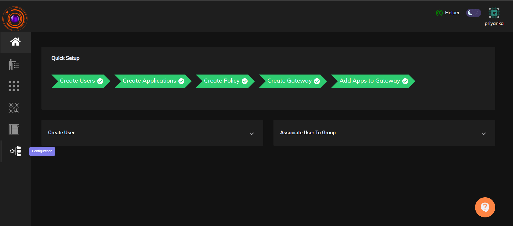

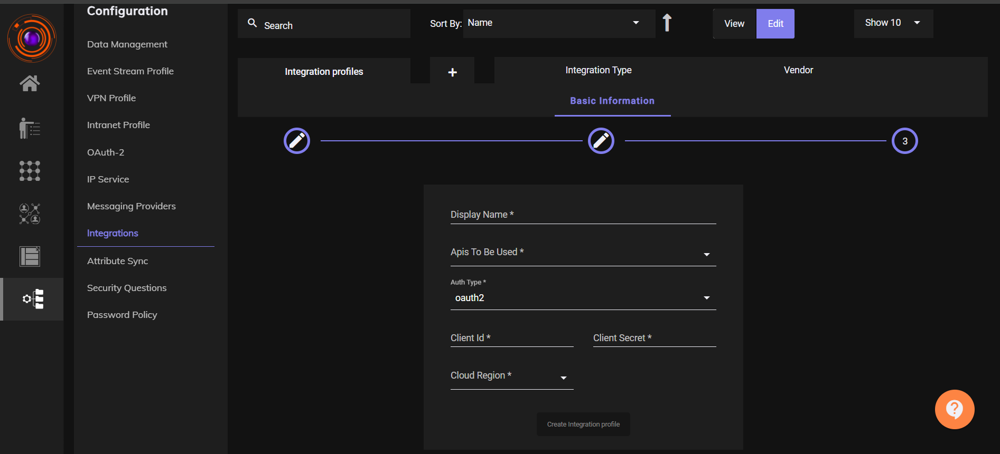

### Create Integration Profile

    - Fill in the Basic Information:

        - Integration Type: Select XDR,then Click Next.

        - Vendor: Select CrowdStrike.

    - Provide the following details:

        - Display Name: Choose a custom name for your integration.

        - APIs to be used: Select - devices/entities/devices/v2.

        - Auth Type: Select OAuth2.

 
        - Client ID and Client Secret: Enter the credentials. These two fields will be shared by Crowdstrike admin. 

        - Cloud Region: Choose the appropriate cloud region (e.g., US, EU, etc.).

    - Click Create Integration Profile.

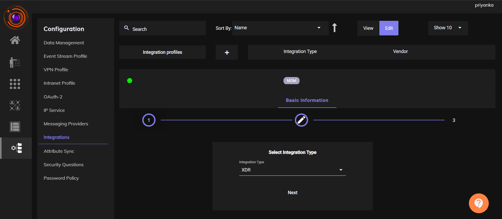

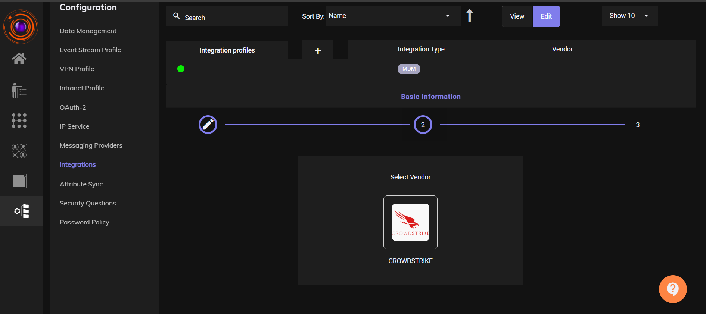

### Create a Dataset

      - Navigate to Configuration → Data Management.
 
      - Click on Create New Dataset.
 
      - Provide a dataset name and select System Serial Number

      - Click Create Dataset. Dataset created successfully message appears.

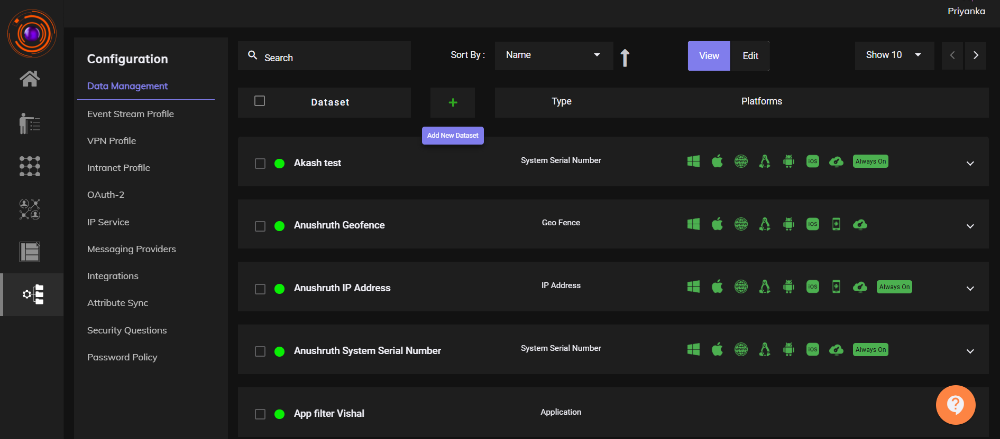

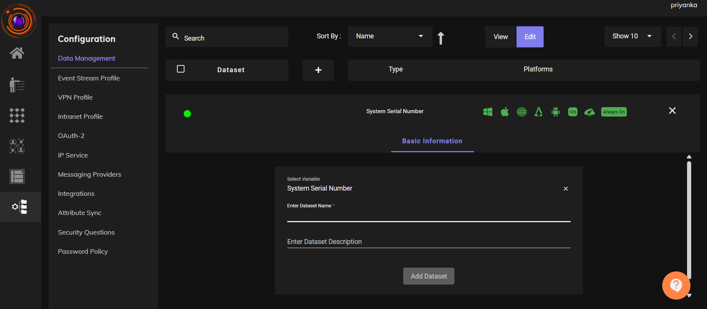

### Configure Attribute Sync

    - Go to Configuration → Attribute Sync.
    
    - Click on (+) Add Attribute Sync Profile 

    - Fill in the following details:

        - Display Name: Choose a name.

        - Integration Profile: Select the integration profile you just created.

        - Dataset: Select the dataset you want to associate with.

        - API to Use: Select the appropriate API.

    - Click on Add Profile.
    
    - Click on the Sync button.

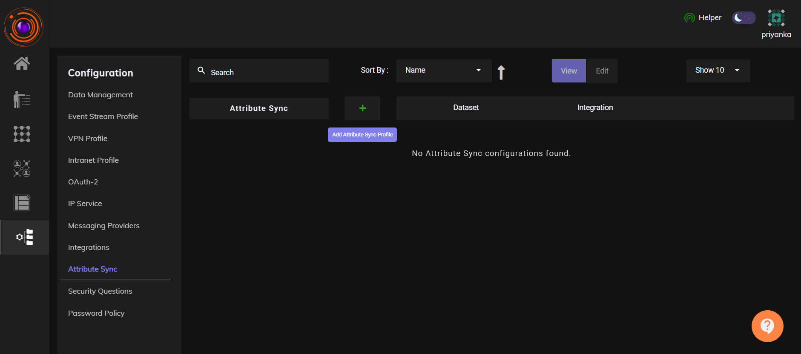

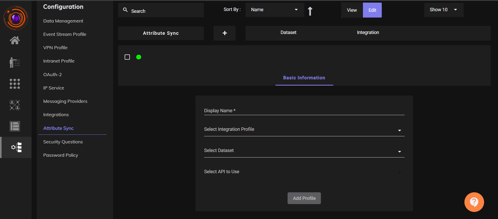

### Audit Logs

    - Go to Audit → Events.

    - Click on Select Events and choose Device Attribute Sync.

    - A record showing the number of devices added and removed, along with their parameters, will be displayed.

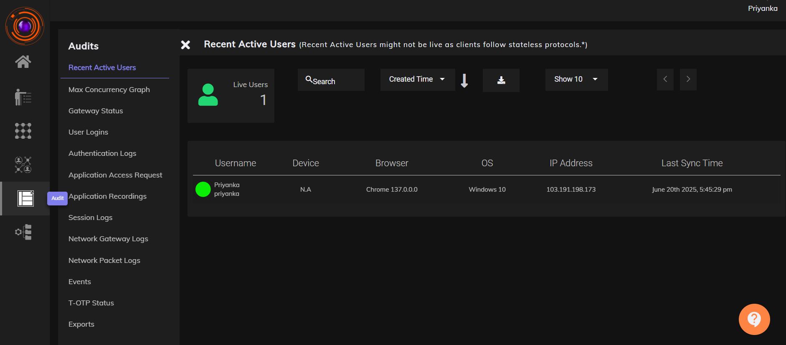

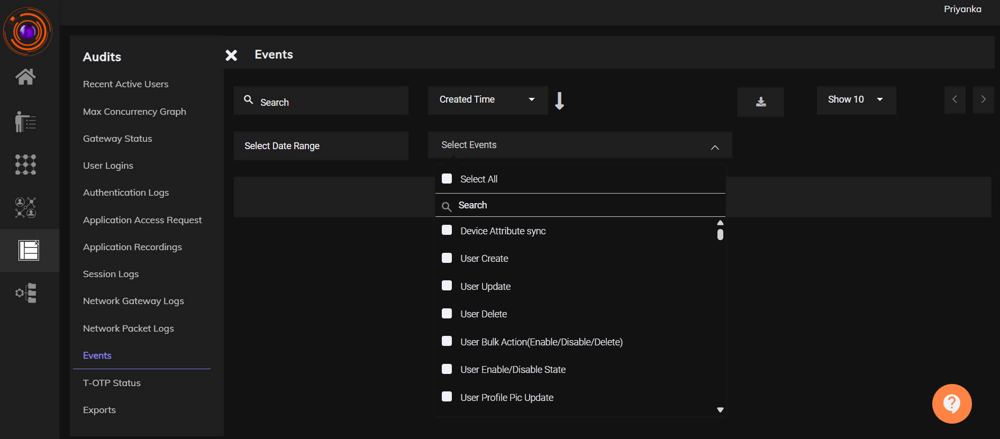

### Verify with Dataset

    - Go to Configuration → Data Management.

    - Locate the dataset you created and click on it.
 
    - Under the Records section, you will see the record values that were added.

    - Check the records of the System Serial Number dataset - All the records should be auto synced to this data set.

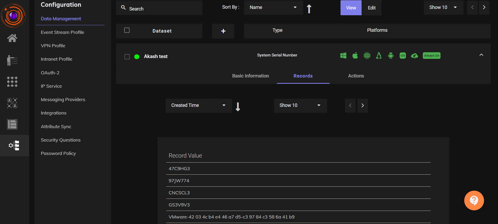

