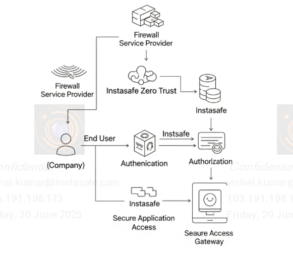
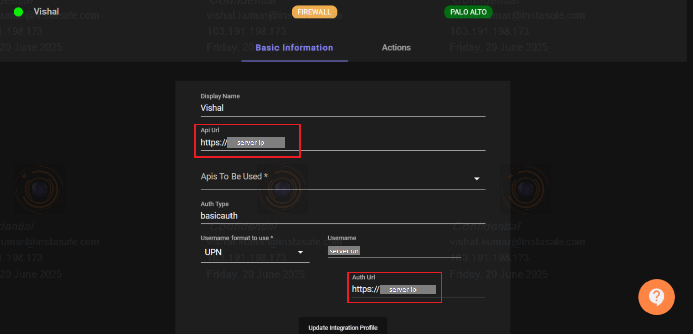
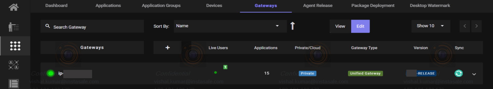
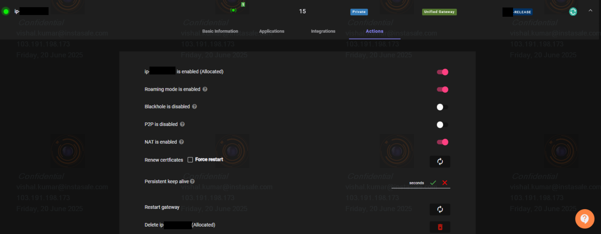
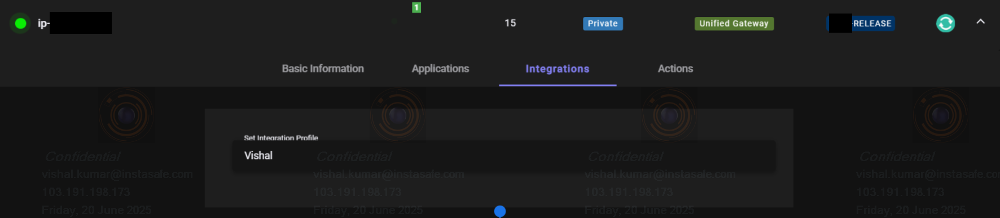
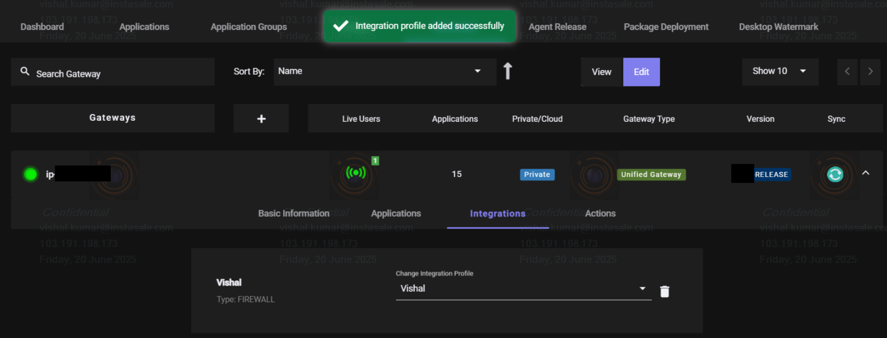
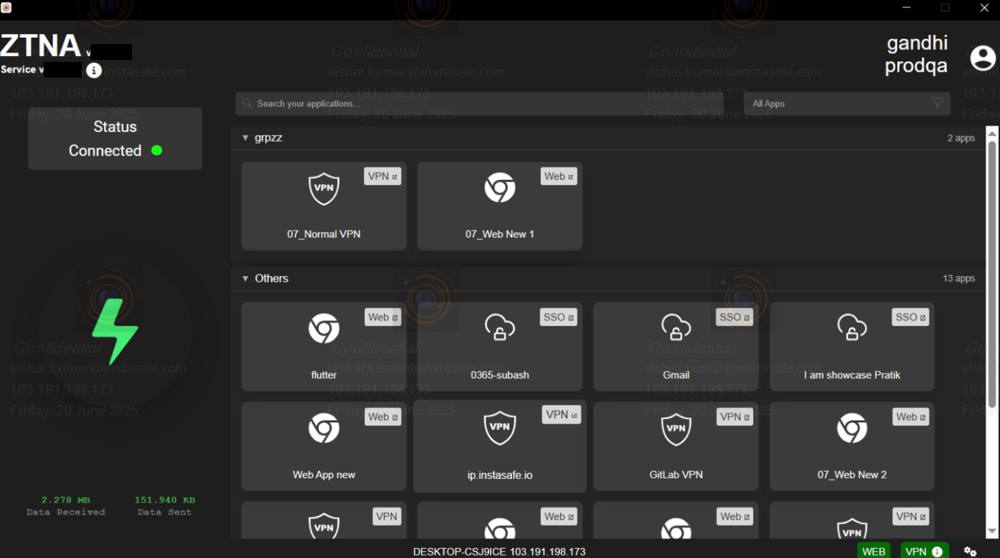
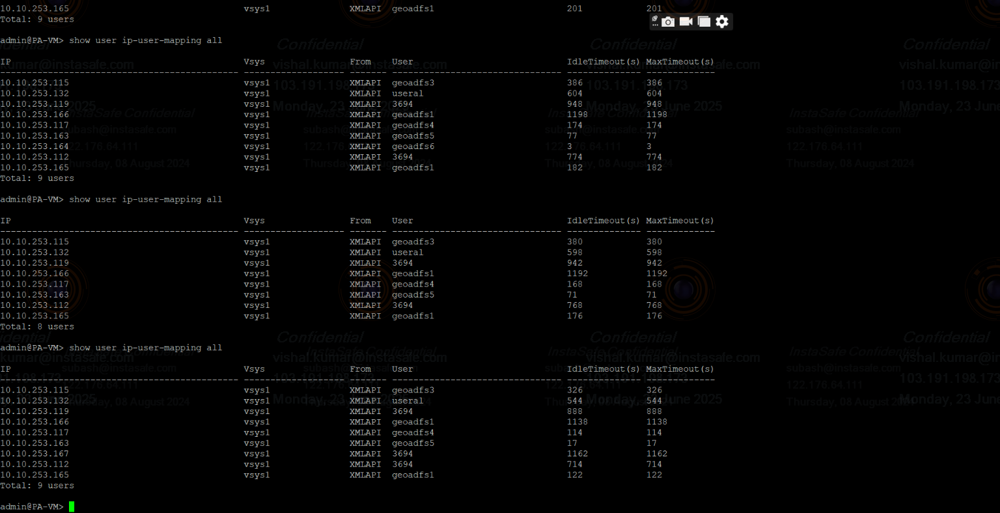

### Why did InstaSafe introduce the Firewall integration feature?

InstaSafe doesn't just replace traditional firewalls, it integrates with them to create a more secure environment. Your firewall is good at protecting the internal enterprise network from outside world. But once someone is inside, even a legitimate user, they might have too much access. This is where InstaSafe comes in, it's like having a personal security detail for every single person and application inside your network.

<!-- -----------------image 1st----------------- -->

* **Bridge On-Prem and Cloud:** Applies consistent security policies across hybrid environments.
* **Centralize Policy Management:** Unified dashboard for managing access and firewall rules.
* **Improve Efficiency:** Enhances user experience and reduces cost by streamlining access and minimizing hardware dependency.

### What is a Firewall?
A firewall is like a security guard for your computer or network. It watches the data coming in and going out and blocks anything suspicious or dangerous—like hackers, viruses, or unwanted connections.

### What is the role of Firewall integration in Instasafe?

* Many organizations already use a firewall to protect their network's outer edge. However, once someone is past the firewall, even a trusted user, they often have too much access inside.
* Instasafe's Zero Trust approach works with your firewall, not against it. It's like adding a personal security check for every user and every application within your network.
* The benefit: Instead of manually configuring firewall rules for each user and service, Instasafe automates this. Once integrated, Instasafe automatically manages granular access based on who the user is, what device they're using, and which specific application they need. This makes your network much more secure by ensuring "least privilege" access, simplifying management, and significantly reducing the risk of internal threats.

### How to integrate InstaSafe ZTAA with PaloAlto Firewall

### Step 1: Create a Firewall Profile

*  Log in to the ZTAA portal using your admin credentials.
*  Navigate to the **Configuration** section.
*  Go to the **Integration Profiles** section.
*  Click on **Add New Integration Profile**.
*  Select **FIREWALL** as the integration type.
*  Choose your firewall vendor from the list.
*  Enter your credentials as shown in the image below.
    * **Display name:** [give your Firewall Profile Name]
    * **API URL:** [Firewall Server ip with https]
    * **Auth Type:** [basicauth]
    * **Username format to use:**
        * Select **UPN** to get username with full AD server domain name.
        * Select **Domain-level** to get username and AD server slogan name.
*  Click the **Create Integration Profile** button.

<!-- -----------------------image 2nd ----------------- -->

### Step 2: Add Firewall Profile in Gateway

*  Go to **Perimeter Management** and navigate to the **Gateways** section.
*  Navigate to the **Integrations** tab within the Gateway Profile.
*  Select to add the appropriate integration profile in the gateway.
*  Open your Gateway Profile and go to the **Actions** tab.
*  Switch to **Edit Mode** and click on **Restart Gateway**.

<!-- ------------------image 3rd--------------------- -->

<!-- ------------------image 4rd--------------------- -->

<!-- ------------------image 5rd--------------------- -->

<!-- ------------------image 6rd--------------------- -->

**Note:** Your firewall configuration is complete. However, if you are an admin and want to verify whether the configuration has been applied correctly, follow the steps below.

### Step 3: Log in as an AD user and connect the ZTNA agent.

*  Log in using an AD user profile that has configured access policies.
*  Connect the ZTAA Agent to initiate access based on the defined policies.

<!-- ------------------image 7rd--------------------- -->

### Step 4: Check whether the Firewall configuration has been applied correctly.

*  Once the integration is complete, ensure that the Palo Alto server is running in AWS.
*  Access the Palo Alto server via SSH.
*  Open your Terminal or Command Prompt.
*  Execute the following command to connect: `ssh -i 'key-path' serverName@serverIP`
*  Once connected, you can verify ZTAA user details on the Palo Alto server.
*  Run the following command on the Palo Alto server: `[ admin@PA-VM> show user ip-user-mapping all ]`
*  If all is good, then you will be able to see all user details in the terminals.

<!-- ------------------image 8rd--------------------- -->

