# LDAP Authentication 

LDAP (Lightweight Directory Access Protocol) authentication allows user identity verification by validating credentials against a directory server. The ZTAA platform supports LDAP as an authentication method, with TOTP-based Multi-Factor Authentication (MFA) as an added security layer.

## Prerequisites

- A service account must be created within the ZTAA tenant.
- Required TCP ports must be open:
  - `389` for Go Auth
  - `389` and `636` for NGINX
- Update configuration in:
  - Go Auth properties file
  - NGINX properties file
- OpenVPN server must be created and configured.
- In AWS Security Group, OpenVPN IP must be allowed on TCP port `389`.

## Step-by-Step Configuration

### 1. Configure ZTAA as an LDAP Identity Provider

- Navigate to:  
  `ZTAA Console → Identity Management → Identity Provider`
- Click the ➕ button and select **LDAP**.
- Provide an **IDP Name**, then click **Next**.

    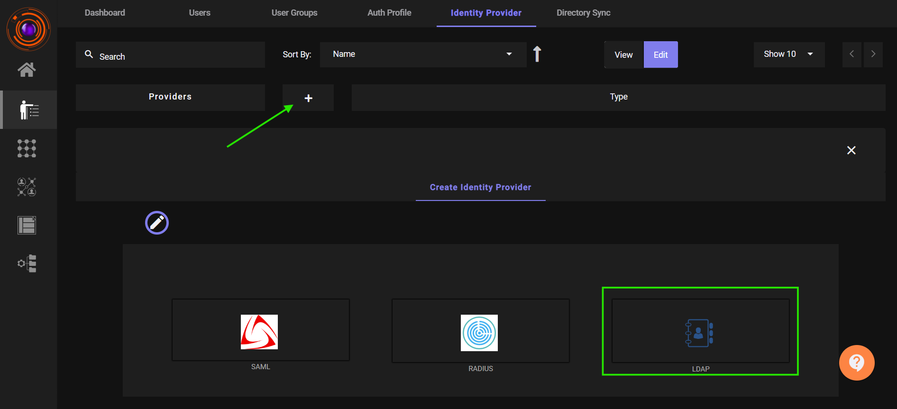
    
    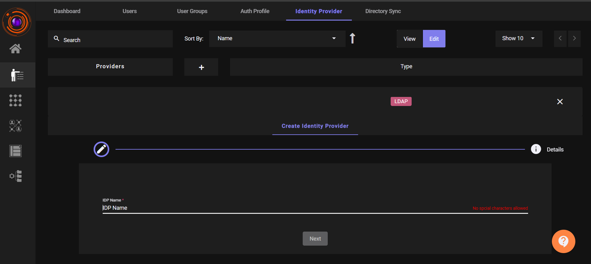

- Choose a **Service Account** from the dropdown.
- (Optional) Enable the **Multi-Factor Authentication (MFA)** toggle.
- Click **Submit**.

    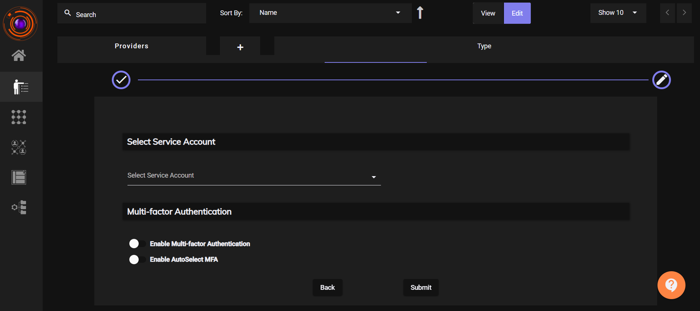

- Once created, the **Bind DN** field will be displayed.  
  **Note** this value — it will be used during OpenVPN integration.

    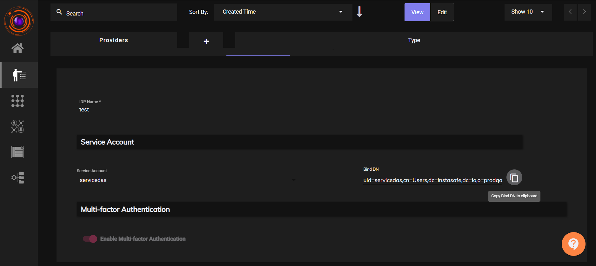

### 2. Create a User and User Group in ZTAA

- [Create an User](https://docs.instasafe.io/Zero%20Trust%20Application%20Access/004-creatingusers/):  
  Navigate to `Identity Management → Users`, and add a new user.
- [Create an User Group](https://docs.instasafe.io/Zero%20Trust%20Application%20Access/004b-usergroup/):  
  Go to `Identity Management → User Groups`, and add the user to this group.
- [Auth Profile](https://docs.instasafe.io/Zero%20Trust%20Application%20Access/004b-usergroup/):  
  Add the created user or group to the Authentication Profile .
- **Bind User Group to LDAP Profile**:  
  In `Identity Management → LDAP Profile`, click **Add User Group** and link the relevant group.
    
    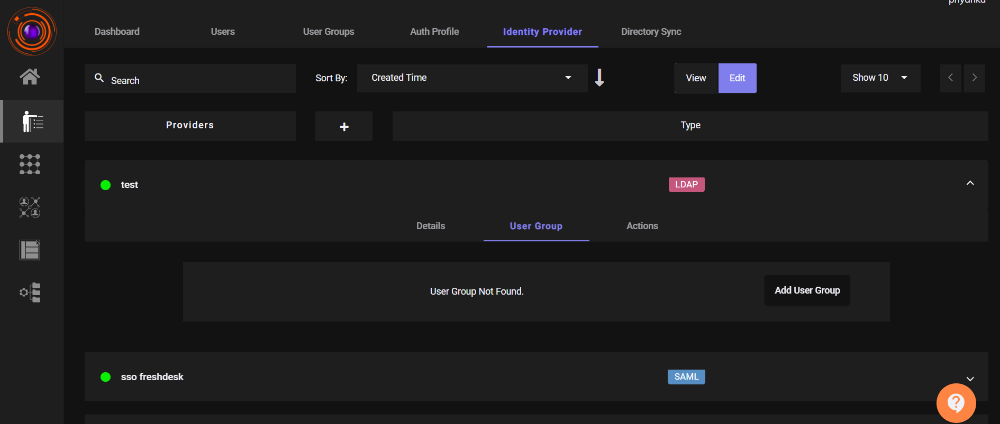

### 3. Configure LDAP Authentication in OpenVPN

#### 3.1 Set LDAP as the Default Auth System

- Log in to the **OpenVPN Admin Portal**.
- Go to `Authentication → Settings`.
- Set **LDAP** as the **Default Authentication System**.

    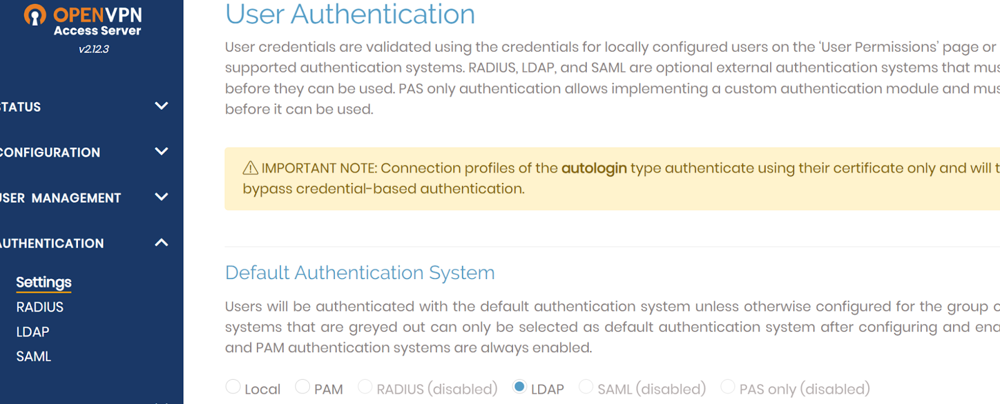

#### 3.2 Enable and Configure LDAP

- Navigate to `Authentication → LDAP`.
- Enable the **LDAP Authentication** toggle.

    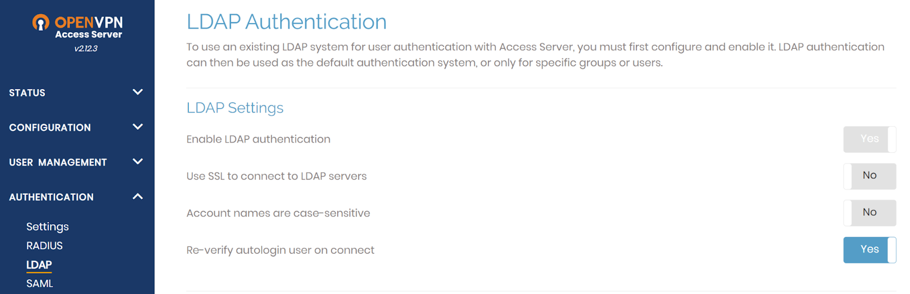

- In the **Primary Server** field, enter:  
  `<Environment IP Address>:389`
- Enable the **Use These Credentials** option.
- Copy the **Bind DN** from the ZTAA LDAP Profile and paste it into the **Bind DN** field in OpenVPN.
- Enter the **Service Account Password** in the **Password** field.

    
    
    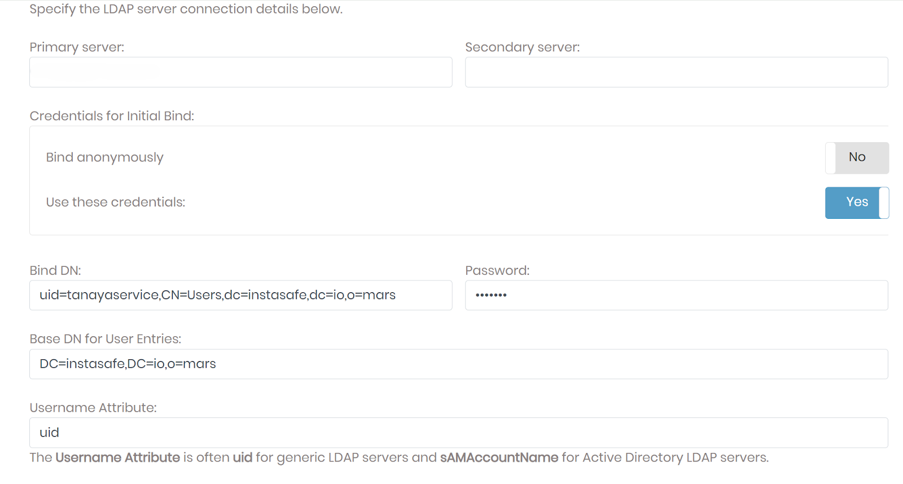

#### 3.3 User Permission and Profile

- Go to `User Management → User Permissions`.
- Add the **ZTAA User** under **Username**.

    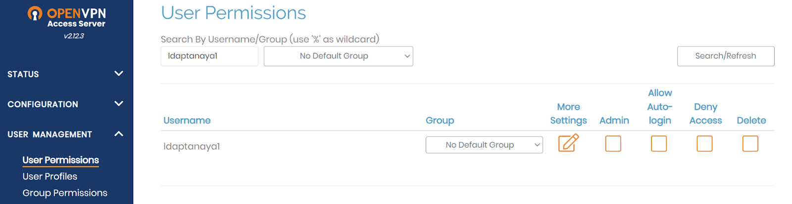

- Navigate to **User Profile**, click **New Profile** for the user.

    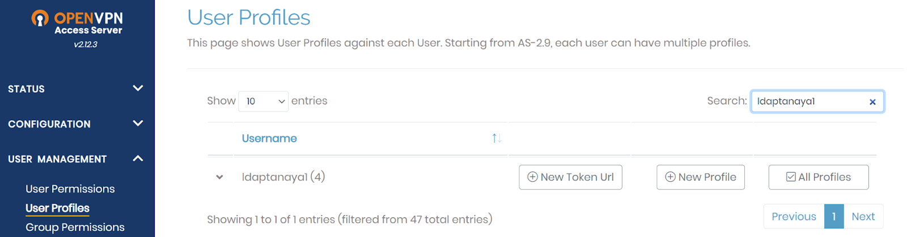

- In the pop-up, click **Create Profile** to download the OpenVPN config file (`.ovpn`).

    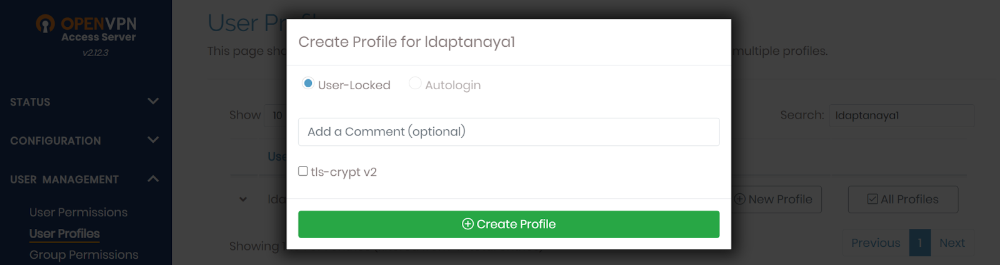

### 4. Configure OpenVPN Client

#### For Windows & Mac

1. Download and install the **OpenVPN Client** from the [OpenVPN website](https://openvpn.net/client/).

    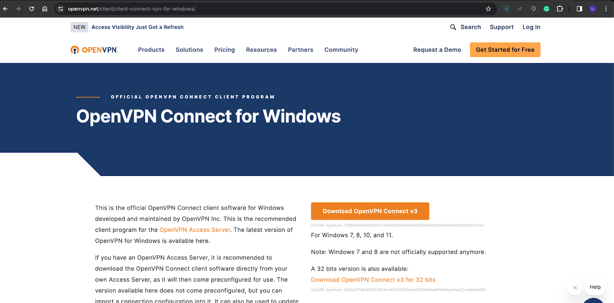

2. Launch the client and click the ➕ button.
3. Click **Browse**, select the downloaded `.ovpn` profile, and click **Connect**.

    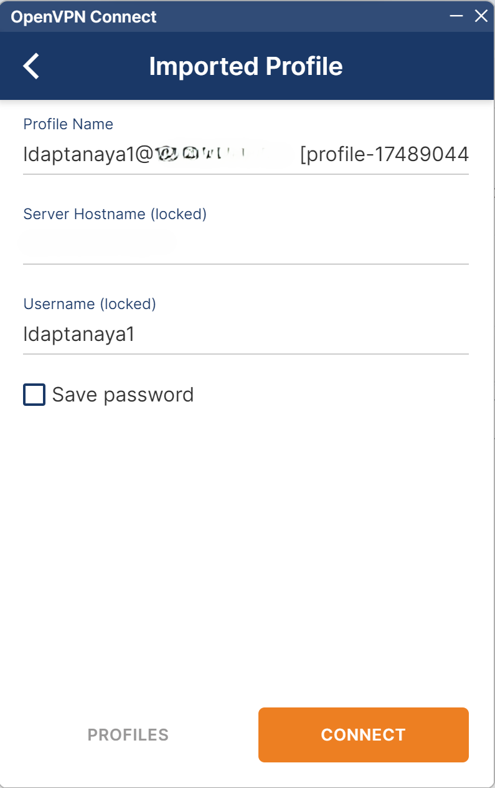

    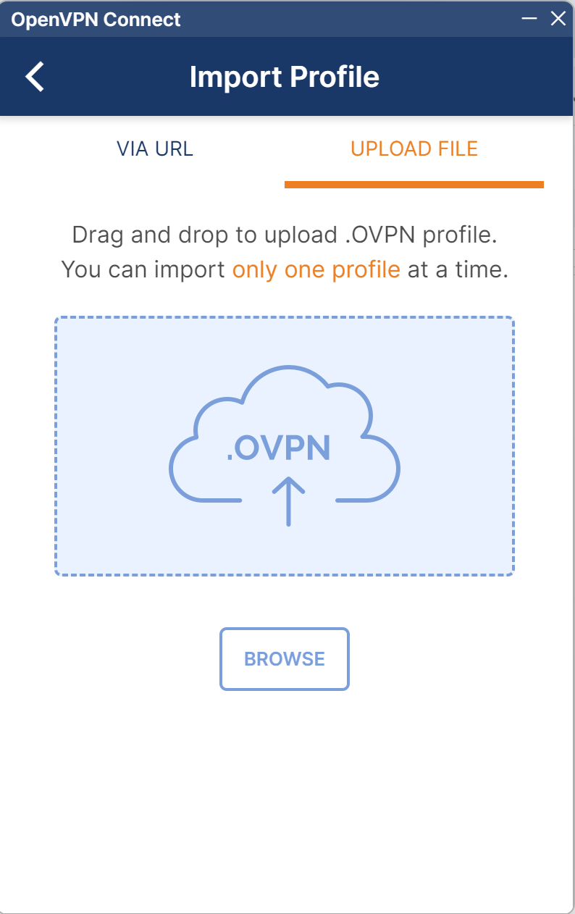

4. Enter **Username**, **Password**, and **TOTP** (comma-separated, e.g., `password,123456`), then click **OK**.

    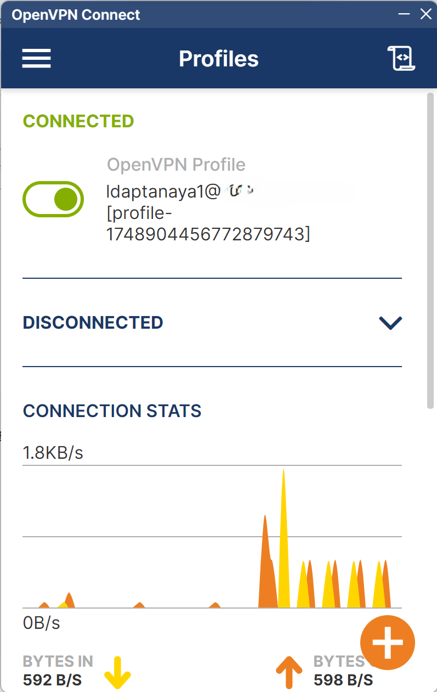

    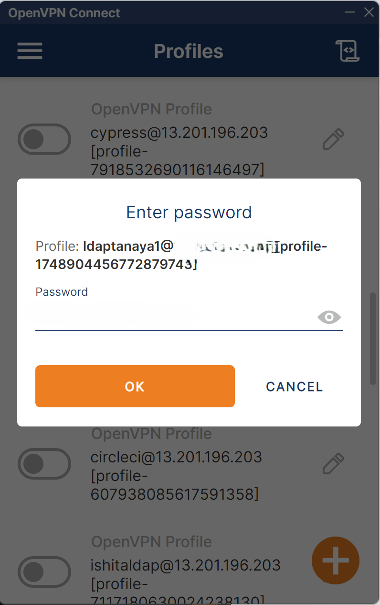

#### For Linux

##### Install and Connect
- Open Terminal in Linux OS
- Move to the File where you have saved the Open VPN File 
- Run the below command

>cd ~/Downloads

>sudo openvpn --config <profile_name>.ovpn

>sudo tail -f /var/log/syslog

##### View OpenVPN Logs

>sudo tail -f /var/log/syslog

