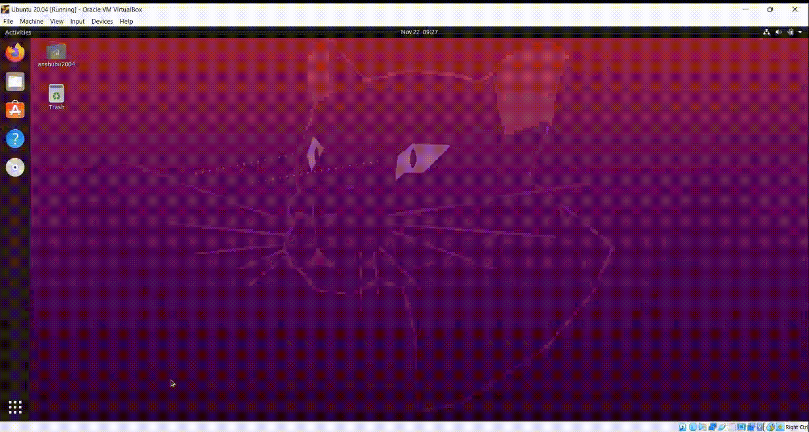

ZTAA is currently supported in Ubuntu 18+(Linux Kernel 5+) and CentOS 7+ (Linux Kernel 5+). Once the user successfully sets his profile password he can download the agent from the console and install it on his device. Applications to which the user has been granted access to can be accessed through the agent.

**Prerequisites**

The following must be ensured before installation of ZTAA in linux systems.

```
1. Users must have sudo access to the system and curl must be pre-installed in 
order to install the ZTAA App. 

2. During installation, the system should have access to the InstaSafe libraries 
and Linux repositories/mirrors so that the relevant packages could be downloaded 
over the internet

3. It is recommended to carry out an 'apt update' or 'yum check-update' depending 
on the Linux distro used, in order to download and update package information 
from all configured sources

```


**Follow these steps to install the agent**

1. Login to the ZTAA console, the link for which is provided in the user provisioning mail.

2. After logging in, go to the downloads section.

3. Verify that the correct Operating System is detected. 

For Linux, the script to download and install the ZTAA Client would be displayed:

```
/bin/bash -c "$(curl -fSsL https://storage.googleapis.com/4tr/client.sh) --production"
```
4. Copy-paste and execute this command in Terminal.

5. Once installation is complete enter your Domain/Username/Password information in the agent.

6. Post login, you will  be prompted for root credentials in order to proceed. Your agent is now successfully configured.

7. In case the user has VPN applications configured then the user will be prompted to enter root password for the first time while trying login to the agent.



