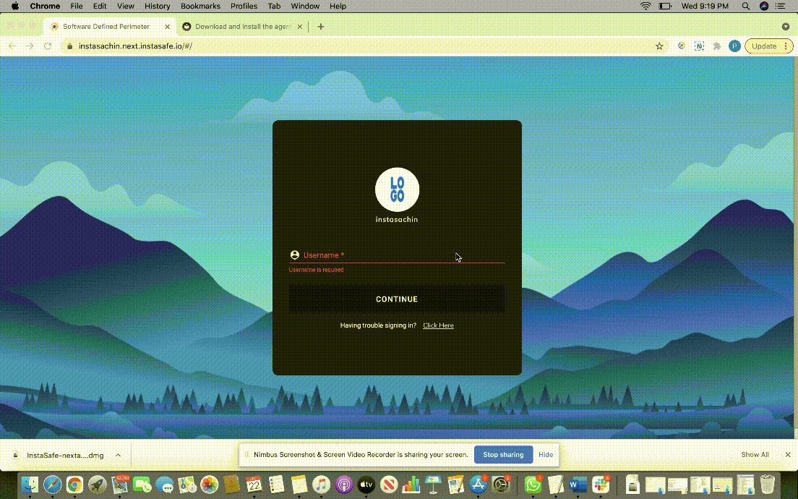

ZTAA is supported in all latest versions of MacOS. Once the user successfully sets his profile password he can downlaod the agent from the console and install it on his device. Applications to which the user has access to can be accessed through the agent.

**Steps for Installation**

1. Double-click the downloaded Disk Image File InstaSafe-ZTAA-macOS.dmg to open it and you will see a Finder Window

2. Drag the App to the Applications Folder to install the ZTAA Client. This step might prompt for Admin credentials

3. Wait for the copy process to finish and eject the .dmg (by clicking the eject button in the Sidebar).

4. Allow access through firewall/antivirus, if any is blocking the installation.

5. Once installation is complete enter your domain/Username/Password information in the agent.

6. Your agent is now successfully configured.

7. In case you have VPN applications, you will be prompted to enter root password  everytime you login to the agent.

