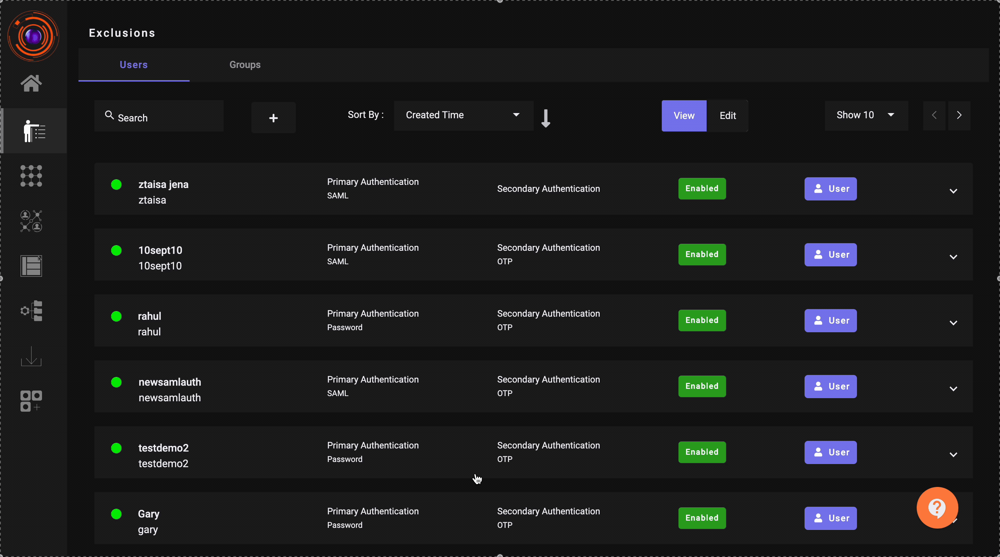

Conditional MFA based on Trusted IP addresses enhances security by requiring multi-factor authentication only when a user logs in from an untrusted or unknown IP address. This approach reduces friction for users while maintaining robust security for sensitive account access.

###Features

**Trusted IP Whitelisting:** Administrators can define a list of trusted IP ranges.

**Conditional Enforcement:** MFA is enforced only for login attempts from untrusted IPs.

**Customizable Policies:** Tailor MFA requirements to organizational, user groups or user-specific needs.

**Real-Time Detection:** IP address evaluation occurs at the time of login.

###Use Cases

**Corporate Networks:** Bypass MFA for users logging in from the corporate office network.

**Remote Workers:** Enforce MFA for users accessing systems from home or public networks.

**Temporary Access:** Allow temporary trusted access for specific IPs during maintenance or audits.

###Implementation of Conditional MFA in ZTAA

The below video illustrates the Conditional MFA use case implementation in the InstaSafe ZTAA platform.

1. As demonstrated in the video, Administrators selects OTP as the Secondary Authentication for a user. When the user tries to login to the ZTAA platform for application access, the user is prompted to provide an OTP for Secondary Authentication.
2. Administrators then updates a Trusted IP address in the 'OTP Bypass' field which is available in the Secondary Authentication tab.
When the user tries to login to the ZTAA platform from an IP which is configured in the 'OTP Bypass', the user is not prompted to provide an OTP.

