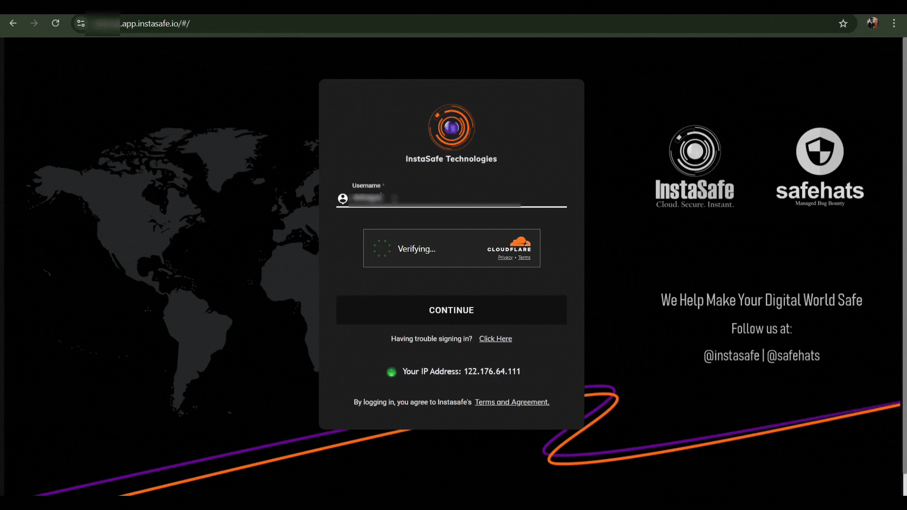

Phishing is a form of social engineering in which cyber threat actors use email or malicious websites to solicit information. For example, in a widely used phishing technique, a threat actor sends an email to a target that convinces the user to visit a threat actor-controlled website that mimics a company’s legitimate login portal. The user submits their username, password, as well as the 6-digit code from their mobile phone’s authenticator app.

Phishing-resistant MFA is the gold standard for MFA. [CISA](https://www.cisa.gov) strongly urges all organizations to implement phishing-resistant MFA as part of applying [Zero Trust](https://zerotrust.cyber.gov/federal-zero-trust-strategy/#identity) principles.

### PHISHING-RESISTANT MFA IMPLEMENTATION

**FIDO/WebAuthn Authentication**

The only widely available phishing-resistant authentication is FIDO/WebAuthn authentication. WebAuthn support is included in major browsers, operating systems, and smart phones. WebAuthn works with the related FIDO2 standard to provide a phishing-resistant authenticator. WebAuthn authenticators can either be:

• Separate physical tokens (called “roaming” authenticators) connected to a device via USB or near-field comms (NFC) or

• Embedded into laptops or mobile devices as “platform” authenticators.

In addition to being “something that you have” FIDO authentication can incorporate various other types of factors, such as biometrics or PIN codes. 

[The InstaSafe Zero Trust platform provides three types of WebAuthn/FIDO2 authentication:](https://docs.instasafe.io/Zero%20Trust%20Application%20Access/webauthn-fido2-mfa/):

1. Windows Hello

2. Security Key

3. Pass Key

Phishing campaigns often use automated tools or bots to distribute malicious payloads, harvest credentials from users and overwhelm security systems with brute-force attacks. To provide protection against phishing campaigns, the InstaSafe Zero Trust platform is secured with [Cloudflare Turnstile](https://www.cloudflare.com/application-services/products/turnstile/).

Cloudflare Turnstile can protect against phishing by acting as a discreet verification tool that distinguishes real users from automated bots, preventing malicious actors from easily submitting forms or accessing sensitive information on phishing websites that might appear legitimate to the naked eye, as Turnstile operates in the background without requiring users to solve obvious CAPTCHA puzzles, making it harder for automated phishing tools to bypass the checks and appear legitimate. 

The below video demonstrates the Cloudflare Turnstile verification in the InstaSafe Zero Trust platform.

