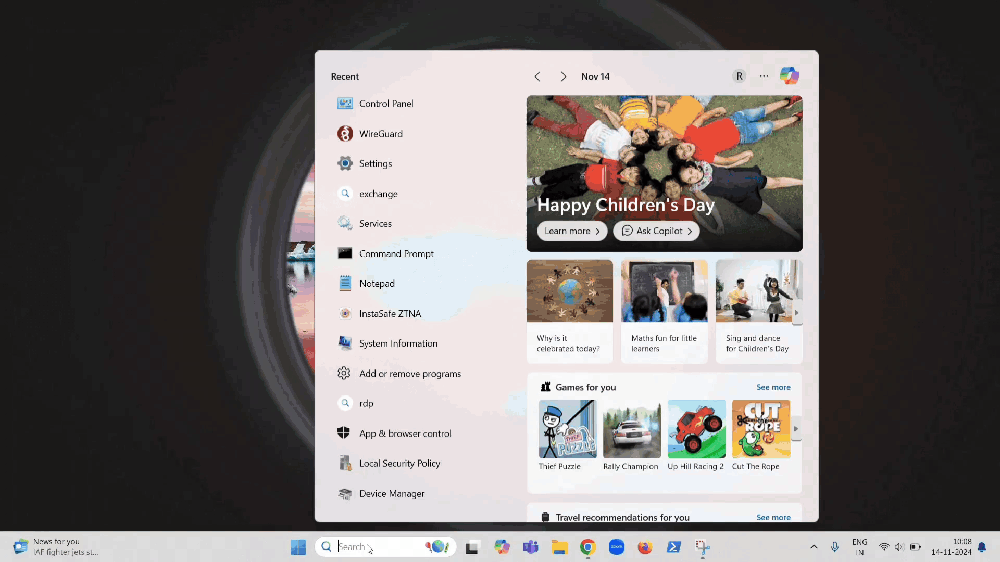

Uninstallation of the ZTNA agent is password protected and it cannot be done by end users. Users can uninstall the ZTNA agent by providing a password which can be generated by a Admin user of the ZTAA tenant.

The below video illustrates on how while trying to perform an uninstallation of the ZTNA agent, end user is prompted to provide a password.

The ZTAA Tenant Admin can generate a password for the 'Hostname' from which the ZTNA agent is tried to be uninstalled by providing the hostname of the end user device in My Profile -> Client Uninstaller -> Enter Hostname field.

The ZTAA Tenant Admin can share the generated password with the end user to complete the unsinstallation of the ZTNA agent.

