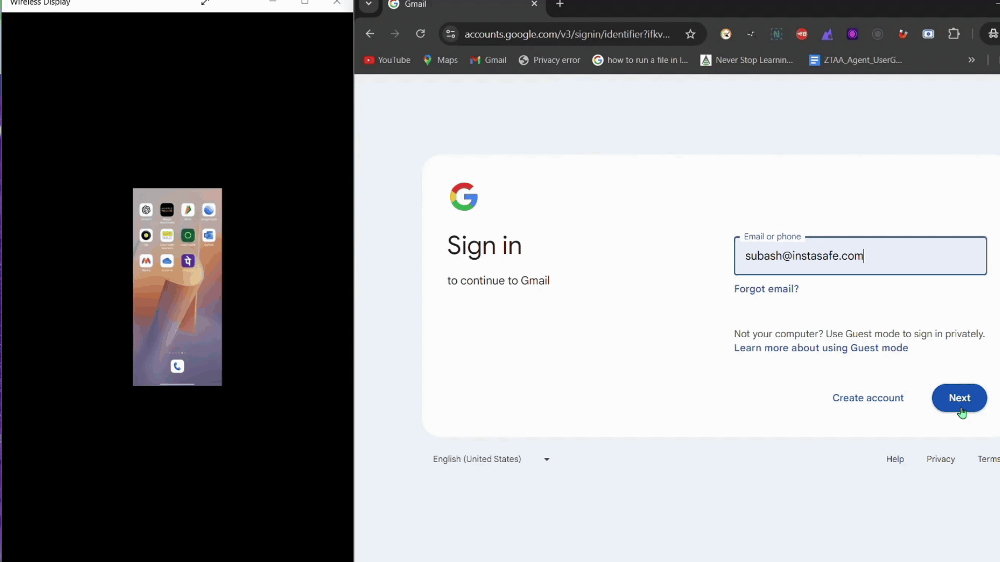
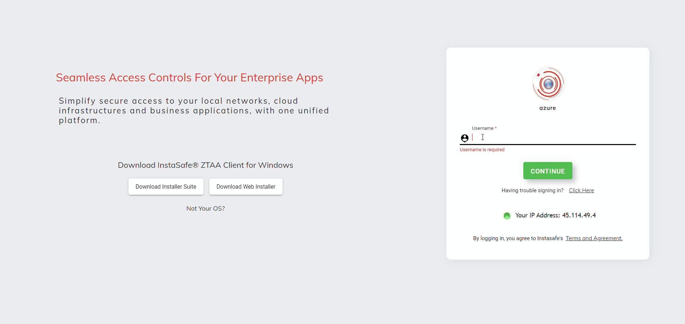

Traditional password-based authentication has been the standard for decades. It relies on a static password or PIN that users must remember and enter to access accounts and services. However, this knowledge-based approach has inherent flaws. Passwords can be guessed, stolen, captured by keyboard logger malware or forgotten - all major security and usability issues.

Passwordless authentication serves as a modern replacement for this outdated model. Instead of passwords, users verify their identity through possession factors like security keys or inherence factors like biometrics. It eliminates the risks of weak, reused, or compromised credentials by removing passwords from the login process completely.

The InstaSafe Zero Trust platform provides the below passwordless authentication mechanism:

- authentication with OTP received over Email & SMS.
- authentication with TOTP from the InstaSafe Authenticator app or a third party authenticator app.
- authentication with push notification from the InstaSafe Authenticator app.
- authentication with a hardware token (YubiKey) or a device biometrics.

The below video shows a passwordless login to Gmail with the InstaSafe Zero Trust platform configured as an Identity Provider. After the identity of the user is confirmed with the InstaSafe Zero Trust platform, the user receives a push notification on the InstaSafe Authenticator app. Upon approving the push notification in the InstaSafe Authenticator app (which is displayed in the left hand in the below video), the user is granted access to his Gmail.

The below video shows a passwordless login to the InstaSafe Zero Trust platform with YubiKey hardware token which is configured for the user.

