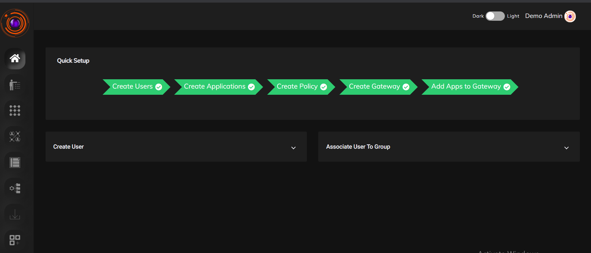

InstaSafe ZTAA provides seamless and secure remote access to internal applications for users by using Software Defined Perimeter (SDP) principles that reduce cybersecurity risks and improves compliance by ensuring applications are hidden, while at the same time allowing access to authorized users and devices after several authentication steps are performed. 

All ZTAA configurations and security policies can be deployed, managed and monitored from a central Admin console irrespective of where the applications are hosted. The intuitive console provides a powerful logging and reporting engine. 

A guided  approach highlighting the steps an admin has to follow is provided upon logging into the console to ensure ease of deployment.

#### Configuring Secure Access for users

1. Create profile for your users. User profile can be [created directly](https://docs.instasafe.io/Zero%20Trust%20Application%20Access/004-creatingusers/) or be [imported from existing Active Directory server](https://docs.instasafe.io/Zero%20Trust%20Application%20Access/008-importADusers/).  

2. Users can be grouped into [User groups](https://docs.instasafe.io/Zero%20Trust%20Application%20Access/004b-usergroup/) based on their roles to make administration easier.

3. [Create the application](https://docs.instasafe.io/Zero%20Trust%20Application%20Access/005-creatingapplication/) which you want to allow access to.

4. [Create Data Set](https://docs.instasafe.io/Zero%20Trust%20Application%20Access/019-datamanagement/) for parameters you want to create access control rules with. 

5. [Create Gateway](https://docs.instasafe.io/Zero%20Trust%20Application%20Access/006-creatinggateways/) based on requirement.

6. [Add application to the gateway](https://docs.instasafe.io/Zero%20Trust%20Application%20Access/006b-addapptogateway/).

7. [Create access control rule](https://docs.instasafe.io/Zero%20Trust%20Application%20Access/007-accesscontrol/).
