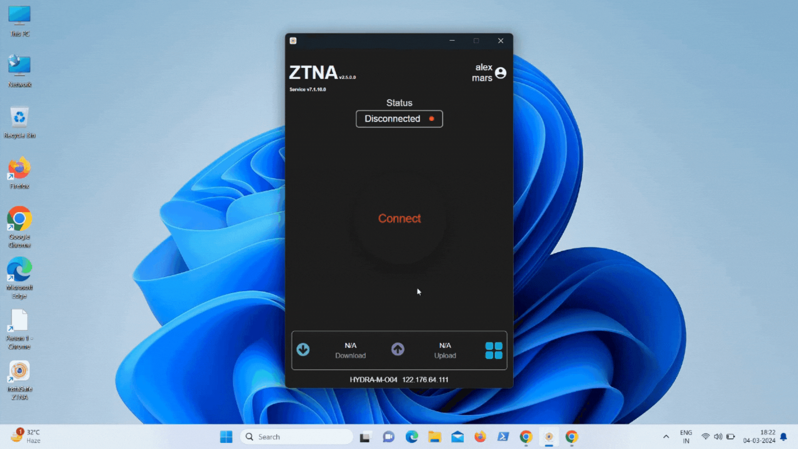

The Watermark or Screen Overlay which is a data leakage protection feature, enhances data security by providing a means to display informative or interactive elements on top of the screen's content. Implementation typically involves creating a dedicated graphical layer that accommodates overlay elements, such as text and images. These elements can be customized and positioned as needed.

The Watermarking endpoint control feature gives Admins the control to display watermark on the screen of the user device. This feature can be applied over devices with Windows operating systems. When users connect to the ZTNA agent to access the corporate applications, the watermark gets displayed on the user's screen. On disconnecting from the ZTNA agent, the watermark content gets removed from the user screen.

The Watermarking feature is available over Windows, macOS and Linux operating systems.

To create and apply the Watermarking endpoint control feature, Admins will have to perform the below steps:

 - Click on 'Access Policies' in the left menu and then click on the 'EndPoint Policies' tab.

 - Click on the '+' icon and then give a name for the policy.

 - Select the 'Watermarking' endpoint control policy.

 - From the 'Select watermark config' dropdown, choose the watermark profile which needs to be displayed on the end user screen.
 
 - Select the operating systems in which the Watermarking control needs to be applied.
 
 - Select the Users/User Groups to which the policy needs to be applied.

 - Click on the 'Submit' button to save the policy.

Please refer the below video on how the Watermarking endpoint control policy gets applied in the end user systems.

