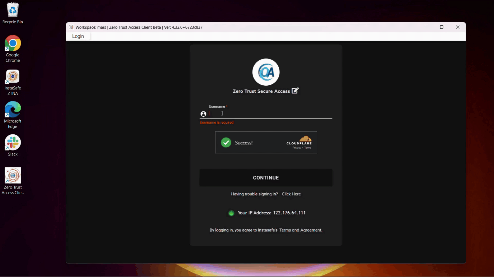

The InstaSafe ZTAA agent is a secure browser solution which provides access to network, web and RDP applications. The ZTAA client is compatible with [Windows](https://docs.instasafe.io/Zero%20Trust%20Application%20Access/windowsagent/), [Linux](https://docs.instasafe.io/Zero%20Trust%20Application%20Access/linuxagent/) and [macOS](https://docs.instasafe.io/Zero%20Trust%20Application%20Access/macagent/), offering versatility across various operating systems. 

The benefit of using the ZTAA agent is that it can perform a [posture check on 17 device attributes](https://docs.instasafe.com/Zero%20Trust%20Application%20Access/deviceposture/) before granting access of applications to user.

The below video demonstates the network and web application access from the ZTAA agent.

