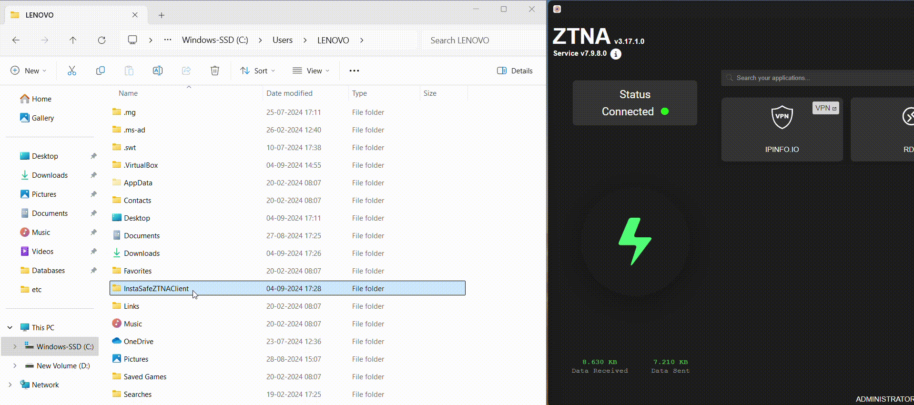
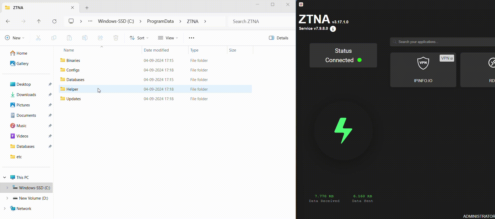

The ZTNA agent, once successfully installed, generates logs that could be helpful in troubleshooting issues related to network connectivity and application access. 

The ZTNA agent and service logs are not generated by default and needs to be enabled in the end user device.

Depending on the device OS, the log file location varies.

### Steps to enable ZTNA agent logs

1. Navigate to the directory path C:\Users\ ..\InstaSafeZTNAClient\Databases on Windows OS. On macOS and Linux OS, navigate to the directory path /Users/../InstaSafeZTNAClient/Databases.

2. Create a file with the name "enabledebug.log" in the above path. A password text needs to be provided in the "enabledebug.log" file which will be shared by the InstaSafe Support team. Save the "enabledebug.log" file after providing the password text. 

3. Restart the ZTNA agent.

4. The ZTNA agent logs will be generated in the directory path C:\Users\ ..\InstaSafeZTNAClient\Logs on Windows OS. On macOS and Linux OS, the ZTNA agent logs will be generated in the directory path /Users/../InstaSafeZTNAClient/Logs.

The below video illustrates on how to enable the ZTNA agent logs.

### Steps to enable ZTNA service logs

1. Browse to the directory path C:\ProgramData\ZTNA\Databases on Windows OS. On macOS and Linux OS, navigate to the directory path /usr/local/opt/instasafe/ZTNA/Databases.

2. Create a file with the name "enabledebug.log" in the above path. A password text needs to be provided in the "enabledebug.log" file which will be shared by the InstaSafe Support team. Save the "enabledebug.log" file after providing the password text.  

3. Restart the ZTNA service and agent.

4. The ZTNA service logs will be generated in the directory path C:\ProgramData\ZTNA\Helper\Logs on Windows OS. On macOS and Linux OS, the ZTNA service logs will be generated in the directory path /usr/local/opt/instasafe/ZTNA/Helper/Logs.

The below video illustrates on how to enable the ZTNA service logs.

