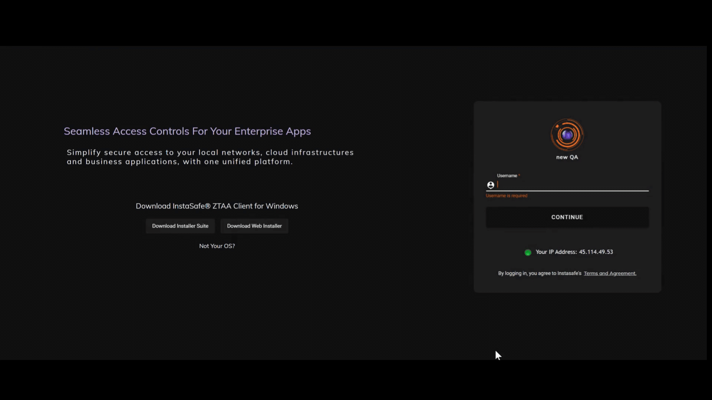
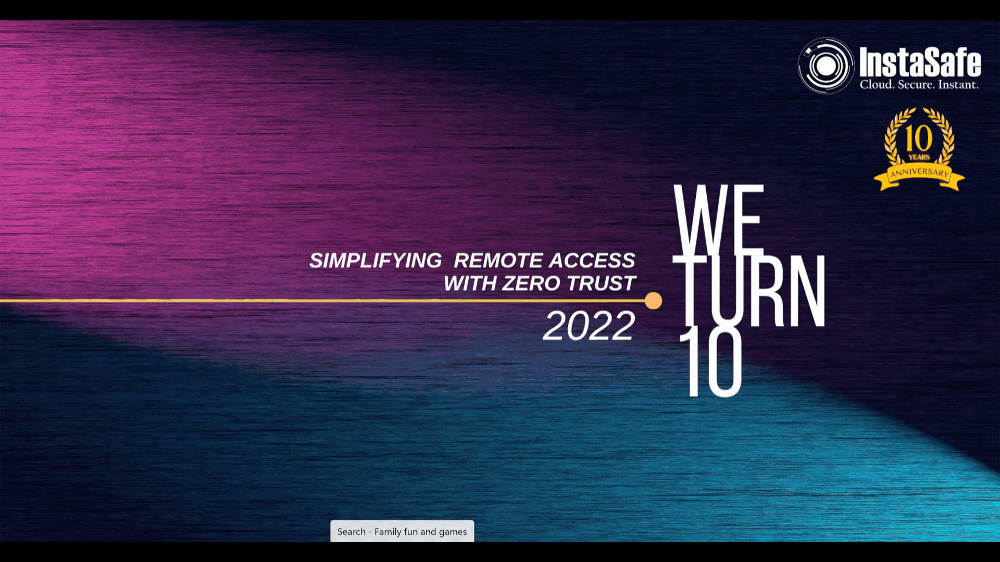

The InstaSafe ZTNA agent is a lightweight solution which provides secure access to network, web and RDP applications. The ZTNA client is compatible with Windows, Linux, and macOS, offering versatility across various operating systems. With low RAM consumption, it optimizes performance, particularly on systems with limited resources.

Featuring a minimalist and user-friendly interface, the ZTNA client enhances ease of use and navigation.

**Steps to install the agent.**

1.  Login to the ZTAA console and click on the 'Downloads' in the left menu.

2.  Click on the 'Download ZTNA Installer' under the Download ZTNA Agent section.

3.  Run the downloaded exe file.

4.  Once installation is complete enter your Domain/Username/Password information in the agent.

5.  To connect the ZTNA agent, click on the 'Connect' button.

The below video shows the steps to download and install the ZTNA agent.

The below video shows the steps to login and connect to the ZTNA agent.

