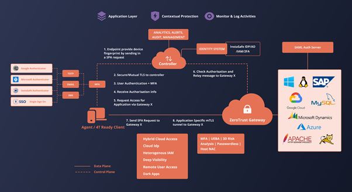
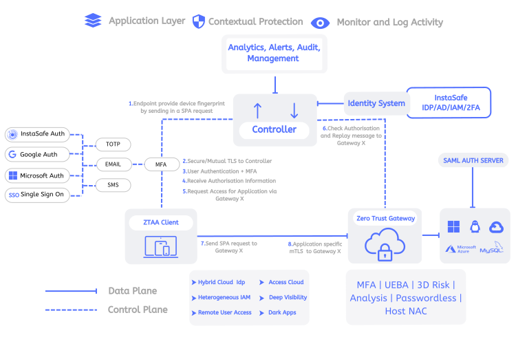
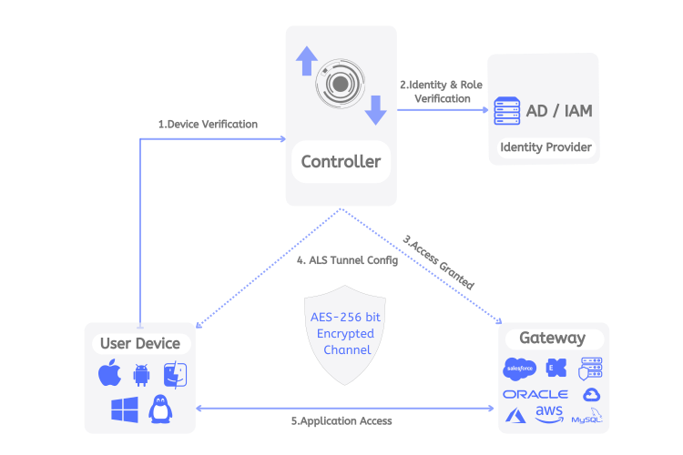
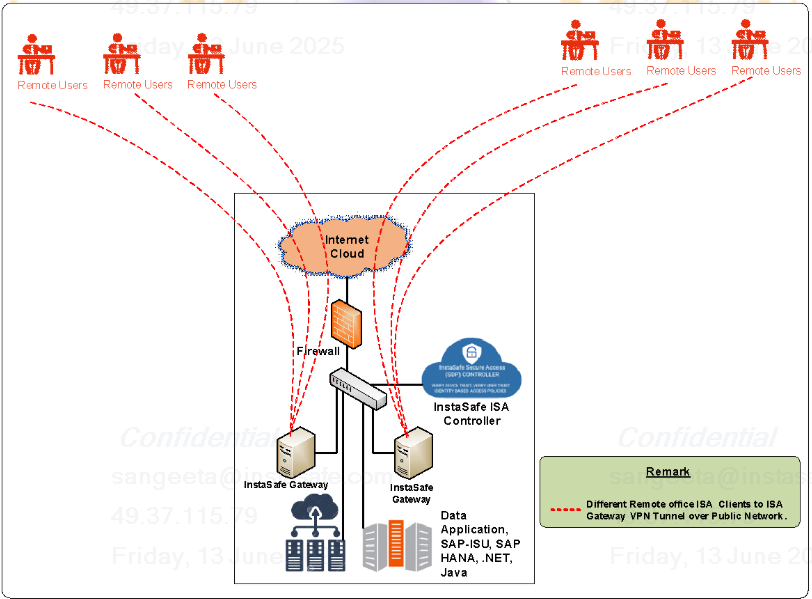

**Superseded.** This is the previous version of this page, kept for comparison. The current
page is [Architecture](002-architecture.md).

The functioning of InstaSafe ZTAA is in accordance to the Client-Gateway based model in Software Defined Perimeter specification as proposed by the Cloud Security Alliance (CSA). It is a client-initiated zero trust solution which creates a secure tunnel between the client and the server with additional features like Multi-Factor Authentication, SSO and integration with SAML for third party applications.

Access to each application is controlled via independent tunnel ensuring that the user access is contained and thereby eliminating the threats posed by lateral movements within network.

<!---->

Thus once deployed Instasafe ZTAA is able to achieve the following 

* Redesign networks into secure micro-perimeters

* Strengthen data security using obfuscation techniques

* Limit application access to need to know basis and enable admin to customise user privileges and access.

* Improve security detection and response with analytics and automation.

## ZTAA Components

ZTAA has four main components which help it achieve the above mentioned objectives.

<!---->

**1- ZTAA Agent** 

A Client Agent has to be installed on end user devices for them to be able to communicate and interact with the Zero Trust Network . The client is configured to drop all connections to the SDP in the case that any of  ZTAA’s access policies are violated or the standards are not met.
 
Note: Clientless access to the resources via browser is also possible,with  fewer secure posture validations.

**2- Controllers** 

Controllers are the decision making components in ZTAA . They are connected to Identity providers  to gather information about the users trying to access the network. It has a inbuilt IdP for user and group management. ZTA Controller also supports Active directory, Azure AD and SAML Assertions for application and network access. The client sends vital information about the user’s device to the controller which helps the controller in granting entitlements i.e the level of access to the clients. In the context of the CSA SDP model, this component is the Policy Decision Point (PDP)

**3- Gateways** 

Gateways are the components which enforce the policies and entitlements set by the controllers. They verify the client's entitlements to grant them access to the resources only in the client’s context. In the context of the CSA SDP or NIZT ZT model, this component is responsible for Policy Enforcement.

InstaSafe supports four  type of Gateways:

* TCP Gateways - Can be used for accessing web applications by syncing users from active directory.

* RDP Gateways - Can be used for accessing RDP, SSH and Fileshare via Web browser and InstaSafe ZTAA Client.

* VPN Gateways - Can be used for accessing private applications hosted in private server/data center or cloud.

* Clientless Gateways - Can be used when the admin wants to allow access from browser without installation of user agent. 

**4- Console** is the web interface using which the admin can manage and monitor activity on the ZTAA platform. The console provides an user interface to the admin using which he can manage the other three components. ZTAA console can be accessed from any web browser on any device unless specific restrictions are placed to that effect. 

<!--#### Working -->

<!---->

1-  The User logs into the agent with credentials and initiates the connection with the controller. User credentials along with device parameters are passed to the controller.

2-  The controller compares the user and device credentials against policies set up by the admin. On successful verification the controller grants permission to the user to connect with the gateway.

3- Once controller has successfully authenticated the user and a tunnel is established between the user device and gateway. 

4- The user can now access applications configured for him/her through ZTAA.

5- All traffic is carried out on AES-256 bit encrypted tunnel.

The solution supports industry-standard encryption protocols such as AES-256, TLS1.3 or Higher to secure communication between internal applications, servers, and connected external devices. All data transmission between endpoints and applications is conducted through a secure, encrypted tunnel, ensuring confidentiality and integrity. It also leverages secure SSL/TLS handshake mechanisms with random number generation to enable strong and dynamic encryption key generation, thereby enhancing overall communication security.

It also supports automatic failover to the authentication server at the Disaster Recovery (DR) site in the event of a failure at the primary site. This ensures uninterrupted user authentication and continuous access to applications, maintaining high availability and business continuity.

The solution has configuration to support for load balancing of incoming user connections across multiple instances, ensuring optimal performance, high availability, and seamless user experience even during peak load conditions.

The Solution supports deployment in High Availability mode (Active-Active, Active-Passive or Primary-Secondary) as required.

InstaSafe solution provides both CLI and web-based administrative access to facilitate secure configuration, monitoring, and troubleshooting.

