Admins can manage and monitor all activities on the ZTAA platform via the web console.The webconsole is accessible on the internet and the admin can log into the console from any device unless IP based filtering rules have  been applied .

 The admin UI is driven by a View/Edit toggle to prevent accidental deletions. Modifications to existing entities can only be made in the edit mode.

### **Home**

This is the first page a User lands into upon logging onto the console.An widget showing his progress can be viewed from here. A guided  approach highlighting the steps an admin has to follow is provided to ensure ease of deployment.

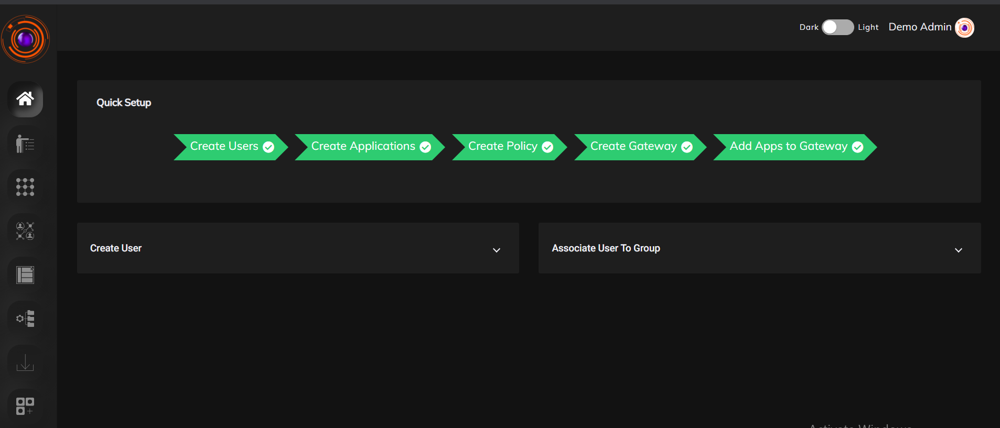

### **Identity Management**

The identity management section of the dashboard allows the admin to manage as well as monitor all user related activities.From here the admin can add new users directly or import from existing directory services such as Active directory or LDAP. He can set authentication methods for each user  such as SAML,OAuth etc.The users can also be grouped according to their roles, so that managing them is easy. 

Supports RESTful APIs for seamless integration with IDAM or any other solutions. The APIs support user and group management functions, including user creation, deletion, status updates, group assignments, and application mapping, enabling centralized identity lifecycle management.

#### **Auth Profile**

Users can be authenticated into the Zero Trust platform in the following ways,

* Primary authentication

* Secondary authentication

The primary authentication mode can be any of the following

**PASSWORD**

A username password can be used to authenticate a user into the platform. The admin need to add the user at the IDP of the ZTA platform at the admin UI. The password confirmation can be done from the side of the end user againt the information present at the ZT Controller.

**Security Assertion Markup Language (SAML)**

Instasafe Zero Trust can act as a [SAML Service Provider](https://docs.instasafe.io/Zero%20Trust%20Application%20Access/013-ConfiguringZTAAasSSOwithSAML/) to utilize any third party IDPs to log users into the system. Both IDP Initiated and SP Initiated modes of SAML Authentication are supported by the ZTAA platform

**Active Directory (AD)**

Companies with existing [Active Directories](https://docs.instasafe.io/Zero%20Trust%20Application%20Access/008-importADusers/) can add their servers to the platform and ZTAA will contact the AD server to authenticate the user’s credentials without the need to register the users individually into the platform. Further details about syncing the AD profiles can be found under the Directory Sync Profiles. In addition to the the primary authentication schemes, Instasafe offers several MultiFactor authentication schemes like,
OTPs (Mobile Apps, Email and SMS) and TOTP.

The User session timeout i.e the event occuring when a user does not perform any action on the platform during an interval and is subsequently logged out due to inactivity can be configured according to the company policy.

<!--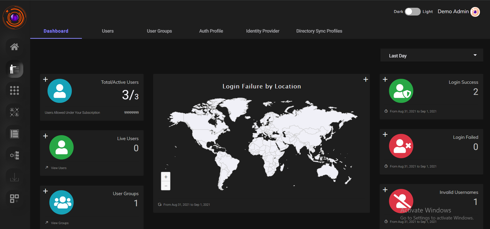-->
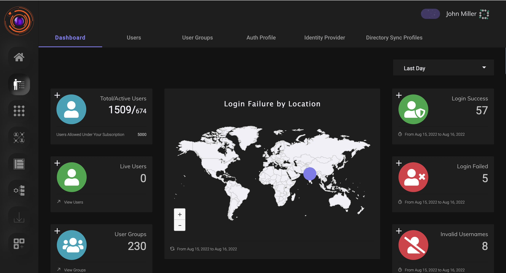

### **Perimeter Management**

From here the admin can manage and monitor access between enterprise resources and users.The perimeter consists of users, user devices, Applications, Gateways, Here the admin can create applications, view details of devices the accessing the enterprise applications, create gateways etc. 

The various tabs under perimeter management are

* Applications
* Application Groups
* Devices
* Gateways
* Agent Release

<!-- 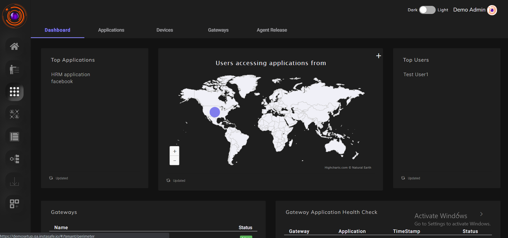-->
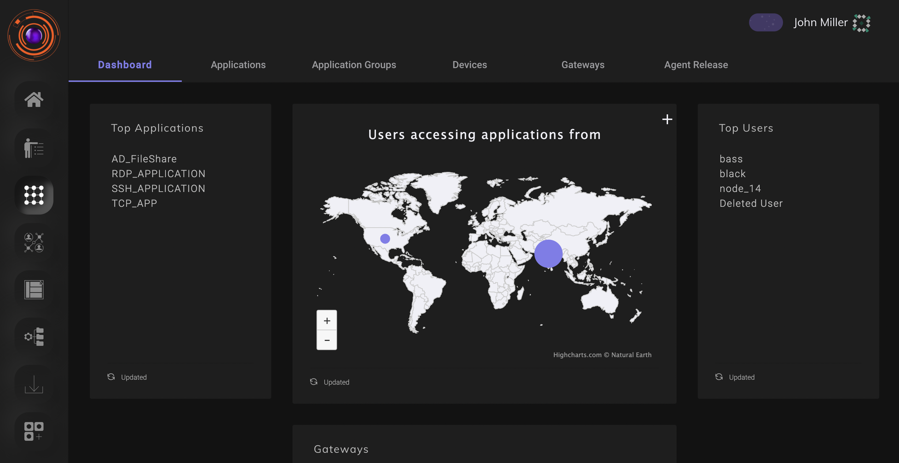

### Access Policies

Access Policies are the way to control a user’s access to company infrastructure. They are a critical component in any zero trust network and have to be configured carefully keeping in mind the need-to-know model of allowing access.

<!--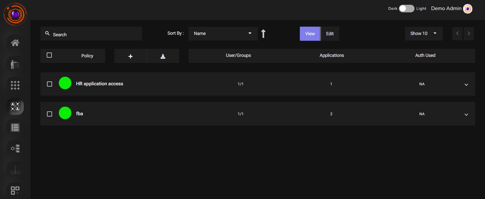-->
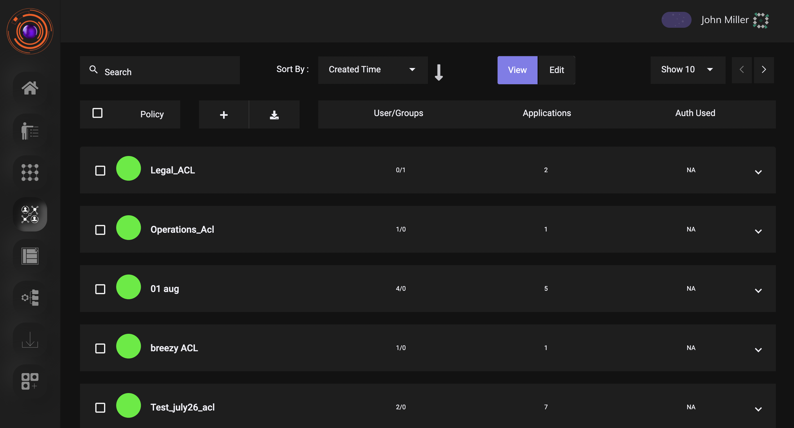

### Configuration

This section is used for advanced configurations relating to VPN ,SIEM or create dataset for device managemnet.

* **Data Management-** Here parameters that will be used to create device rules or enhanced access control management will be defined.
* **Event Stream Profile**- This will be useful for streaming logs to external SIEM.
* **VPN Profile-** This will be useful for configuring, IP address pool from which the users and gateways will be allocated a IP 

<!--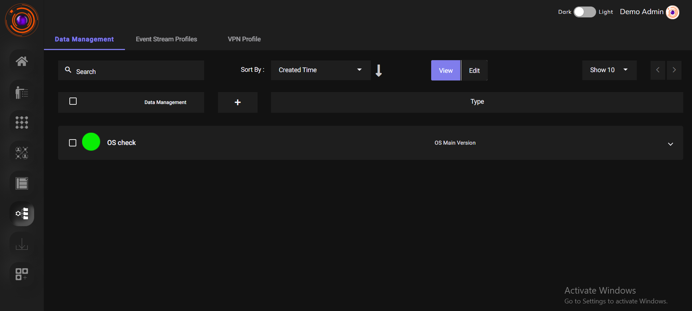-->
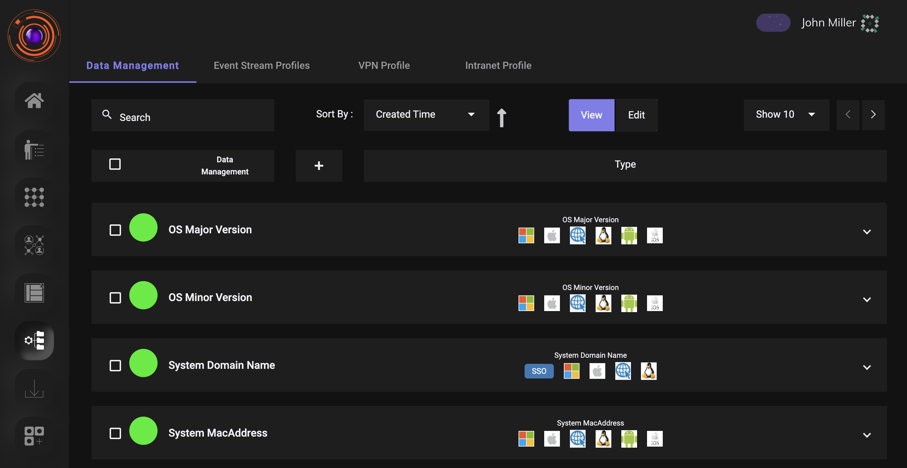

### Downloads

This section is used for downloading the user agent. The gateway installation script is also available here.

<!--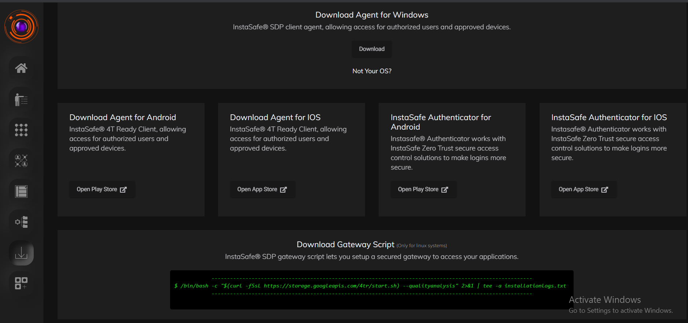-->
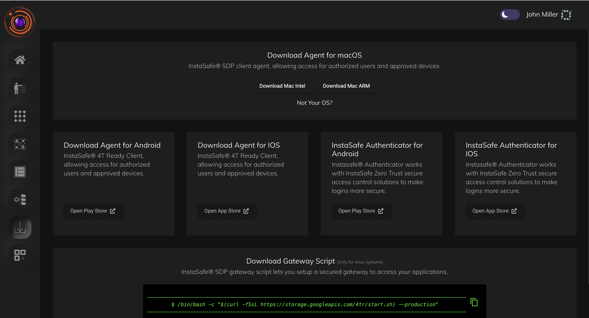

### Applications

This section is available to both user as well as admin. Here applications for which browser access has been enabled will be available.

<!--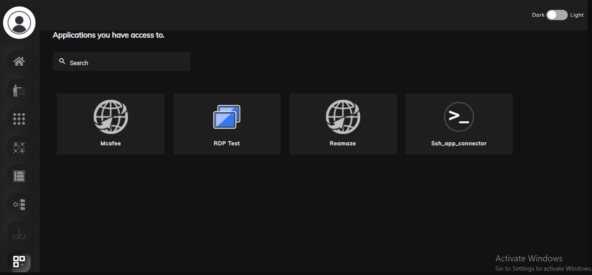-->
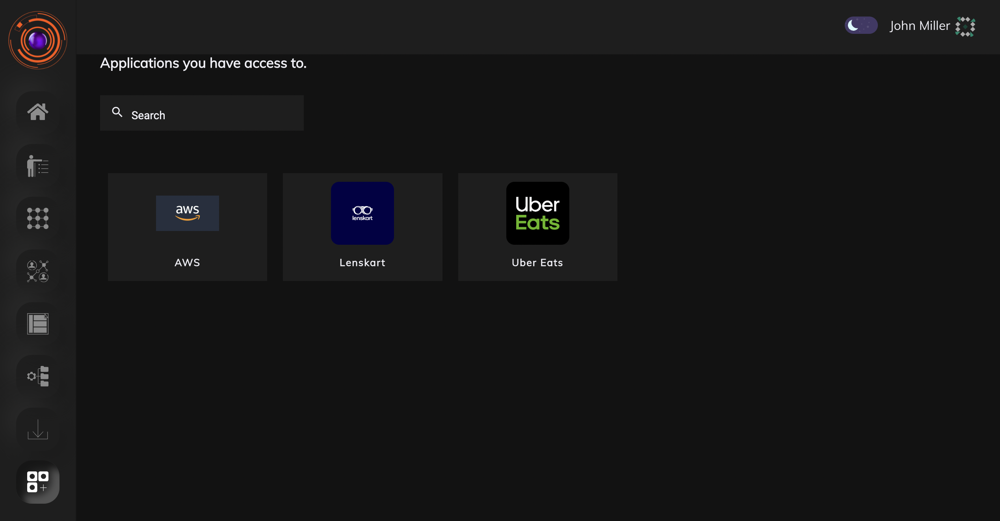

**Cross-Browser Accessibility**

The InstaSafe Authenticator App and Web Console are designed with a focus on usability and accessibility, ensuring seamless user experience across widely adopted browsers. By adhering to modern web standards and backward compatibility, InstaSafe ensures that administrators and end-users can securely access the platform without dependency on specific devices or environments.

**Supported Browsers:**

Google Chrome (version 39 and above)

Chromium-based browsers (version 39 and above, including Microsoft Edge)

Mozilla Firefox (version 33 and above)

Internet Explorer 11

Apple Safari (version 5.5 and above)

**Customizable & Multi-Language User Interface**

The InstaSafe platform offers a highly flexible and user-friendly interface that can be tailored to meet the unique branding, usability, and compliance standards of each organization. This ensures that enterprises can deliver a seamless and familiar experience to their users while maintaining corporate identity guidelines.

**Key Features:**

Customizable UI – Modify look and feel, logos, color schemes, and layouts to align with organizational branding and standards.

Multi-Language Support – Provides localization capabilities to support global teams and diverse user bases by enabling users to interact with the platform in their preferred language.

Consistent User Experience – Ensures that both administrators and end-users have an intuitive, uniform, and secure access experience regardless of customization.

Enterprise Standards Alignment – Supports adherence to accessibility guidelines (such as WCAG) and corporate UI/UX requirements.
