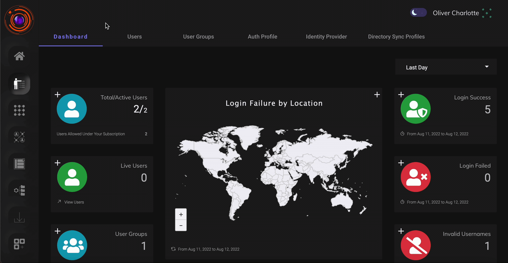

**Superseded.** This is the previous version of this page, kept for comparison. The current
page is [User Groups and Role-Based Access](004b-usergroup.md).

To accomodate the challeges of a growing organisation and to facilitate efficient administration, ZTAA allows similar users to be grouped toghether based on roles,responsibility and location. User Groups are a construct by which administrators can keep track of users as groups instead of individual users. This allows the administrators to perform actions on groups of users which saves times and organizational effort. 

### Steps to create a user group

User groups can be crated in the User group tab under Identiy Management section. The following steps demonstrates how admin can create user groups. 

1- The admin can create user groups as required by clicking on the "add user group" button and giving the valid group name.After giving the valid name to the group.

2- After the name is given click on the next button.

3- The admin will be asked to add the members to the group which can be done with the help of 'Add user' button.The admin can select multile users and add them to the group.

The above steps and the process of creating an user group can be seen in the video below.

