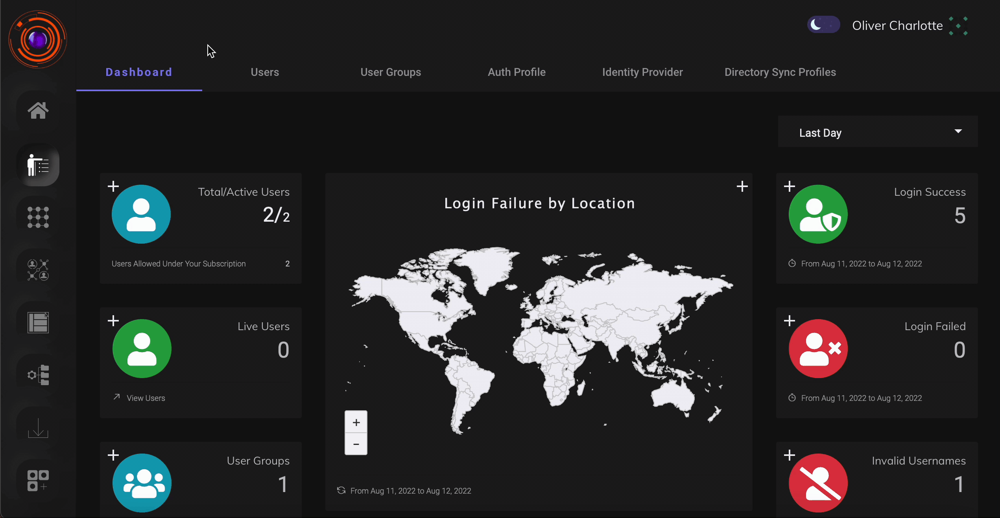
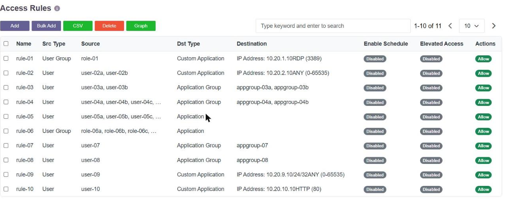
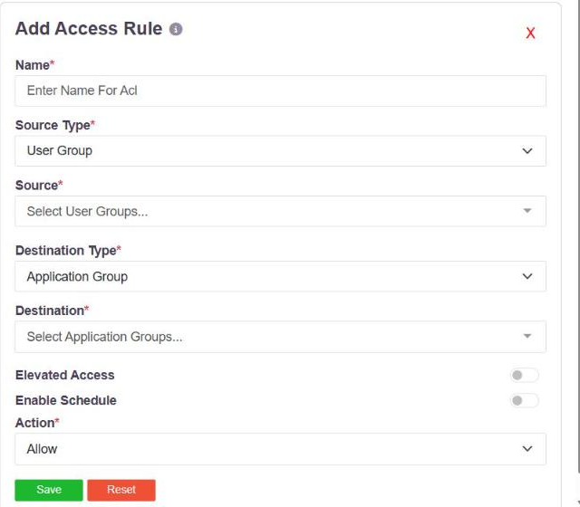

To accomodate the challeges of a growing organisation and to facilitate efficient administration, InstaSafe ZTNA allows similar users to be grouped toghether based on roles,responsibility and location. User Groups are a construct by which administrators can keep track of users as groups instead of individual users. This allows the administrators to perform actions on groups of users which saves times and organizational effort. 

### Steps to create a user group

User groups can be crated in the User group tab under Identiy Management section. The following steps demonstrates how admin can create user groups. 

1- The admin can create user groups as required by clicking on the "add user group" button and giving the valid group name.After giving the valid name to the group.

2- After the name is given click on the next button.

3- The admin will be asked to add the members to the group which can be done with the help of 'Add user' button.The admin can select multile users and add them to the group.

The above steps and the process of creating an user group can be seen in the video below.

## What a group can reach

A user group is not only a way of keeping track of people. It is the thing an **access rule**
is written against, which is what makes application access role-based: group the users by
their role, define the resources that role needs as an application group, and bind the two
with one rule.

Access rules grant application access by **role** rather than by individual. Users are
grouped by their role in the organisation, the resources that role needs are defined as an
application group, and a single access rule binds the two. The rule is identity-based: it
permits access on the strength of who the user is, not on parameters such as the source IP
address.

Rules are listed and created on the **Access Rules** page of the console.

Each row states the rule's source and its destination. Where **Src Type** is *User Group*,
every member of that group inherits the entitlement.

### What a rule holds

| Field | What it holds |
|---|---|
| **Name** | A name for the rule. A-Z, a-z, 0-9, up to 50 characters. |
| **Source Type** | **User**, **User Group** or **Application**. Choosing *User Group* is what makes the rule role-based. |
| **Source** | The user groups the rule applies to. More than one can be added. |
| **Destination Type** | **Application Group**, **Application**, **Custom Application**, **URL Filter**, **Content Filter**, **FileType Filter** or **Domain List**. |
| **Destination** | The application groups the rule covers. More than one can be added. A *Custom Application* is defined in the rule itself, by IP address or network plus one or more ports. |
| **Elevated Access** | Requires the access to be elevated before it is granted. |
| **Enable Schedule** | Applies the rule only during a configured schedule. |
| **Action** | **Allow**, **Deny** or **Bypass**. |

### Granting access to a role

1. **Group the users by role.** Create the group on the
   [Local Groups](../i365customprivateedition/057-Configuring_Local_Groups.md) page, or import it
   from [Microsoft Active Directory](../i365customprivateedition/070-Configuring_Microsoft_Active_Directory__AD__Integration.md)
   so that a directory group becomes the role.
2. **Define what that role reaches.** Pair the addresses or networks with their services on
   the [Application Groups](../i365customprivateedition/055-Configuring_Application_Groups.md) page.
   Services are defined under
   [Application Services](../i365customprivateedition/056-Configuring_Application_Services.md).
3. **Bind them with one rule.** On the Access Rules page, click **Add**, then set
   **Source Type** to *User Group*, **Source** to the role, **Destination Type** to
   *Application Group*, **Destination** to the resources, and **Action** to *Allow*.

Every member of the group inherits the entitlement, and a user who joins or leaves the
group gains or loses it without the rule being touched. That is the whole point of writing
the rule against the group rather than against people.

A **Deny** rule is written the same way, and is normally used to carve an exception out of
a broader allow.

### How rules are applied

When an allow rule is saved, the controller configures the route at both ends: it sends the
route to the user's agent, and the route with its ports to the gateway serving the
resource. The user does not receive a route to anything no rule grants them.

Rules are evaluated by **specificity** - a more specific rule wins over a less specific one,
all else being equal. So a rule naming a single address beats a rule naming the network it
sits in, and a deny on an address beats an allow on that network.

### Related

- [Application Access Time](applicationaccesstime.md) - restricting a rule to particular
  days and hours
- [Configuring Access Rules](../i365customprivateedition/054-Configuring_Access_Rules.md) -
  editing, bulk upload, export and deletion of rules
