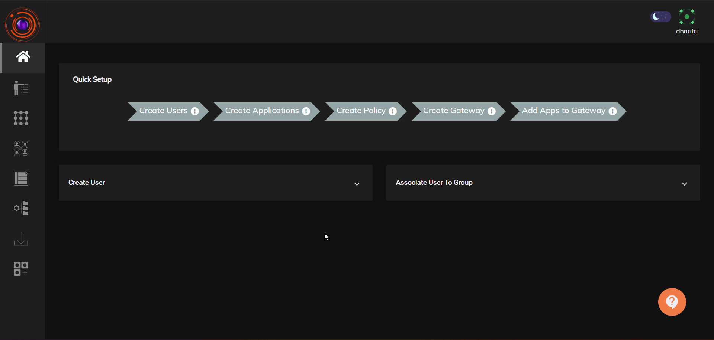
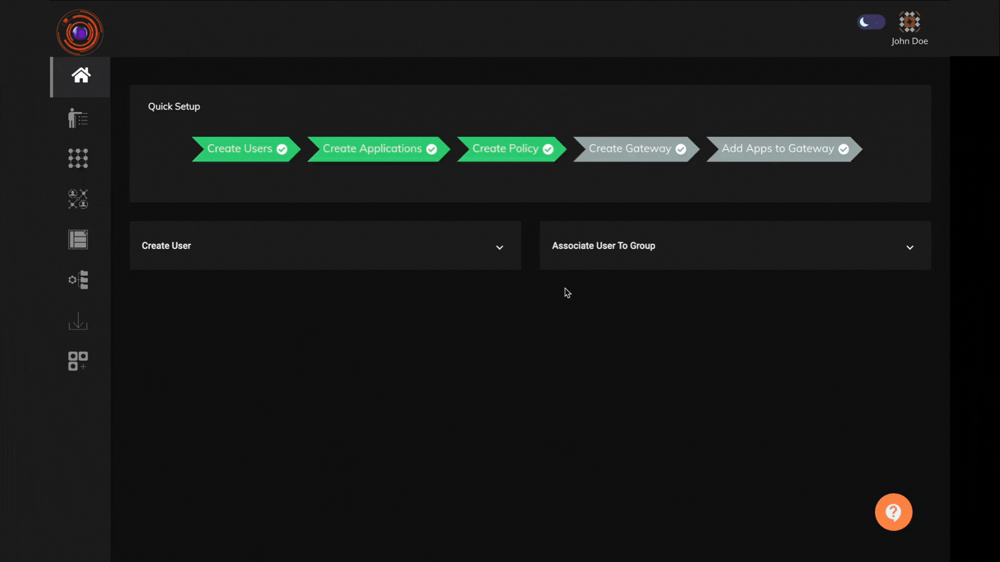

### Prerequisite

The  company admin must ensure that the following prerequisites are met prior to installation of InstaSafe ZTNA gateway. It is recommended to set up a backup InstaSafe Gateway, with the same configuration for the purpose of redundancy.


| Virtual Machine Parameter | Requirement  |
|-----------------------|--------------------------|
| **Operating System** |Ubuntu 22.04.2 LTS(server edition)  |
| **OS Type**|64-bit |
| **RAM** | Minimum 8 GB|
|**Hard Disk**|Minimum 30GB of free space  |
| **CPU**|2 x Dual Core processor (x64 based) |

#### Network requirements for Gateway installation

| Source | Application Type  | Port | Direction |
|-----------------------|--------------------------|--------------------------|--------------------------|
| any | Network  | UDP 8443 | Inbound |
| any | RDP & SSH  | TCP 8080 | Inbound |
| any | Web applications (Agentless)  | TCP 443 | Inbound |
| any | Web applications (via Agent)  | TCP 8081 | Inbound |
| InstaSafe Gateways | any (private/public internet)  | any | Outbound |


**Please Note**

```
1. InstaSafe ZTNA Gateway has inbuilt firewall features and hence is equipped to handle network traffic coming from unknown sources, 
even when a network firewall allows traffic from any source.
2. If any proxy configuration is present, it must be ensured that direct connection from the firewall is allowed.
3. InstaSafe ZTNA VPN component only works on NAT and hence the gateway needs to be installed in DMZ.

```


### Installing the Gateway  

1. Login as a Tenant admin.
2. Create a Service Account user and set its password. Keep a record of the username and password as it will be required during the gateway installation. Please refer to the below video on creation of a Service Account.



3. Click on Perimeter Management -> Gateways.
4. Click on the '+' icon for new gateway creation.
5. Check the 'Private Gateway' option.
6. Click on the 'Next' button.
7. Copy the gateway installation script available under the "Private Gateway Installation Script".
8. Paste the gateway installation script in the Ubuntu instance where you would like to have the gateway installed.
9. Provide inputs in the gateway installations CLI.
10. Provide the name of the Tenant. If your tenant url is "https://example.app.instasafe.io/" then the Tenant name to be provided is _example_.
11. Provide the Service Account username and password which was created in step 2.
12. The gateway installation will be complete. It will take between 2 to 5 mins for the gateway to become available in the Admin console.
13. Click on Perimeter Management -> Gateways and the installed gateway will be available.

The above video illustrates the steps on how to install a gateway. 




