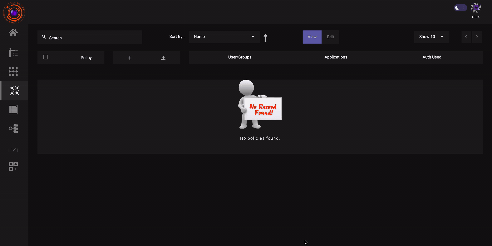

**Superseded.** This is the previous version of this page, kept for comparison. The current page is [Contextual Access Control: Device and Browser Identity](007-accesscontrol.md). Role-based application access control is documented under [User Groups](004b-usergroup.md).

Access Policies are a set of policies that govern user access to a particular application. The admin can configure access rules to define what resources are accessible to the user.

### Creating Access Policies

Access policies can be created from the **Access Policies section** or by directly clicking on **‘Create policy  Tab’** in the  Quick setup section of the dashboard .

1. In the Access policy  Section, Click on **Create New**  button.

2. Enter Name and a brief description of the Application policy and click Next.

3. Click on Add member and  Select the users you want to be a part of the policy. You can also  select User groups directly.Click Next.

4. Click on Add application text box. Select from list of predefined applications and click next.

5. With the help of managed logic rules contextual access control policies based on different parameters such as device posture, antivirus details, geolocation etc. can be created. Create logic rule with [datasets](https://docs.instasafe.io/Zero%20Trust%20Application%20Access/019-datamanagement/) and save the changes. 

P.S. [Datasets must be configured](https://docs.instasafe.io/Zero%20Trust%20Application%20Access/019-datamanagement/) before they can be used for creating access control policies. Availability of dataset is subject to subscribtion.

The above steps highlighting the process of creating an Access Control Policy can be seen in the video below.

### Modifying Access Policies (ACL)

ACL’s can be modified in the same way they are created. Go to the Access Control section of the application. You can see a list of existing ACLs.

1. Click on the ACL you wish to modify.
2. To edit the ACL turn on  EDIT mode. The Update button will now appear.
3. Now You can edit the ACL. Proceed to the section which you want to edit.  After making necessary modifications click on the Update button.

**P.S. - New users can be added into an ACL by Modifying an existing  ACL.**
