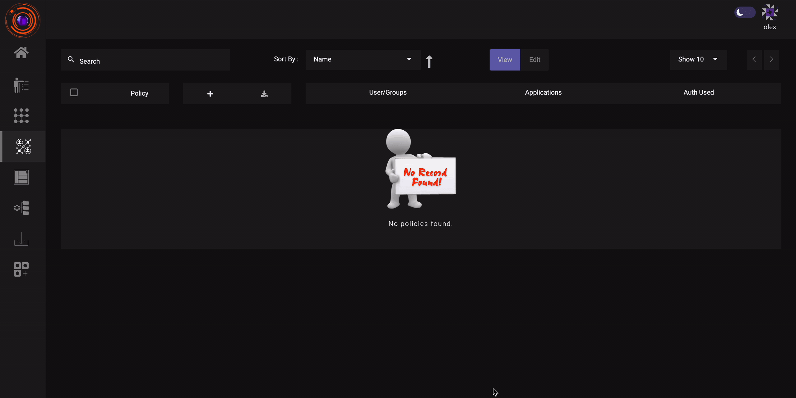

**Alternative version.** This is the InstaSafe ZTNA-worded version of this page, kept in case the the console is the one to document. The page in use is [Role-Based Application Access Control](007-accesscontrol.md).

# Role-Based Application Access Control

Access policies govern which users reach which applications. InstaSafe ZTNA groups similar users
together based on their role, responsibility or location, so a policy is normally written
against a user group rather than against named individuals: the group is the role, and the
policy is the entitlement that role carries.

A policy names its members, names the applications they may reach, and optionally carries
logic rules that narrow access further by context. Policies are created in the
**Access Policies** section of the console, or from **Create policy** in the Quick setup
panel of the dashboard.

## What an access policy is made of

| Element | What it holds |
|---|---|
| **Name and description** | A name for the policy and a brief description of what it is for. |
| **Members** | The users the policy applies to. User groups can be selected directly, which is what makes the policy role-based. |
| **Applications** | One or more applications, chosen from those already published on the platform. |
| **Logic rules** | Optional contextual conditions - device posture, antivirus details, geolocation and similar - built from [datasets](019-datamanagement.md). |

## Granting access to a role in three steps

1. **Group the users by role.** See [Create an User Group](004b-usergroup.md). Administrators
   act on the group instead of on individual users.
2. **Publish the applications that role needs.** See
   [Create an Application](005-creatingapplication.md).
3. **Bind the two in one access policy.** Add the user group as a member, add the
   applications, and save. The steps below walk through it screen by screen.

Access is granted by policy, so the same application can be reached by one group and not by
another, and a group's access changes by editing one policy rather than every user record.

## Creating Access Policies

Access policies can be created from the **Access Policies section** or by directly clicking on **'Create policy  Tab'** in the  Quick setup section of the dashboard .

1. In the Access policy  Section, Click on **Create New**  button.

2. Enter Name and a brief description of the Application policy and click Next.

3. Click on Add member and  Select the users you want to be a part of the policy. You can also  select User groups directly. Click Next.

4. Click on Add application text box. Select from list of predefined applications and click next.

5. With the help of managed logic rules contextual access control policies based on different parameters such as device posture, antivirus details, geolocation etc. can be created. Create logic rule with [datasets](019-datamanagement.md) and save the changes.

P.S. [Datasets must be configured](019-datamanagement.md) before they can be used for creating access control policies. Availability of dataset is subject to subscription.

The above steps highlighting the process of creating an Access Control Policy can be seen in the video below.

## Modifying Access Policies (ACL)

ACL's can be modified in the same way they are created. Go to the Access Control section of the application. You can see a list of existing ACLs.

1. Click on the ACL you wish to modify.
2. To edit the ACL turn on  EDIT mode. The Update button will now appear.
3. Now You can edit the ACL. Proceed to the section which you want to edit.  After making necessary modifications click on the Update button.

**P.S. - New users can be added into an ACL by Modifying an existing  ACL.**
