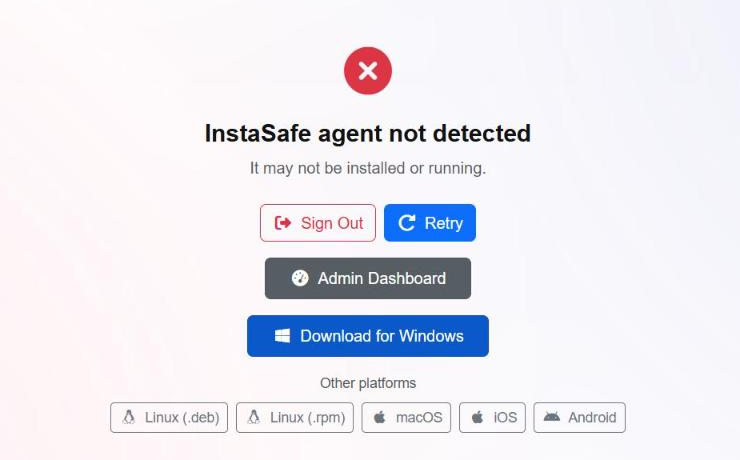
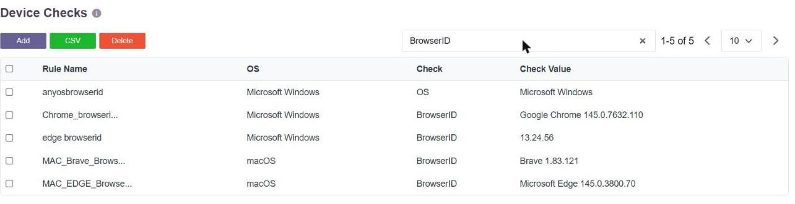
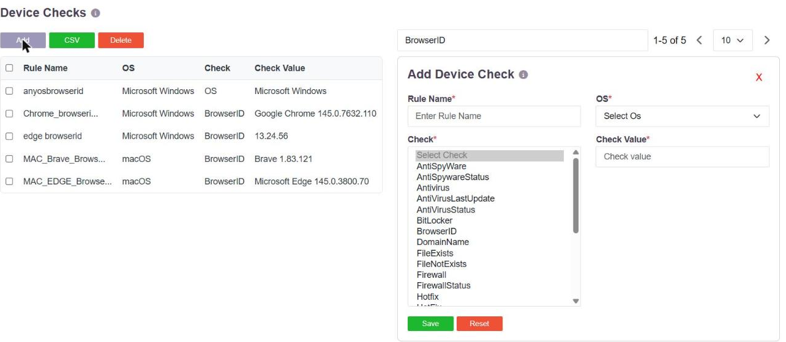

# Contextual Access Control: Device and Browser Identity

Access is granted on more than identity. Before a user is let in, the platform can require
that the device they are using is one the organisation accepts - the right device, in the
right place, patched, protected, and running an approved browser.

**Device Compliance for Web Access** verifies that a user's device meets the organisation's
security policy before the user is let into the web portal, instead of relying on username
and password alone. A device that does not satisfy the configured requirements is refused,
with the reason stated.

## How it works

1. The user opens the web portal and enters their credentials.
2. The device compliance check starts.
3. The **Web Device Compliance Agent** - InstaCheck - validates the device on the endpoint.
4. If every check passes, the user reaches their dashboard. If any check fails, the login is
   blocked and the reason shown.

The checks are performed on the endpoint itself, not inferred from the browser, which is why
a browser session can be held to the same standard as an agent session.

## Turning it on

Enable **Device Compliance for Web Access** in **User Settings → Access Controls**:

Compliance is then enforced **for users who have Device Bind, Geo Bind or Device Check
configured at the user or group level**. Enabling the toggle on its own does not impose a
check that has not been defined; the toggle brings the checks already configured for that
user or group to bear on web login.

## What is checked on a web login

| Check | What it establishes |
|---|---|
| **Device Binding** | The user is logging in from a device registered to them. A personal laptop in place of the registered company laptop is refused. |
| **Geo Binding** | The login comes from a permitted country or location. |
| **Antivirus** | Endpoint protection is present and active. A disabled Windows Defender fails the check. |
| **Operating System** | The device runs an approved OS and version - for example, Windows 11 24H2 or later. |
| **Browser version** | The browser is at or above the configured build. **Google Chrome** and **Microsoft Edge** are the browsers covered by this check. |

A browser one build below the configured minimum - Chrome 137 against a policy of Chrome 138
or later - is refused; a browser at or above it is admitted.

### What the user is told when a check fails

| Message | Reason | What the user does |
|---|---|---|
| **Device Not Registered** | Logging in from an unapproved device | Use the registered device, or ask the administrator to approve the new one |
| **Geo Location Mismatch** | Location outside the configured policy | Connect from an approved location, or ask for the policy to be updated |
| **Operating System Version Mismatch** | OS below the minimum required | Upgrade the operating system |
| **Antivirus Disabled** | No active antivirus protection detected | Enable or install antivirus and retry |
| **Browser Version Mismatch** | The browser is below the configured build | Update the browser |

The refusal names the control that failed, so the user can act on it without raising a
ticket.

## The first login

The first time a user signs in with compliance enabled, they are prompted to download the
**Web Device Compliance Agent**. The download page offers the installer for each supported
operating system; on Windows the installer is run as administrator.

On the next sign-in the browser asks to open **Insta-Check**, which validates the device
posture and the geo binding configured for that user, and the sign-in continues.

## Where the checks are defined

A device check is a named rule stating what the endpoint must look like, created in
**Devices & Checks → Device Checks**. **BrowserID** is one of the check types, and its value
is a browser name and build:

A single rule can list several acceptable browsers separated by `|`, so one rule expresses
"any of our approved browsers, at or above these builds", and rules are created per
operating system.

BrowserID sits alongside the rest of the endpoint checks:

| Group | Check types |
|---|---|
| Malware protection | `Antivirus`, `AntiVirusStatus`, `AntiVirusLastUpdate`, `SEPLastAVUpdate`, `AntiSpyWare`, `AntiSpywareStatus` |
| Host hardening | `Firewall`, `FirewallStatus`, `BitLocker` |
| Identity of the machine | `BrowserID`, `OS`, `OSName`, `OS Version`, `ServicePack`, `Hotfix`, `TenantId` |
| Management state | `InDomain`, `DomainName`, `mdm` |
| Files, processes, registry | `FileExists`, `FileNotExists`, `ProcessRunning`, `ProcessNotRunning`, `RegistryKeyExists` |

Checks are enabled per user group, as the **Device checks** action - see
[Device Binding for Browser Users](device-binding-clientless.md).

## What is recorded, and what happens on a change

Every session records the browser, the platform, the public IP and the country, visible in
the session and access logs - see
[Last Login, and Access by Day and Time](last-login-and-time.md).

Separately from the checks, **Browser Switch** and **Platform Switch** are available as risk
types, so a browser or operating system that differs from the one previously seen for that
user can raise an alert, deny the access, suspend the user or disconnect the session. See
[Email Alerts and Scheduled Reports](email-alerts.md).

A device check and a risk type answer different questions. The check asks whether the
endpoint is acceptable at all. The risk type asks whether it is the same one as last time.
